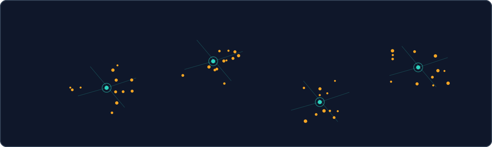

<!-- SPDX-License-Identifier: Apache-2.0 -->
# TRACE — a self-organizing memory database (research preview)

[](https://github.com/Anshul48/trace/actions/workflows/ci.yml)
[](https://github.com/Anshul48/trace/blob/main/LICENSE)
[](https://github.com/Anshul48/trace/releases/tag/seam12a-10m-freeze)

[](https://anshul48.github.io/trace/)

**Your agent forgets everything outside its context window. TRACE remembers — 10 million tokens filed into one map you can open in your browser. No reindex, no rebuild. [Replay a probe.](https://anshul48.github.io/trace/play/#p=7&m=10m&v=race&lso=0&t=7)**

**New here? [Watch the map, two ways](https://anshul48.github.io/trace/recording/)** — 57 seconds of mechanism, 45 seconds of real replay — then replay a probe yourself. [Beyond 10M?](https://anshul48.github.io/trace/future/) Measured, on-disk, and vision — all labeled.

[Watch it](#watch-it) · [Try it](#try-it-in-5-minutes) · [Proof](#proof-one-line) · [Deep dive](#go-deeper)

| Start here | Pick a path |
|---|---|
| Researchers | [Proof](#proof-one-line) · [Benchmarks](docs/BENCHMARKS.md) · [Architecture](docs/ARCHITECTURE.md) |
| Developers | [Try it in 5 minutes](#try-it-in-5-minutes) · [Portable 20k reproduction](repro-20k/README.md) · [Code tour](docs/CODE-TOUR.md) |
| Judges | [60-second tour](https://anshul48.github.io/trace/explorer/) · [Animated demo](https://anshul48.github.io/trace/recording/) · [Raw recorded run](https://anshul48.github.io/trace/recording/#raw-run) |

## What you can do with it today

- **Replay a real 10M-token memory in your browser** — [the replay theater](https://anshul48.github.io/trace/play/#p=7&m=10m&v=race&lso=0&t=7) lights recorded probe paths on the real graph: arrivals becoming atoms, atoms organizing into schemas, guided-vs-flat races. No install. (Replay, not Q&A: the staged export carries topology + rows, not text.)
- **Replay a real run to PASS** — [the recording hub](https://anshul48.github.io/trace/recording/) walks install, frozen-file checks, and an engine run on the portable 20k prefix, with the unedited terminal capture kept as evidence.
- **Run your own pilot in 5 minutes** — freeze check, package suite, and a genuine 10K-token pilot to `claim=measured, status=PASS` on your machine. [Jump in](#try-it-in-5-minutes).
- **Build on content-addressed storage** — ingest once with the Python package and the `product_pilot` CLI, local-first in an isolated venv. No services, no containers.

## Watch it

- 🎬 **[Demo suite](https://anshul48.github.io/trace/recording/)** — what TRACE is, how it works, and how to use it, in about a minute. Video file `docs/recording/trace.mp4` (720p H.264, captions + transcript on the page; voice is synthetic).
- 🖱️ **[Live interactive twin](https://anshul48.github.io/trace/explorer/)** — the same story you can click: documents in, atoms, schemas, retrieval, self-repair, driven on the real graph.
- 📊 **[Play with real data](https://anshul48.github.io/trace/play/)** — client-side querying of the recorded 10M exports, honestly labeled recorded vs live.

## Proof (one line)

10M tokens, ~8.5 GB peak, self-repairing — every figure measured and receipt-backed. Full records: [docs/BENCHMARKS.md](docs/BENCHMARKS.md).

## Try it in 5 minutes

Fastest path — nothing to install beyond Python 3:

1. `git clone https://github.com/Anshul48/trace.git`
2. `cd trace`
3. `./tools/run-trace.sh` — serves the explorer locally and opens your browser (Windows: double-click `tools\run-trace.bat`).

Prefer the manual path? This is the exact sequence verified on a clean host (WSL2 Ubuntu, Python 3.12.3), re-verified from a fresh tarball extract with the environment created inside the extracted tree — expected outputs quoted from those runs:

```bash
# 1. Get the frozen source and verify it (1.2 MB source-only tarball).
sha256sum -c seam12a-fork.tar.gz.sha256
# expect: seam12a-fork.tar.gz: OK
# Extract it; the runnable tree is fix7/cand/ (set CAND to that path).
tar xzf seam12a-fork.tar.gz
CAND=$PWD/fix7/cand
cd "$CAND"

# 2. Environment, created INSIDE the extracted tree (needs uv;
#    without uv: python3 -m venv .venv). The tarball ships no README,
#    setup.py, pyproject.toml, or requirements file, so there is nothing
#    to pip-install from the package itself: create a venv and add the two
#    runtime dependencies (blake3 is hard-required by tlsys/identity.py;
#    verified with numpy 2.5.4; o94 run receipts record numpy 2.5.3).
uv venv .venv --python /usr/bin/python3
uv pip install --python .venv/bin/python "numpy==2.5.4" "blake3==1.0.11"

# 3. Smoke checks (all paths relative to $CAND).
SUP_PYTHON=$CAND/.venv/bin/python bash runtime.sh tools/product_pilot.py --help
# expect: exit 0, full usage printed (all o94 flags present).
PYTHONPATH=$CAND/fork/tl-sys $CAND/.venv/bin/python -B fork/tl-sys/tests/test_o93_repair_columnar.py
# expect: o93 repair-columnar: all groups PASS (221 checks).
# The package integration suite also passes unmodified:
$CAND/.venv/bin/python -B -m unittest tests.test_integration
# expect: Ran 6 tests ... OK (about 3 s).

# 4. Build the synthetic 10K corpus (layout tl-gpu-embcache-v1; corpus
#    synthetic, pipeline 100% genuine). No corpus generator ships in the
#    tarball, so this inline step builds synth-data/ from the shipped
#    chunker (same seeded content as the reference run: 48 docs).
$CAND/.venv/bin/python - <<'EOF'
import hashlib, json, sys
from pathlib import Path
import numpy as np
sys.path.insert(0, 'fork/tl-sys')
from tlsys.ingest import chunk_text
OUT = Path('synth-data'); CACHE = OUT / 'emb_cache'
RPS, NDOCS = 256, 48
TOPICS = [
    ('sport', ['match', 'team', 'score', 'player', 'coach', 'season', 'league', 'goal', 'field', 'training', 'victory', 'rival', 'trophy']),
    ('harbor', ['tide', 'dock', 'vessel', 'cargo', 'anchor', 'harbor', 'sailor', 'lighthouse', 'storm', 'channel', 'ferry', 'net', 'catch']),
    ('orchard', ['apple', 'harvest', 'soil', 'rain', 'branch', 'blossom', 'farmer', 'basket', 'cider', 'frost', 'seed', 'grove']),
    ('circuit', ['voltage', 'resistor', 'signal', 'wire', 'current', 'board', 'sensor', 'diode', 'ground', 'meter', 'switch', 'relay']),
]
rng = np.random.default_rng(0)
OUT.mkdir(parents=True, exist_ok=True); CACHE.mkdir(parents=True, exist_ok=True)
docs = []
for i in range(NDOCS):
    topic, words = TOPICS[i % len(TOPICS)]
    sents = []
    for s in range(14):
        w = rng.choice(words, size=14, replace=True)
        sents.append('Document %d sentence %d about %s: %s.' % (i, s, topic, ' '.join(w)))
    docs.append({'doc_id': 'synth-doc-%03d' % i, 'text': ' '.join(sents)})
with open(OUT / 'docs-100m.jsonl', 'wb') as f:
    for d in docs:
        f.write((json.dumps(d) + '\n').encode())
config = json.dumps({'normalize_embeddings': False}, separators=(',', ':'))
meta = {'format': 'tl-gpu-embcache-v1', 'dim': 384, 'dtype': 'float32-le',
        'key_config_json': config,
        'config_id': hashlib.sha256(config.encode()).hexdigest()[:16],
        'rows_per_shard': RPS}
(CACHE / 'meta.json').write_text(json.dumps(meta))
prefix = b'tl-gpu-embcache-v1\0' + config.encode() + b'\0'
rows = []
for d in docs:
    chunks = chunk_text(d['text']) or [(0, 0, '', 0, 0)]
    for ch in chunks:
        body = ch[2].encode('utf-8')
        key = hashlib.sha256(prefix + body).hexdigest()
        rows.append((key, hashlib.sha256(body).hexdigest(), len(body)))
vecs = rng.standard_normal((len(rows), 384)).astype(np.float32)
with open(CACHE / 'index.jsonl', 'w') as f:
    for g, (key, csha, blen) in enumerate(rows):
        f.write(json.dumps({'key': key, 'chunk_sha256': csha, 'byte_len': blen,
                            'dim': 384, 'shard': g // RPS, 'row': g}) + '\n')
for sh in range((len(rows) + RPS - 1) // RPS):
    vecs[sh * RPS:(sh + 1) * RPS].astype('<f4').tofile(CACHE / ('shard_%06d.f32' % sh))
print(json.dumps({'docs': len(docs), 'chunks': len(rows), 'shards': (len(rows) + RPS - 1) // RPS}))
EOF
# expect: {"docs": 48, "chunks": 96, "shards": 1}

# 5. A real 10K-token pilot through the genuine entry point.
SUP_PYTHON=$CAND/.venv/bin/python bash runtime.sh tools/product_pilot.py --tokens 10000 --profile local --source-root $CAND --data-dir $CAND/synth-data --out $CAND/out-pilot --drain-attribution --drain-census --holon-descriptor-columnar --overrides-columnar --descriptor-matrix-all --per-view-sharing --cold-scan-chunk 4096 --repair-columnar --candidate-source hnsw --drain-bounded-k 32 --candidate-shadow-audit 8
```

Real output of step 5 (from `out-pilot/result.json`): `claim=measured, status=PASS`; input 10,080 actual tokens, 36 complete documents, 72 atoms, 0 cache misses; guided recall@10 0.40 (all-sources, 120 probes), flat recall@10 1.0; final 72 atoms, 0 pending documents; repair 0 iterations, final debt 0; peak parent 87.1 / peak child 81.2 MiB; retained ~8.1 MB; wall ~26 s (39.8 s in the RUNLOG reference run — host-dependent).

---

## Vision (direction — not shipped)

> Agents will need memories that grow with them instead of context windows that don't. TRACE bets on bounded, repairable memory: arrivals searchable the moment they land, questions descending only the most promising branches, ledgers that repair themselves. What exists today is one frozen, receipt-backed 10M run plus the portable 20k proof above — everything beyond that is roadmap, not a claim.

---

## Go deeper

- [docs/ARCHITECTURE.md](docs/ARCHITECTURE.md) — storage ledger, fix stack, reader isolation.
- [docs/CODE-TOUR.md](docs/CODE-TOUR.md) — file-by-file walkthrough of the frozen tree.
- [docs/BENCHMARKS.md](docs/BENCHMARKS.md) — unabridged benchmark records and derivations.
- [docs/REPRO.md](docs/REPRO.md) — reproduction commands, environment, pin hashes, and the two honest blockers on a full 10M rerun.
- [Release seam12a-10m-freeze](https://github.com/Anshul48/trace/releases/tag/seam12a-10m-freeze) — frozen source tarball, measurements, and study record.
- [repro-20k/README.md](repro-20k/README.md) — portable 20k-token reproduction (88 documents, precomputed vector cache).
- [tools/verify_freeze.py](tools/verify_freeze.py) / [tools/check_receipts.py](tools/check_receipts.py) / [tools/check_links.py](tools/check_links.py) — freeze, receipt, and link checks run in CI.

---

## Status

**Status: research preview.** TRACE is an experimental research prototype, proudly so: one measured 10M run on one VM, receipt-backed and honestly labeled — not a product, and no state-of-the-art claims are made.

Freeze: **seam12a** — verify with `python3 tools/verify_freeze.py`; full identity, pins, and scope notes in [docs/REPRO.md](docs/REPRO.md).

---

## Contributing

TRACE is a research preview: bug reports and reproduction attempts with receipts are the most useful contributions. Please open an issue at [Anshul48/trace issues](https://github.com/Anshul48/trace/issues) with the exact command, the freeze check output, and the run receipts.

## License

Apache-2.0 ([LICENSE](https://github.com/Anshul48/trace/blob/main/LICENSE)). Corpus text excerpts and vector models keep their upstream licenses; see [repro-20k/LICENSES-DATA-MODEL.md](repro-20k/LICENSES-DATA-MODEL.md).

## Further reading

> External readings below are inspiration, not endorsement. Inclusion does not
> imply affiliation, approval, or that our systems implement these methods.

- Dense Passage Retrieval for Open-Domain Question Answering — Karpukhin et al. https://arxiv.org/abs/2004.04906
- Retrieval-Augmented Generation for Knowledge-Intensive NLP Tasks — Lewis et al. https://arxiv.org/abs/2005.11401
- REALM: Retrieval-Augmented Language Model Pre-Training — Guu et al. https://arxiv.org/abs/2002.08909
- MemGPT: Towards LLMs as Operating Systems — Packer et al. https://arxiv.org/abs/2310.08560

Shared tokens: [docs/assets/design.css](docs/assets/design.css),
[docs/assets/motion.js](docs/assets/motion.js).

## Related: ANIMA

[ANIMA](https://github.com/Anshul48/anima) owns agent orchestration; TRACE owns the retrieval overlay. The two are separate systems with no shared runtime — this README covers TRACE only.
