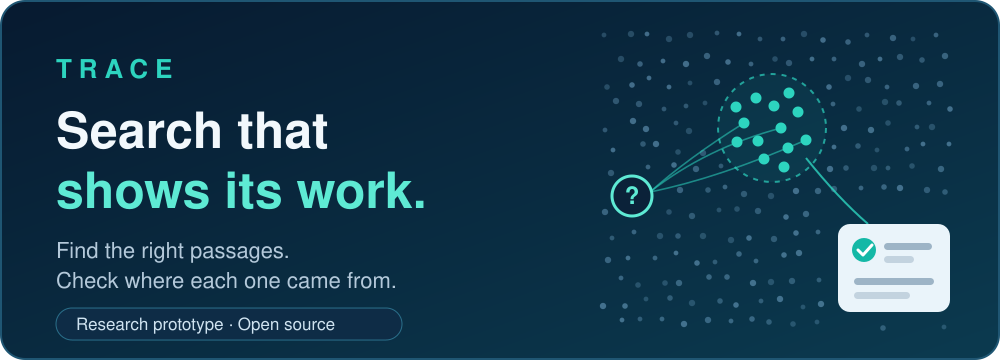
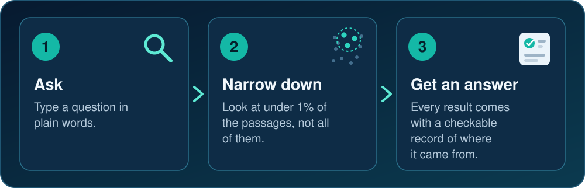
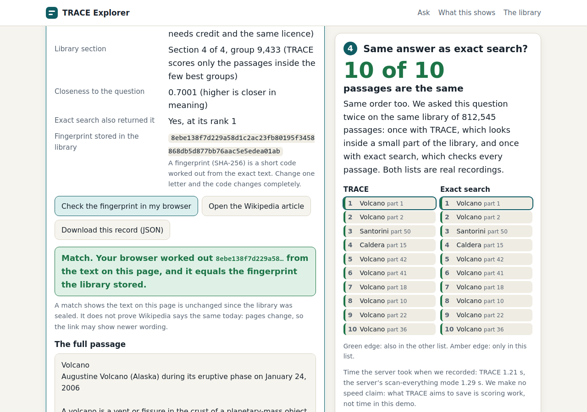
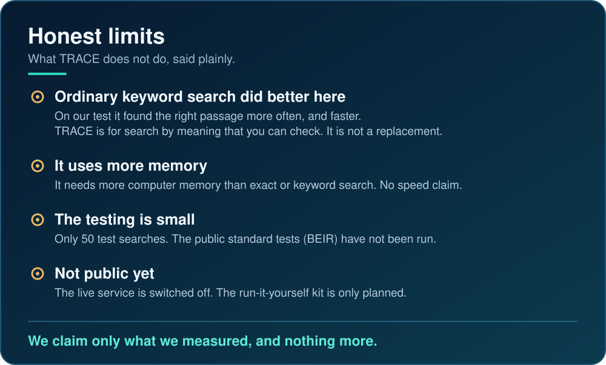

<!-- SPDX-License-Identifier: Apache-2.0 -->

  

**TRACE is search that shows its work.** It finds nearly the same passages as a full, exact search by meaning, while looking at under 1% of the passages, and every result comes with a checkable record of where it came from.

*Research prototype. Open source (Apache-2.0).*
[Watch it work](#watch-it-work) · [How you use it](#how-you-use-it) · [Honest limits](#honest-limits) · [Next step](#next-step) · [For researchers](#for-researchers)

---

## The problem

You ask a question and get back ten passages. Were they the best ten? Did the search quietly skip something? Where did each one come from?

Searching by meaning normally means comparing your question with every passage in the library. That is fine for a small library and gets expensive for a big one. Shortcuts exist, but they often hand you a list you simply have to trust.

**TRACE takes the shortcut and keeps the proof.** It narrows in on the likely part of the library first, compares only those passages, and keeps a checkable record of where each result came from, so you can verify it instead of trusting it.

## Watch it work

**[Open the explorer](https://anshul48.github.io/trace/explorer/)**. It replays real questions that TRACE answered on our own server, so you can see what it looked at and what it returned.

*A checkable record: your browser recomputes the fingerprint and it matches.*

### What we measured

| Library size | Results kept | Passages compared |
|:---:|:---:|:---:|
| **812,545** | **0.9985** | **0.79%** |
| passages in the fixed library we tested on | how much of the full search's results TRACE kept (1 means identical) | share of passages TRACE compared your question against (measured on one of the library's four equal parts) |

These come from our test searches. The 0.79% was measured on one of the library's four equal parts, each about the same size. We re-ran the claims from the server itself (not over the public internet) and the checkable records matched. No outside party has verified this yet.

## How you use it

| What | Status |
|---|---|
| Explorer in your web browser: replay real recorded questions. Nothing to install. | **Working today** |
| The explorer's mode that runs inside your own browser | **Prototype** |
| Search over the whole test library on our own cloud server (Microsoft Azure, in India) | **Runs today** on our private server; you cannot query it yourself yet. |
| A public live service anyone can query | **Not built yet.** It is switched off: it failed a first test with many people using it at once. A later fix passed a local retest, but the public service is still off. |
| A download you run on your own computer | **Not built yet. Planned.** |

- **What works today:** open the explorer and replay a recorded question. You need a web browser and nothing else.
- **What is planned:** a run-it-yourself kit. It does not exist yet, so there is no download, size or hardware list to give.

## Honest limits

In plain words:

- **Ordinary keyword search did better on this test.** Keyword search (the kind that matches the words you type) was tried on the same 50 test searches (40 written questions and 10 taken from passage openings). It put the right source passage in its top ten for 82% of them; TRACE did for 52%. A full, exact search by meaning also got 52%, so the gap is meaning-search versus keywords, not TRACE's shortcut.
- **Keyword search was also faster, and TRACE is not a replacement for it.** It answered in 6 milliseconds against 1.2 seconds. TRACE is for search by meaning that you can verify.
- **No claim of being better, faster or smaller.** TRACE needs more computer memory to serve searches than a full exact search or keyword search does.
- **The testing is small.** 50 test searches. We have not run TRACE on the public standard tests for this kind of search (called BEIR). A separate, earlier test (16 October 2026) used a different, larger collection and is not part of the numbers above: it turned 1.53 billion word-sized pieces of text into 7.13 million searchable entries on rented cloud computers, and a search that looks only at the most likely groups of entries kept 0.9947 of the exact results while looking at 6.6% of the entries. That collection was never served through TRACE with checkable records, so we do not count it as a result for this page.
- **The checking is ours.** The records matched when we re-ran them. An outside party has not confirmed it.
- **Not public yet.** The live service is off, and the run-it-yourself kit is only planned.

## Next step

**[Open the explorer](https://anshul48.github.io/trace/explorer/)** and replay one question. It needs a web browser and nothing else.

## For researchers

The technical record is still here. Some of it was written for an earlier, smaller experiment, so its numbers can differ from this page.

- [docs/README-technical.md](docs/README-technical.md): the earlier full README, including how to reproduce a small run on your own machine
- [docs/ARCHITECTURE.md](docs/ARCHITECTURE.md): the design, in technical terms
- [docs/BENCHMARKS.md](docs/BENCHMARKS.md): the measurement records
- [docs/REPRO.md](docs/REPRO.md): reproduction commands and environment
- [docs/CODE-TOUR.md](docs/CODE-TOUR.md): a walk through the code
- [repro-20k/README.md](repro-20k/README.md): a small reproduction you can run yourself

---

Questions or problems: [open an issue](https://github.com/Anshul48/trace/issues). License: Apache-2.0 ([LICENSE](LICENSE)). TRACE also serves as the shared memory in a separate project, [ANIMA Harness](https://github.com/Anshul48/anima-substrate) (a prototype connection, not a finished product).
