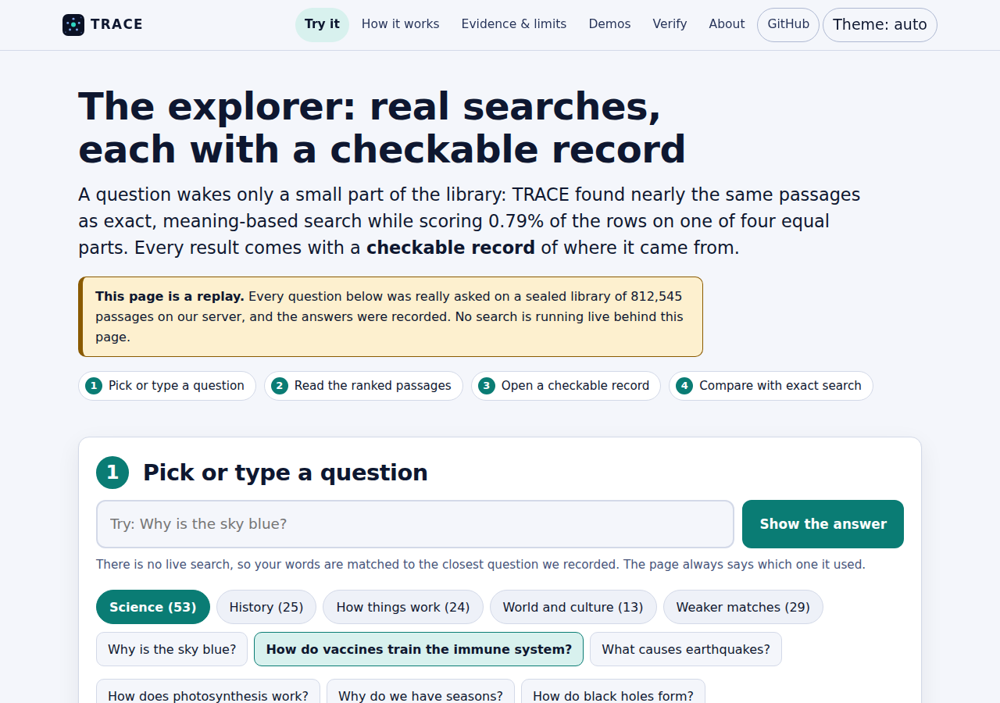
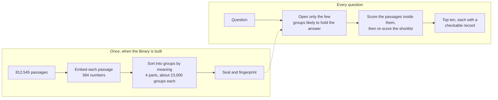

<!-- SPDX-License-Identifier: Apache-2.0 -->
<!-- GENERATED from docs/source/README.src.md by tools/build_site.py. Edit the source, then run: python3 tools/build_site.py -->
# TRACE

**Meaning-based search over a sealed 100M-token library, where every result carries a record you can check. It is slower than a standard index, and this README says so before anything else.**

Research prototype · Apache-2.0 · **[Open the explorer](https://anshul48.github.io/trace/explorer/)** (no install) · [Benchmarks](BENCHMARKS.md) · [FAQ](docs/FAQ.md) · [How it works](docs/EXPLAINER.md) · [Watch the working films](https://anshul48.github.io/trace/demos/)
<!-- PAPER-LINK: once the preprint is public, add a Paper link (the Zenodo DOI URL) to the line above, then rebuild with tools/build_site.py -->

<p align="center">
  <a href="https://anshul48.github.io/trace/explorer/"></a>
</p>
<!-- GIF-SLOT: replace the screenshot above with docs/img/explorer-lit.gif (8-12 s, a question lights a few groups) when the cut is delivered. Keep the link and the alt text. -->

*The explorer replays real searches we ran on our server. No search runs live behind it.* [60-second tour (video)](docs/media/tour-60s.mp4).

## Where it loses (read this first)

- **Speed.** In our same-store head-to-head, TRACE's live service answered in a median of **1,236 ms**. The best standard index that matched its hit rate (HNSW) answered in **0.66 ms**: about **1,880 times** faster, with the same 26 of 50 hits. The comparison is not like for like (the index returns ids only; the service starts engine processes and returns passages), but it is still a loss. [BENCHMARKS A1](BENCHMARKS.md#a-where-trace-loses)
- **Keywords.** On the same 50 test searches, plain keyword search put the right source passage in its top ten for **82%**; TRACE for **52%** (about +/- 11 and +/- 13 points). Exact meaning-based search also got 52%, so the gap is meaning versus keywords, not our shortcut. If you need exact words, use BM25. [A4](BENCHMARKS.md#a-where-trace-loses)
- **You cannot re-run our 100M numbers.** The library, its search store and the C engine source are **not published**. The 100M figures are ours, from our own server, with no outside check. What you can run is below.

## Quickstart

```bash
git clone --depth 1 https://github.com/Anshul48/trace && cd trace
python3 run_explorer.py --dataset 20k
```

Needs Python 3.8 or newer and a browser; nothing else is installed or downloaded after the clone (about 130 MB with Git data; on our connection the clone took 16 to 36 seconds and the server was up in under a second). This serves the explorer from your clone at `http://127.0.0.1:8000/explorer/`. It is **demo scale**: a replay of 144 recorded searches plus a 20k-token sample (88 documents). It is not a live search of the 100M library. Add `--no-browser` on a machine without a browser.

Then check us:

```bash
python3 tools/verify_freeze.py    # entries=207 ok=207 missing=0 mismatch=0
python3 tools/check_receipts.py   # receipts ok: gates, both probe modes, matched work, caps, freeze digest
python3 tools/verify_20k.py       # IDENTICAL
```

These re-check the frozen code and the recorded gates (the first takes well under a second). A small reproduction of the earlier protocol (needs `numpy` and `blake3`, about a minute) is in [docs/reproduction/repro-20k](docs/reproduction/repro-20k/README.md). `python3 run_explorer.py --download 100m` exits with code 2: no whole-library download exists yet.

## How it works



TRACE sorts a library into groups by meaning. A question opens only a few groups and scores only the passages inside them: **1,600 of 203,137 rows (0.79%)** in one of the four library parts, keeping **0.9985 of exact search's top ten** ([B1, B2](BENCHMARKS.md#b-what-the-method-does)). That is less scoring work, not less time. Every result comes with its article, character span, licence and a SHA-256 fingerprint that your browser can recompute. The 10-minute walkthrough is [docs/EXPLAINER.md](docs/EXPLAINER.md).

## Benchmarks

Every number links to a record. Our library of **812,545 passages / 99,891,846 tokens** (0.11% short of 100 million), our method, **50 test searches**, our server. Full table with scope and caveats: **[BENCHMARKS.md](BENCHMARKS.md)**.

| What | Number | Record |
|---|---|---|
| Served latency, median, against HNSW | 1,236 ms against 0.66 ms (about 1,880x slower; same 26/50 hits) | [A1](BENCHMARKS.md#a-where-trace-loses) |
| Right source in top ten: keyword against TRACE | 82% against 52% (50 searches) | [A4](BENCHMARKS.md#a-where-trace-loses) |
| Search store size on disk | 2.279 GB, bigger than the 1.248 GB of exact vectors it approximates | [A6](BENCHMARKS.md#a-where-trace-loses) |
| Rows scored per search, one of four parts | 1,600 of 203,137 (0.79%): work, not time | [B1](BENCHMARKS.md#b-what-the-method-does) |
| Agreement with exact search's top ten | 0.9985 on average; merged lists identical on 50 of 50 | [B2, B3](BENCHMARKS.md#b-what-the-method-does) |
| Append against rebuild, 203,137 passages | about 18 s against 291 s, recall not worse; one run | [C1](BENCHMARKS.md#c-what-the-extra-time-buys) |

## Limitations, plainly

- **Not faster.** It does less scoring work and takes more time. The served path starts a fresh engine process for each of four parts on every search; a resident server is designed, not built.
- **Loses to keyword search** on our 50 searches, and has not been run on any public benchmark (BEIR, LongMemEval, LoCoMo).
- **Self-benchmarked.** 50 searches, our library, our method, no outside check, not reproduced on public data. The measured arm is vector search only, with no keyword part.
- **Not checkable at 100M.** The library, its store, the raw per-query files and the C engine source are not published. This repository holds the frozen Python candidate (207 files), the explorer, the records and the checks.
- **Bigger, not smaller.** Its search store takes more disk than the exact vectors. We claim no memory win.
- **Demo scale only.** The explorer is a replay; the public query service is switched off.
- **Append is one run.** One shard-sized base of 203,137 passages, not the full library.
- **A checkable record is a consistency check,** not an independent seal. It shows the text matches what we published, not that the search found the best passage.
- **Not an agent product.** We have not measured whether TRACE makes any agent better. ANIMA's link to it is a prototype memory link, and we make no cross-session recall claim.

More in the [FAQ](docs/FAQ.md) and in [BENCHMARKS.md, "Not measured"](BENCHMARKS.md#e-larger-builds-and-what-we-do-not-claim).

## Roadmap

Planned or under way. None of this exists today, and there are no dates.

- **A download of the whole library**, so anyone can re-run the 100M numbers. Not built.
- **A resident search server** (open each part once, answer many questions). Designed; no speed number is claimed for it.
- **Publishing the C engine source** into this repository. Under consideration.
- **TRACE on public benchmarks** (BEIR first) with full-run records, and **an outside check** of our numbers.
- **A preprint**, "Checkable memory for agents", on the audit method and these results (in preparation).

## The ecosystem

One builder, three projects. TRACE is the memory at the front; ANIMA brings that memory into coding work through a prototype link; Reflex is a separate line of work on screens and buttons.

| Project | Repository | Demo |
|---|---|---|
| TRACE | [Repository](https://github.com/Anshul48/trace) | [Explorer](https://anshul48.github.io/trace/explorer/) |
| ANIMA | [Repository](https://github.com/Anshul48/anima-substrate) | [Recorded replay](https://anshul48.github.io/anima-substrate/demo/) |
| Reflex | [Demo repository](https://github.com/Anshul48/demo-trace-anima-reflex) | [Replay](https://anshul48.github.io/demo-trace-anima-reflex/) |

ANIMA is a prototype for one job type (fix a bug, judged by a hidden checker). It is a prototype layer on top of the coding agent you already use, giving it memory (a prototype link), a checker it cannot see, and a screen to watch it work. The Muse Code, Claude Code and Codex adapters are prototypes, and the screen shows the recorded state tree of a run (UI preview). See the companion repository for its installation status. Reflex does not use TRACE.

## Where everything is

| Destination | What lives there |
|---|---|
| [BENCHMARKS.md](BENCHMARKS.md) | Every number, its scope and its record. |
| [docs/EXPLAINER.md](docs/EXPLAINER.md) · [docs/FAQ.md](docs/FAQ.md) | The 10-minute walkthrough and the hard questions. |
| [Checkable records](receipts/) | The records of our runs: the qualification run, the earlier larger builds, the order measurement, the [filed summaries](receipts/filed-summaries/README.md). |
| [Reproduce](https://anshul48.github.io/trace/verify/) | The commands that re-check the code and the records, and a [small reproduction](docs/reproduction/repro-20k/README.md). |
| [Architecture](docs/ARCHITECTURE.md) | The design in technical terms, plus a [walk through the 207 files in the tested snapshot](docs/CODE-TOUR.md). |
| Research notes | [In-depth benchmarks](docs/BENCHMARKS-DEEP.md), the [scale and build-memory runs](docs/SCALE-AND-MEMORY.md), and [how the code was written](docs/META-USE.md). |
| [Status](https://anshul48.github.io/trace/built/) | Every capability with its Working today / Prototype / Planned badge, driven by [status.json](docs/status.json). |

**Recorded replay:** working today. **Browser mode:** prototype. **Public backend:** off. **Local kit:** planned.

**Found a number that does not hold?** That is the most useful report we can get: [open a claim-check issue](https://github.com/Anshul48/trace/issues/new?template=claim_check.yml).

[Contributing](.github/CONTRIBUTING.md) · [Security](.github/SECURITY.md) · [Cite](docs/CITATION.cff) · [Changelog](docs/CHANGELOG.md) · [Open an issue](https://github.com/Anshul48/trace/issues). License: Apache-2.0 ([LICENSE](LICENSE)). Passages in the library are English Wikipedia text under CC BY-SA 4.0.
