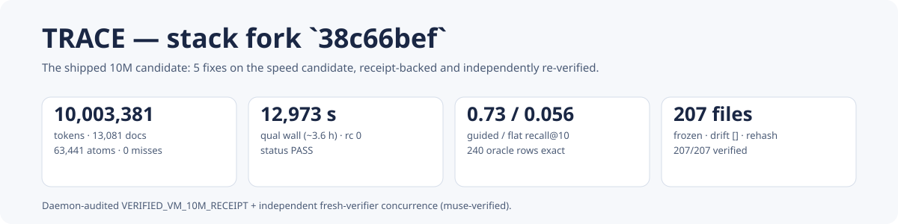
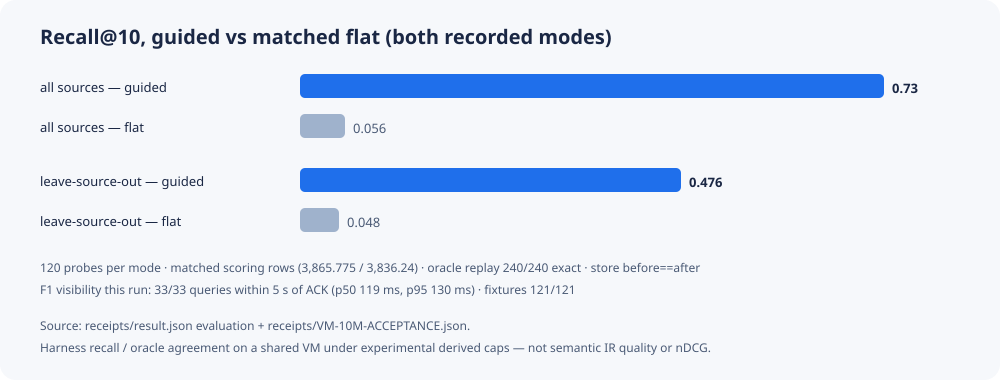
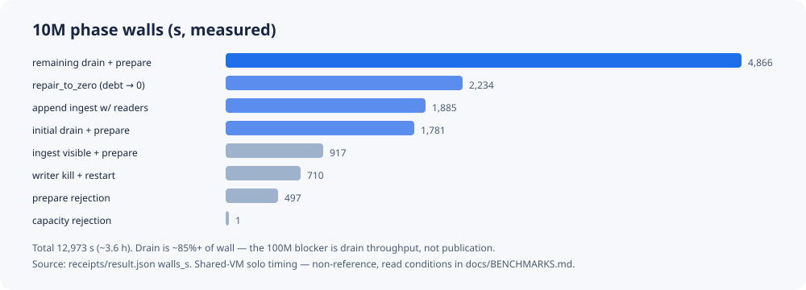
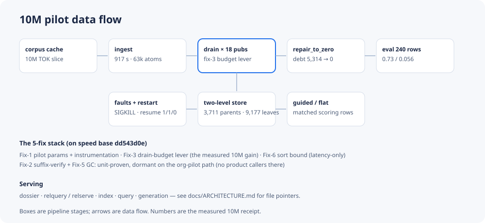

<!-- SPDX-License-Identifier: Apache-2.0 -->
# TRACE — stack-fork candidate with a receipt-backed 10M qualification



TRACE ingests a token corpus into a two-level self-organizing store, drains
it through publication cycles, and serves hierarchy-routed (**guided**) and
brute-force (**flat**) similarity queries over the same vectors. This
repository publishes one exact candidate — the stack fork in
[`freeze-src/`](freeze-src/cand/SOURCEFREEZE.json) — together with the VM
receipts that qualify it, so every headline number below can be traced to a
staged JSON record.

> **Identity, precisely.** `38c66bef71fbc8768a2887024fecf1bf58ff90f3feaf3a922d4c8b51a43a0d54`
> is the SHA-256 of the `SOURCEFREEZE.json` manifest file (207 pinned files).
> It is a **source-freeze digest, not a Git commit**. Run
> `python3 tools/verify_freeze.py` to rehash all 207 files against it.

## Start here

| If you want… | Read |
|---|---|
| The design and the 5-fix stack | [docs/ARCHITECTURE.md](docs/ARCHITECTURE.md) |
| A file-by-file tour of the frozen code | [docs/CODE-TOUR.md](docs/CODE-TOUR.md) |
| Every benchmark number, gate, and condition | [docs/BENCHMARKS.md](docs/BENCHMARKS.md) |
| Pins, hardware, and what re-runs locally | [docs/REPRO.md](docs/REPRO.md) |
| The proposed GitHub About text and topics | [docs/ABOUT.md](docs/ABOUT.md) |
| The previous publication, preserved byte-exact | [archive/previous-c2-publication/INVENTORY.md](archive/previous-c2-publication/INVENTORY.md) |

## Measured qualification (VM `trace-build500`, 2026-10-13)

All values are read from [`receipts/`](receipts/result.json)
(`result.json`, `VM-10M-ACCEPTANCE.json`, `AUDIT-RESULT.json`,
`source-pin.json`, `cap-derivation.json`). **Scope labels, not fine print:**
these are shared-VM measurements under *experimental derived caps*; the
recall figures are **harness recall and oracle agreement on the recorded
probe protocol — not semantic IR quality, nDCG, BM25 comparison, SOTA, or a
universal “5-second” guarantee**. No numbers from any other campaign are
mixed into this record.

| Outcome (measured) | Value |
|---|---|
| Corpus | 10,003,381 TOK_V1 tokens / 13,081 docs / 63,441 atoms, 0 cache misses |
| Qualification wall | 12,973.17 s (~3.6 h), rc 0, status PASS |
| Convergence | 0 pending documents; `repair_to_zero` debt 5,314 → 0 (5 iterations) |
| Closed ledger | 166,457 commits / 166,457 dedup / 0 intake (caps 669,436 / 1,000,000) |
| Acceptance gate | `VM-10M-ACCEPTANCE.json`: PASS, hardened, `manifest_match true`, fixtures 121/121 |
| Audit gate | `AUDIT-RESULT.json`: `VERIFIED_VM_10M_RECEIPT` (240 queries) |
| Oracle replay | `VERIFIED_PASS_READONLY_ORACLE_REPLAY`: 240/240 exact, store before == after (229,927 files) |
| Final source head | `e8334c07-731d-4ff9-a292-8329b89c41b9:0:166457` |

### Both recorded probe modes, with matched-flat controls

The harness ran 120 probes in **each** of two modes. Guided and flat arms
score the same mean number of rows per query in each mode (matched work);
that control is what makes the pairs comparable.

| Mode | Guided recall@10 | Matched-flat recall@10 | Mean scoring rows (guided = flat) | Guided p50 wall |
|---|---:|---:|---:|---:|
| `all_sources` (LSO off) | 0.73 | 0.0558 | 3,865.775 | 33.19 ms |
| `leave_source_out` (LSO on) | 0.4758 | 0.0483 | 3,836.24 | 33.24 ms |

| Family | `all_sources` guided / flat | `leave_source_out` guided / flat |
|---|---|---|
| chunk | 0.81 / 0.0575 | 0.5775 / 0.04 |
| noisy | 0.75 / 0.05 | 0.5125 / 0.035 |
| cross | 0.63 / 0.06 | 0.3375 / 0.07 |



### Phase walls, memory, caps, hardware

| Phase | Wall (s) | Share |
|---|---:|---:|
| Ingest (visible + prepare) | 917 | 7% |
| Initial drain + prepare | 1,781 | 14% |
| Append ingest with readers | 1,885 | 15% |
| Source-capacity rejection | 1 | <1% |
| Prepare rejection (fresh frontier) | 497 | 4% |
| Writer kill + restart (SIGKILL, exit −9, 0 recommits) | 710 | 5% |
| Remaining drain + prepare with readers | 4,866 | 38% |
| `repair_to_zero` | 2,234 | 17% |



| Field | Recorded value |
|---|---|
| Hardware | GCP `n2-highmem-16` (16 vCPU, ~125 GiB), solo on CPUs 0–2, `nice 19`, single-thread BLAS |
| Peak RSS | Parent 22,566 MiB; child 15,669 MiB (tripwire 46,811,848,704 B) |
| Retained disk | 2,868,578,536 B (2.87 GB) |
| Readers | 2 threads, 15,813 + 15,812 requests, 0 errors; p50 116 ms, p95 381 ms |
| F1 visibility (this run only) | 33/33 queries within 5 s of ACK return (p50 119 ms, p95 130 ms); ack→query 0.12 s after a 331.7 s post-ingest wait |
| Cap derivation | Experimental, derived: `ceil(2·max(basis))` from a measured 1M run (37,117 commits / 7,035 atoms / 4,424 docs, margin 2.0) → 669,436 |
| Vectors | Cached FP32, unnormalized; cosine normalizes at scoring |

### Negative findings (kept visible)

- Per-document drain cost grows about **N^1.5** (remaining phase ≈1.49 s/doc
  at 10M); drain is ~85%+ of wall and is the 100M blocker, not publication.
- `repair_to_zero` cost **2,234 s (~17% of wall)** even with repair off in
  the default path.
- Concurrent readers roughly **halve drain throughput (~2× penalty)** in
  reader phases.
- A **cosine cache gave no gain** (slower with readers); constant-factor
  fixes do not bend the drain curve.

Full definitions, probe work budgets, and conditions are in
[docs/BENCHMARKS.md](docs/BENCHMARKS.md).

## Browser demo

DEMO-SCREENSHOT-PLACEHOLDER

An interactive browser demo (same frozen engine on a clearly labelled small
corpus, plus a read-only explorer for the full 10M receipt record above)
lives in [`demo-app/`](demo-app/README.md). The 10M figures in this README
remain the staged VM receipts; the local demo does not rerun or relabel
them.

## Quickstart (no corpus, no 10M run)

```bash
python3 tools/verify_freeze.py        # expect: entries=207 ok=207 missing=0 mismatch=0
python3 tools/check_receipts.py       # receipt schema + recorded gate values
python3 demo/synthetic_recall.py      # synthetic guided-vs-flat shape demo (illustrative, not a benchmark)
bash freeze-src/run_all.sh stack      # stack unit tests (needs Python with numpy+blake3; set PY=)
bash freeze-src/run_all.sh existing   # shipped suites: pending_topk, publication, pool_reuse, serving_pool
```

The 10M run itself is **not** reproducible from this repository alone: it
needs the VM-side corpus cache and billed multi-hour hardware.
[docs/REPRO.md](docs/REPRO.md) records the exact command and pins and what
to re-check locally instead; nothing here should be described as a
clean-checkout 10M reproduction.

## Layout

```text
trace/
  freeze-src/cand/      frozen 207-file candidate (tools/, fork/, fix1/, stack/, tests/) + BUILD-REPORT.md
  receipts/             staged VM JSONs verbatim (result, source-pin, input, acceptance, audit, …)
  docs/                 ARCHITECTURE.md · CODE-TOUR.md · BENCHMARKS.md · REPRO.md · ABOUT.md
  assets/               hero + architecture + measured charts (SVG, receipt numbers only)
  demo/                 synthetic local demo (no corpus)
  demo-app/             browser demo (see its README; wrappers outside the freeze)
  tools/                verify_freeze.py · check_receipts.py · check_links.py (outside the freeze)
  archive/              previous publication, every file preserved byte-exact with an inventory
```



Files whose names contain `c2` **inside** the 207-file snapshot (for example
frozen tests under `freeze-src/cand/`) are implementation names in the exact
qualified source; they stay byte-exact and are not the archived previous
publication.

## Limits (read these)

- Experimental derived caps and shared-VM timing — non-reference numbers.
- Harness recall and oracle agreement only: no semantic-relevance, nDCG,
  BM25-quality, SOTA, capability (“notes → clusters/contradictions”), or
  universal-latency claim is made or implied.
- No corpus, weights, store, or private data ship here (the ~2.9 GB run
  store is excluded by size; its digest is in the acceptance record).
- Frozen bytes are never edited; wrappers live outside `freeze-src/`.
- Shipping/default adoption and protocol or acceptance changes are
  maintainer decisions, not consequences of this record.

## License

Apache-2.0 ([LICENSE](LICENSE), SPDX `Apache-2.0`). Corpus-cache licensing
follows the source collection; this repository adds no data rights.
Third-party and data terms recorded inside the frozen snapshot and receipts
are retained as-is.
