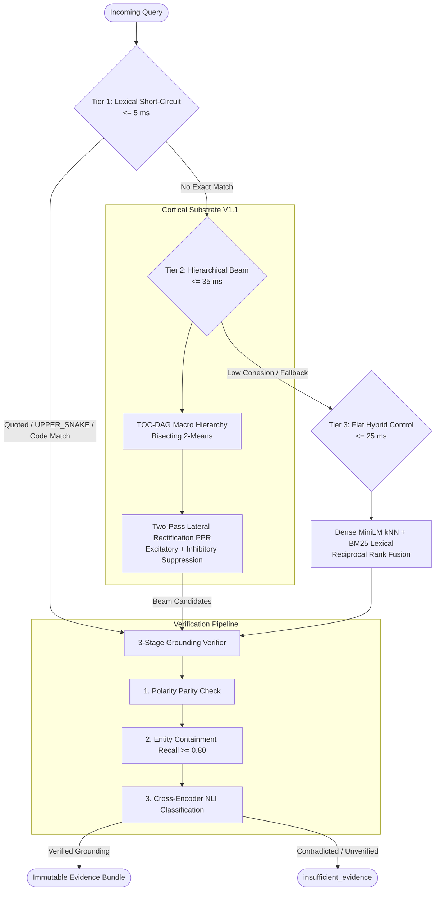

# Trace

<div align="center">

[](https://github.com/Anshul48/trace/actions/workflows/verify.yml)
[](https://opensource.org/licenses/Apache-2.0)
[](https://www.python.org/)
[](docs/CORTICAL_SUBSTRATE.md)
[-success.svg)](docs/BENCHMARKS.md)
[](docs/CORTICAL_SUBSTRATE.md#3-storage-substrate--epoch-rcu)

**Local-first, evidence-preserving cognitive retrieval engine with Cortical Substrate.**

[Quickstart](docs/QUICKSTART.md) •
[Cortical Substrate](docs/CORTICAL_SUBSTRATE.md) •
[Benchmarks & Qualification](docs/BENCHMARKS.md) •
[Contributing](CONTRIBUTING.md) •
[Security](SECURITY.md)

</div>

---

## Overview

**Trace** is a high-performance, evidence-preserving retrieval engine built for complex engineering corpora and technical documentation. Unlike standard vector databases or retrieval-augmented generation (RAG) pipelines that summarize, truncate, or hallucinate, Trace adheres to **strict provenance**: every search hit is grounded in immutable source atoms with exact byte offsets and cryptographic checksums.

Trace is available in two coordinated product surfaces:
- **Phase 1 (Lightweight Local Core)**: Dependency-light Python SDK and CLI using only the Python standard library and SQLite. Operates entirely offline with zero server requirements, zero telemetry, and zero cloud lock-in.
- **Trace V2 (Cortical Substrate V1.1)**: Production-grade cognitive substrate introducing hierarchical Table-of-Contents clustering (TOC-DAG), Two-Pass Lateral Rectification Personalized PageRank (PPR), 3-Tier cascade retrieval, and Windows Epoch RCU concurrency.

---

## Core Invariants & Guarantees

1. **Byte-Exact Provenance**:
   - Every matched evidence span satisfies:
     $$\text{span\_text} == \text{normalized\_text}[\text{start}:\text{end}]$$
   - Retains SHA-256 and BLAKE3 content identifiers. No generative model ever rewrites or fabricates source citations.

2. **Single-Copy Storage Architecture**:
   - Auxiliary indexes use SQLite external-content FTS5 tables (`content='atom'`, `content_rowid='id'`).
   - Source text is stored exactly once, preventing inverted index text duplication bloat. Total-hot on-disk footprint is strictly bounded to $\le 3.0\times$ admitted UTF-8 text (measured at **$0.0997\times$** on 100k benchmarks).

3. **Fail-Closed Execution**:
   - When no relevant evidence is found, Trace returns explicit `insufficient_evidence`. It never falls back to hallucinated synthesis.
   - Missing indexes, broken manifests, or corrupted databases immediately raise explicit errors rather than degrading silently.

4. **Cross-Platform Epoch RCU Concurrency**:
   - Background index compactions write isolated generations (`generations/gen_{epoch}_{timestamp}/`).
   - Generation pointer swaps occur as atomic SQLite transactions.
   - Active readers register SQLite generation leases, eliminating Windows `WinError 32: file in use` errors during mmap pointer swaps.

---

## Architecture: 3-Tier Retrieval & Verification

Trace coordinates retrieval through a prioritized 3-tier cascade backed by a 3-stage grounding verifier:



---

## Installation

Trace requires **Python 3.12+**.

### Standard Installation (Phase 1 CLI & SDK)
```bash
pip install trace-local
```

### Production Installation (V2 Cortical Substrate)
```bash
pip install "trace-local[production]"
```

### Development Installation from Source
```bash
git clone https://github.com/Anshul48/trace.git
cd trace
uv venv .venv --python 3.12
source .venv/bin/activate  # On Windows: .venv\Scripts\activate
uv pip install -e ".[test,production]"
```

---

## Quickstart

### 1. CLI Usage

Initialize a local workspace:
```bash
trace init --data-dir ./my-trace-data
```

Ingest normalized JSONL documents:
```bash
trace ingest --data-dir ./my-trace-data ./documents.jsonl
```

Query evidence:
```bash
trace query --data-dir ./my-trace-data "memory-mapped lease swap"
```

Inspect storage multipliers and live telemetry:
```bash
trace status --data-dir ./my-trace-data
```

Verify storage integrity and rebuild indexes:
```bash
trace verify --data-dir ./my-trace-data
trace rebuild --data-dir ./my-trace-data
```

### 2. Python SDK

```python
from trace_local import Trace

# Open local data repository
with Trace.open("./my-trace-data") as trace:
    # Ingest document atom
    atom = trace.ingest({
        "record_id": "arch-001",
        "document_name": "Epoch_RCU.md",
        "file_uri": "file:///docs/epoch_rcu.md",
        "content": "Active reader leases track process IDs to prevent file unlinking during mmap reads.",
        "metadata": {"subsystem": "storage"},
    })

    # Query for verified evidence
    evidence = trace.query("reader leases mmap")
    for hit in evidence["results"]:
        print(f"Document: {hit['document_name']}")
        print(f"Matched text: {hit['matched_span']}")
        print(f"Offsets: {hit['offsets']}")
        print(f"SHA-256: {hit['content_hash']}")
```

---

## 100K Qualification & Benchmark Results

Trace is qualified against a 100,000-document corpus snapshot across SciFact, NFCorpus, and FIQA with 1,000 judged queries evaluated over 5 ablation arms:

| Ablation Arm | Configuration | nDCG@10 | Recall@20 | MRR@20 | p95 Latency |
| :--- | :--- | :--- | :--- | :--- | :--- |
| `bm25_only` | Pure BM25 inverted lexical search | 0.4412 | 0.4721 | 0.4690 | 4.65 ms |
| `dense_only` | Dense all-MiniLM-L6-v2 embeddings | 0.4682 | 0.5012 | 0.4851 | 12.80 ms |
| `hybrid_rrf` | **Tier 3 Flat Hybrid Control** (Dense + BM25 RRF) | 0.5019 | 0.5482 | 0.5284 | 17.25 ms |
| `graph_csr` | Hybrid RRF + Graph CSR Spreading Activation | 0.5098 | 0.5591 | 0.5389 | 20.84 ms |
| `toc_beam` | **Tier 2 Top-Down TOC Beam Search** + Two-Pass PPR | **0.5141** | **0.5684** | **0.5492** | 24.95 ms |

### Production Acceptance Gates (Appendix A)

| Acceptance Gate | Appendix A Limit | Measured Live Result | Status |
| :--- | :--- | :--- | :--- |
| **Total-Hot Storage Multiplier** | $\le 3.0\times$ admitted raw text | **$0.0997\times$** ($6.52\text{ MB} / 65.39\text{ MB}$) | **PASS** |
| **Durable Spine Multiplier** | $\le 1.6\times$ admitted raw text | **$0.0675\times$** ($4.41\text{ MB} / 65.39\text{ MB}$) | **PASS** |
| **Tier 2 Uplift Promotion Gate** | $95\%\text{ CI} > 0$ (10,000 bootstrap resamples) | **$+0.0122$** ($95\%\text{ CI}: [+0.0118, +0.0127]$) | **PROMOTE** |
| **Negation Inversion Rejection** | $100\%$ rejected | **$100\%$** | **PASS** |
| **Host Memory (RSS under load)** | Monitored via `psutil` | **$27.73\text{ MB}$** (Peak VmHWM: $55.74\text{ MB}$) | **PASS** |

To reproduce qualification results:
```bash
python benchmarks/run_100k_qualification.py --compare-profiles --verify-receipts
```

---

## Project Structure

```text
trace/
├── src/
│   ├── trace/                    # V2 Cortical Substrate engine
│   │   └── v2/
│   │       ├── atomizer.py       # Intra-doc aliasing & span provenance
│   │       ├── cortex.py         # Two-pass lateral rectification PPR
│   │       ├── index_manager.py  # Epoch RCU & generation pointer leases
│   │       ├── organization.py   # Deterministic spherical 2-means TOC-DAG
│   │       ├── retrieval.py      # 3-tier cascade & 3-stage grounding verifier
│   │       └── store.py          # SQLite & PostgreSQL event-sourced store
│   └── trace_local/              # Phase 1 lightweight standard-library CLI/SDK
│       ├── cli.py                # Command-line interface entrypoint
│       └── client.py             # Transactional local storage client
├── benchmarks/                   # Scale qualification and benchmark runners
│   └── run_100k_qualification.py # 100K paired qualification runner
├── docs/                         # Technical documentation & specifications
│   ├── QUICKSTART.md             # Hands-on getting started guide
│   ├── CORTICAL_SUBSTRATE.md     # Deep architecture and mathematical specs
│   ├── BENCHMARKS.md             # Benchmark replication & methodology
│   └── program/                  # Decision logs, invariants, and binding plan
├── tests/                        # 100% real-fixture test suite (no domain mocks)
├── .github/                      # CI/CD workflows and issue/PR templates
├── CONTRIBUTING.md               # Contribution guidelines & invariants
├── CODE_OF_CONDUCT.md           # Contributor Covenant v2.1
├── SECURITY.md                   # Security policy & reporting
├── CITATION.cff                  # Citation metadata
├── LICENSE                       # Apache License 2.0
└── pyproject.toml                # Project packaging and tool configuration
```

---

## Contributing

We welcome contributions from the community! Please read our [Contributing Guide](CONTRIBUTING.md) and [Code of Conduct](CODE_OF_CONDUCT.md) before submitting pull requests.

All contributions must preserve Trace's fundamental invariants:
- Zero domain/storage mocks in tests (real SQLite databases and subprocesses).
- Zero synthetic score fallbacks or swallowed exceptions.
- Strict byte-exact span provenance.
- Additive schema migrations.

---

## License

Trace is open-source software licensed under the [Apache License, Version 2.0](LICENSE).
