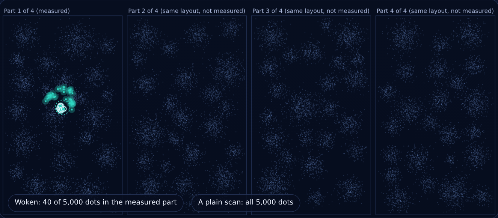

<!-- SPDX-License-Identifier: Apache-2.0 -->
<!-- GENERATED from docs/source/README.src.md by tools/build_site.py. Edit the source, then run: python3 tools/build_site.py -->
# TRACE — a memory that organizes itself.

TRACE organizes a 100M library by meaning, so developers and researchers can find the context their agents need. Passages form their own groups, and a question opens only the groups most likely to hold an answer.

**[Open the explorer](https://anshul48.github.io/trace/explorer/)** · [Watch the 3-minute story](https://anshul48.github.io/trace/demos/)

  

*Illustration of the grouping and search. 20,000 dots stand in for the passages; where each dot sits is drawn. What is real is the proportion: four equal parts, and a question waking under one percent of one of them.*

## The 3-minute proof

A question scored **0.79% of the library** and kept **99.85% of exact search's top ten**.

*<small>Scope: 50 test searches; one of four equal library parts; passage-scoring work only. The full numbers, with every caveat, are on the [evidence page](https://anshul48.github.io/trace/evidence/).</small>*

| | | | |
|---|---|---|---|
| **100M library** | **0.79% of the library scored** | **99.85% of exact top ten kept** | **670 recorded Muse Code worker jobs** |
| one frozen library behind every number | per question, passage-scoring work only | of exact meaning-based search's top ten | [what we used and did not use](docs/META-USE.md) |

*<small>Fine print: 812,545 passages · 99,891,846 tokens — 0.11% short of the 100M target. Our library and our method, 50 test searches; no outside check yet. Every result carries a fingerprint your browser can re-check.</small>*

### The ecosystem

One builder, three projects. TRACE is the memory at the front; ANIMA brings that memory into coding work through a prototype link; Reflex is a separate line of work on screens and buttons.

| Project | Repository | Demo |
|---|---|---|
| TRACE | [Repository](https://github.com/Anshul48/trace) | [Explorer](https://anshul48.github.io/trace/explorer/) |
| ANIMA | [Repository](https://github.com/Anshul48/anima-substrate) | [Recorded demo](https://anshul48.github.io/anima-substrate/demo/) |
| Reflex | [Demo repository](https://github.com/Anshul48/demo-trace-anima-reflex) | [Replay](https://anshul48.github.io/demo-trace-anima-reflex/) |

TRACE is a memory that sorts a huge pile of text into groups by itself, so a question opens only the few groups it needs, and every result comes with a record you can check.

ANIMA is a layer you install in one line on top of the coding agent you already use (Muse Code first, then Claude Code, Codex), giving it memory (a prototype link), a checker it cannot see, and a screen to watch it work. Install: `curl -fsSL https://raw.githubusercontent.com/Anshul48/anima-substrate/main/install.sh | sh`. Headless adapters exist for Muse Code, Claude Code and Codex; the screen shows the recorded state-tree of a run.

Reflex is a line of work where an AI looks at a screen and finds the right button to press (SAM 3.1 with Muse Spark).

### Walkthroughs & Visual Proofs

| Track | Watch today |
|---|---|
| Flagship film | [Watch the 3-minute story](https://anshul48.github.io/trace/demos/) <!-- VIDEO_SLOT: Flagship film - Replace href when rendered --> |
| 60-second explorer tour | [Open the explorer](https://anshul48.github.io/trace/explorer/), a replay of 144 recorded searches <!-- VIDEO_SLOT: 60-second explorer tour - Replace href when rendered --> |
| ANIMA state-tree replay | [Recorded demo](https://anshul48.github.io/anima-substrate/demo/) <!-- VIDEO_SLOT: ANIMA state-tree replay - Replace href when rendered --> |
| Reflex clip | [Short film](https://anshul48.github.io/trace/demos/#reflex) |
| Module deep dives | [How it works](https://anshul48.github.io/trace/how-it-works/) <!-- VIDEO_SLOT: Module deep dives - Replace href when rendered --> |

## The deep end

| Destination | What lives there |
|---|---|
| [Receipts](receipts/) | The records of our runs: the qualification run, the earlier larger builds, the order measurement. The [evidence page](https://anshul48.github.io/trace/evidence/) tells the story they tell. |
| [Reproduce](https://anshul48.github.io/trace/verify/) | The commands that re-check the code and the records, and a [small reproduction](docs/reproduction/repro-20k/README.md) that runs on your own computer. |
| [Architecture](docs/ARCHITECTURE.md) | The design in technical terms, plus a [walk through the 207 tested files](docs/CODE-TOUR.md). |
| [Research notes](docs/BENCHMARKS.md) | The measurement records of the earlier builds, and the [scale and build-memory runs](docs/SCALE-AND-MEMORY.md) with their raw records. |
| [Status](https://anshul48.github.io/trace/built/) | Every capability with its Working today / Prototype / Planned badge, driven by [status.json](docs/status.json). |
| [Contribute](.github/CONTRIBUTING.md) | The rules for changing this repository. |

Try it, and check it

- **No install:** the [explorer](https://anshul48.github.io/trace/explorer/) in your browser.  
- **Run the explorer on your own computer** (Python 3, downloads nothing): `./tools/run-trace.sh` (Windows: `tools\run-trace.bat`).
- **Check that the published code is exactly what we tested** (207 files): `python3 tools/verify_freeze.py` should end with `entries=207 ok=207 missing=0 mismatch=0`. 
- **Run a small reproduction** (20,000 tokens, needs `numpy` and `blake3`): see [docs/reproduction/repro-20k/README.md](docs/reproduction/repro-20k/README.md). 

[Contributing](.github/CONTRIBUTING.md) · [Security](.github/SECURITY.md) · [Cite](docs/CITATION.cff) · [Changelog](docs/CHANGELOG.md) · Questions or problems: [open an issue](https://github.com/Anshul48/trace/issues). License: Apache-2.0 ([LICENSE](LICENSE)). Passages in the library are English Wikipedia text under CC BY-SA 4.0.
