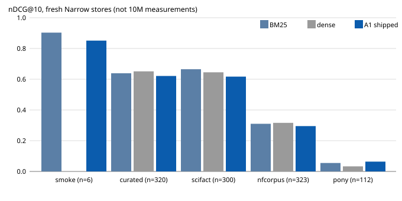
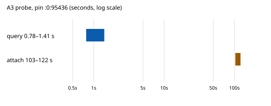

# C2-10M publication record: claims, evidence, figures

Publication claims for the shipped historical candidate — **C2-10M
freeze-v2 qualified release** (SHIP 2026-10-08, store pin
`ee06a4e4-83f7-4315-9e23-bd6e5034cccb:0:95436`, producer freeze
`c2-b100m-producer-freeze-002`, 89/89 bytes recovered and verified).
Each claim names its evidence file; each figure carries a text
equivalent (the adjacent table); limitations and negatives are part of
the record, not footnotes.

## Claim 1 — Qualified ship (identity)

An independent lane-READ10M review passed 7/7 gates on 2026-10-08 and
the coordinator concurred after spot checks; the release shipped with
an explicit deployment condition (§Claim 5).
Evidence: `benchmarks/evidence/receipts-10m-shipped/ship-record/
c2-10m-SHIPPED.md` + `READ10M-REPORT.md` (verbatim).

## Claim 2 — Exact bytes (provenance)

The tree carries the exact frozen bytes: 85 producer code files
(pre-repair `dossier.py`/`index.py`), 7 serving files (repaired bytes +
pre-176 `query.py`), 3 policy pins, 3 small data inputs + derivation
maps, and a reconstruction tool that reproduces both corpus files
byte-exactly (`RECONSTRUCT PASS`: `c098fdac…`, `04bbbb3e…`).
Evidence: `c10m/PINS.sha256` (110 entries) + `c10m/data/DATA-README.md`
§3 (verification run) + `benchmarks/evidence/CANDIDATE-PINS.md`.

## Claim 3 — Fresh-store retrieval quality (1061 queries × arms, 0 failures)

On fresh Narrow stores the shipped stack (A1, M80-P100-A40) trails the
bm25/dense references on four lanes and leads on BRIGHT-pony:

*Figure 1 — nDCG@10 per lane (fresh stores). Text equivalent:*

| lane | n | bm25 | dense | A1 shipped |
|---|---|---|---|---|
| smoke | 6 | 0.903 | — | 0.851 |
| curated | 320 | 0.639 | 0.651 | 0.621 |
| scifact | 300 | 0.665 | 0.645 | 0.617 |
| nfcorpus | 323 | 0.310 | 0.316 | 0.295 |
| pony | 112 | 0.055 | 0.033 | 0.064 |

Significant gaps (original paired t-test + bootstrap, no
multiple-comparison correction): recall@20 on curated/scifact/nfcorpus;
nDCG@10 on scifact (vs bm25) and nfcorpus (vs dense). On pony A1 beats
dense significantly on nDCG@10/MAP@10/R@20/MRR and leads bm25
non-significantly; all arms score low there. The A40 emission cutoff
costs nothing measurable vs the A100 diagnostic on any lane.
**These are fresh-store measurements, not 10M measurements.**
Evidence: `benchmarks/evidence/receipts-10m-shipped/lane-BENCH10M/`
(REPORT.md §0–§1 + per-lane `compare-*.md`, all arms and misses).

## Claim 4 — Actual-10M retrieval point (frozen rung, Narrow 4c8c9673)

First measured TL retrieval point at ≥10M tokens (13081 docs /
10,003,381 TOK-v1 / 63,441 atoms; 809 queries; 0 errors): TL ndcg10
**0.6311** (dense 0.6442, hybrid 0.6563, bm25 0.5642), prune-neutral,
above the predicted ≈0.55–0.62 band. Verdict: 10M RETRIEVAL EVIDENCED.
Provisional latency MISS recorded as the specified FINDING
"superlinear latency regime" (BM25 full-scan dominates; dense p50
357 ms vs 2.3–2.8 s for BM25-touching systems). Cost: 1.05 GB store,
1.65 GB peak RSS. 100M retrieval is NOT evidenced and NOT claimed.
Evidence: `benchmarks/evidence/receipts-10m-shipped/scale10m/`
(`metrics.json` `679575e4…`, `rows.jsonl` `c08b2b77…`, PHASE2-REPORT.md).

## Claim 5 — Deployment condition + attach wall (A3 probes)

Serving a query on the resident 10M store takes ~1 s; (re)attaching
the NarrowIndex takes ~2 min and dominates every cold-attach request
(two independent probe runs agree; 5/5 requests, 40/40 entries):

*Figure 2 — A3 probe ranges, log seconds. Text equivalent: query
0.78–1.41 s; attach 103–122 s per request (runs 156: 117–122 s /
0.78–1.41 s; 162: 103–117 s / 0.78–1.09 s). Warm-cache observations.*

Persistent serving process + resident MiniLM required: warm
1620–2358 ms and storage-cold 3530 ms PASS vs 5 s; fresh-process first
request ~8–10 s EXCEEDS (voids latency claims outside the condition;
correctness stands).
Evidence: `store-probe.json`, `store-probe-162.json`, CONFIG.md.

## Claim 6 — Later stress evidence ships WITH its failures

Campaign-186 completed later (COMPLETE-10M, 31 chunks / 1984 receipts)
with ORIGINAL F2 overall FAIL (fresh-reader p95 13.3–13.9 s, 124/124
exceed; same-process add p95 14.7–16.2 s, 31–32/124 exceed;
same-process correction PASS). It is evidence, never the build; its
release bytes were NOT adopted (unidentified `release-sha256.txt`
target). No thresholds were rewritten.
Evidence: `benchmarks/evidence/receipts-186/` + NEGATIVE-RESULTS.md.

## Limitations (binding)

- Demo/synthetic surfaces prove code paths run, never quality at scale;
  the demo's stand-in encoder is disclosed on every surface.
- Fresh-store scores (§Claim 3) must never be quoted as 10M results.
- Latency claims hold only inside the deployment condition (§Claim 5).
- Corpus reconstruction needs the three pinned upstreams; the
  `wikipedia_delta.jsonl` fetch is a stated provenance gap
  (`c10m/data/DATA-README.md` §6).
- R9 10M RelIndex verification FAILED (OOM); CONFIRM Phase-2 reached
  no verdicts; dossier (S2/S3) quality at 10M is out of scope.

Reproduction: [C2-10M-REPRO-APPENDIX.md](C2-10M-REPRO-APPENDIX.md).
Runnable entry points: [release summary](RELEASE-SUMMARY.md),
[demos](../demos/README.md), [bench evidence](../benchmarks/evidence/).
