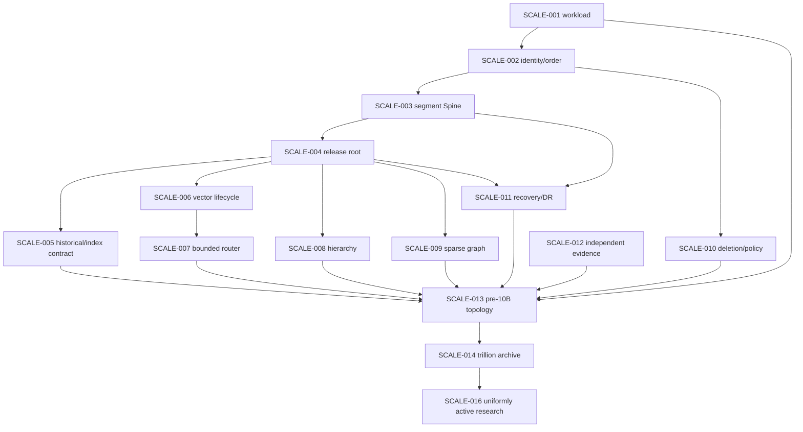

# Trace Scale Decision Register

> Status: queued decision program. No entry is accepted merely because a
> provisional position appears in `SCALE_HARD_PROBLEMS.md`.

## 1. Decision states

| State | Meaning |
| --- | --- |
| `queued` | Question and dependencies are known; implementation is not authorized |
| `researching` | Evidence and reversible prototypes may be collected |
| `proposed` | Options, evidence, consequences, and a recommendation are ready for owner review |
| `accepted` | Human owner has recorded the decision and implementation packets may depend on it |
| `rejected` | Proposal was declined; reason and reconsideration trigger are recorded |
| `superseded` | A later accepted ADR replaces this one without rewriting history |

Only the human owner changes `proposed` to `accepted` or `rejected`. An agent may
draft and recommend but may not self-promote an architectural decision.

## 2. Lead decision queue

| ID | Decision | Current state | Depends on | Blocks | Required owner |
| --- | --- | --- | --- | --- | --- |
| SCALE-001 | Workload vector, scale units, active/archive service classes, SLA, recovery, and cost envelope | queued | Foundation evidence for measured baselines | Every scale claim and topology choice | Human + lead architect |
| SCALE-002 | Canonical source/atom/event identity, logical partition key, per-partition sequence, causal time, split/merge, and release cuts | queued | SCALE-001 | SCALE-003, 004, 010, 011, 013 | Human + lead architect |
| SCALE-003 | Source blob, atom/event segment, checksum, manifest, compaction, schema evolution, and object-store commit format | queued | SCALE-002 | Tiered Spine and archive | Human + lead architect |
| SCALE-004 | Projection fragment identity, candidate validation, workspace/partition release root, activation CAS, rollback, leases, and collection | queued | SCALE-002, SCALE-003 | Safe multi-store and multi-shard releases | Human + lead architect |
| SCALE-005 | Current versus historical retrieval/index coverage, archive discovery, `as_of` semantics, and rebuild equivalence | queued | SCALE-001, SCALE-002, SCALE-004 | Historical scale and policy claims | Human + lead architect |
| SCALE-006 | Vector ownership, model/config identity, precision/quantization tiers, index topology, snapshots, and resharding | queued | SCALE-001, SCALE-004 | Billion-scale vector lane | Lead architect; human approves cost/quality tradeoff |
| SCALE-007 | Router signals, oracle protocol, shard/fan-out budgets, confidence expansion, deterministic merge, and partial-failure behavior | queued | SCALE-001, SCALE-004, SCALE-006 | Shard pilot and 10B retrieval claim | Human + lead architect |
| SCALE-008 | Hierarchy units, structural sharing, node identity, summary policy, overflow/rebalance, and cross-unit directory | queued | F1 evidence, SCALE-004 | Incremental self-organization | Lead architect; human approves mechanism scope |
| SCALE-009 | Affinity graph schema, candidate generation, degree/relation/time budgets, run isolation, expiry, and rollback | queued | F1 ablations, SCALE-004 | Graph-assisted scale claim | Lead architect; human promotes only with evidence |
| SCALE-010 | Supersession, revocation, logical deletion, physical erasure, retention, keys, snapshots, and historical authorization | queued | SCALE-002, threat/policy brief | Any production or archival policy claim | Human + lead architect/security reviewer |
| SCALE-011 | Checkpoints, snapshot-plus-delta replay, compaction, backpressure, RPO/RTO, region topology, and disaster recovery | queued | SCALE-002, SCALE-003, SCALE-004 | Availability and F3+ promotion | Human + lead architect/operations reviewer |
| SCALE-012 | Independent evaluator identities, evidence maps, statistics, held-out policy, fault schedule, attestation, and promotion dossier | queued | None; may proceed in parallel without inspecting unfinished handoffs | Every release-scale claim | Independent evaluator owner + human |
| SCALE-013 | Pre-10B topology: metadata placement, object/index shards, replication, coordinator boundaries, capacity and migration plan | queued | Passed F2; SCALE-001 through 012 as relevant | F3/F4 implementation | Human + lead architect |
| SCALE-014 | Trillion archive: tier definitions, discovery/rehydration SLA, integrity sampling, deletion/retention, multi-region DR, and economics | queued | Passed F4/F5 evidence | F6 implementation | Human + lead architect |
| SCALE-015 | Native component extraction or explicit no-rewrite decision | queued | Stable profile from a passed real gate | Any Rust/Go/native implementation | Human + lead architect |
| SCALE-016 | Uniformly active trillion-token research target and value case | queued | Passed F6 and explicit unmet use case | Research program R7 | Human only to authorize |

## 3. Dependency spine



`SCALE-012` is intentionally independent. The evaluator must be able to reject
the rest of the graph rather than inherit its assumptions.

## 4. Provisional positions to test, not silently adopt

The lead-architecture baseline currently favors:

- stable logical source/workspace partitioning with versioned physical
  placement, never canonical semantic shards;
- per-partition replay order plus causal metadata, not one global writer;
- immutable content-addressed source/atom/event segments and manifests;
- an immutable vector of partition manifests under one small active-release
  compare-and-swap per workspace;
- a revisioned bounded fresh-tail overlay plus structurally shared compacted
  projection fragments;
- lexical, vector, hierarchy, and sparse-graph retrieval as independently
  replaceable channels;
- bounded shard routing measured against exhaustive/oracle samples;
- canonical revalidation of every finalist;
- separate current, historical, active, warm, and archival coverage contracts;
- tiered trillion-token archive before any uniformly active trillion target;
- Python/reference semantics until a measured stable hot path justifies native
  extraction.

An ADR must still compare credible alternatives, record evidence, and define a
reconsideration trigger. "The master plan says so" is not sufficient evidence.

## 5. Human promotion gates

| Gate | Decision required |
| --- | --- |
| H0 Foundation | Accept the frozen Foundation dossier as input to scale work |
| H1 real 100K | Freeze P-005-style thresholds before held-out execution; decide whether F1 evidence authorizes F2 |
| H2 real 1M | Decide whether single-node economics are exhausted and whether to fund the F3 shard pilot |
| H3 shard pilot | Accept/reject `SCALE-013`, including cost, migration, rollback, and kill criteria for the 10B pilot |
| H4 10B/100B | Decide whether observed bottlenecks justify the trillion-archive program and accept `SCALE-014` |
| H5 trillion archive | Decide whether F6 is sufficient or a separate uniformly active research target has a real value case |

No Codex/agent session substitutes for these decisions.

## 6. ADR packet template

Every scale ADR should contain the following broad sections. Lower-cost agents
may populate inventories and examples but not the decision or thresholds.

```markdown
# SCALE-NNN: concise decision title

Status: researching | proposed | accepted | rejected | superseded
Owner:
Decision date:
Supersedes / superseded by:

## Decision question

One falsifiable question, with explicit scope and excluded questions.

## Inputs and fixed identities

- Foundation/previous-gate evidence hashes
- workload manifest
- code, schema, model, dataset, transform, and protocol identities

## Invariants

Truth, evidence, policy, bounded-work, rollback, and compatibility constraints.

## Options

For each option: data shape, algorithm, failure semantics, migration, operations,
cost model, advantages, limitations, and reversibility.

## Experiments and observations

Real or controlled workloads, instrumentation, raw artifact hashes, negative
results, uncertainty, and independent review.

## Proposed decision

Exact behavior and boundaries. No aspirational implementation prose.

## Consequences

Accepted tradeoffs, new risks, required migrations, and unsupported behavior.

## Rollout, rollback, and kill criteria

Steps are implementation packets; verifier steps are separate packets.

## Reconsideration triggers

Measured conditions that reopen the ADR.

## Human record

Decision, rationale, date, and signer/owner identity.
```

## 7. Packet decomposition after an ADR is accepted

An accepted ADR becomes a DAG of small packets:

1. schema/contract implementation;
2. reference adapter and deterministic fixtures;
3. migration/backfill tooling;
4. runtime implementation behind a disabled or shadow feature flag;
5. operational telemetry and rollback path;
6. implementation-session evidence bundle;
7. separate verifier packet against a frozen artifact;
8. human promotion or a signed repair packet.

Packets must declare exact read/write scope, forbidden areas, prerequisites,
artifact outputs, test/evidence responsibility, and stopping conditions.

## 8. Work suitable for lower-cost agents

After a lead decision narrows the space, delegated agents may:

- enumerate current schemas/APIs and produce field-level mapping tables;
- create JSON schema drafts from accepted semantic fields;
- expand option inventories without recommending promotion;
- populate capacity spreadsheets from provided measurements;
- write migration checklists, runbooks, dashboards, and fault-case permutations;
- curate source/license/checksum manifests during authorized acquisition;
- generate fixture catalogs and adapter task lists;
- cross-link accepted decisions through repository documentation.

They may not decide partition semantics, identity, consistency, release atomicity,
historical/deletion guarantees, thresholds, or whether evidence is sufficient for
promotion.

