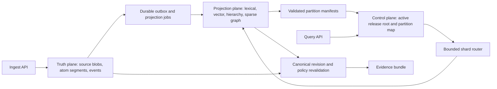
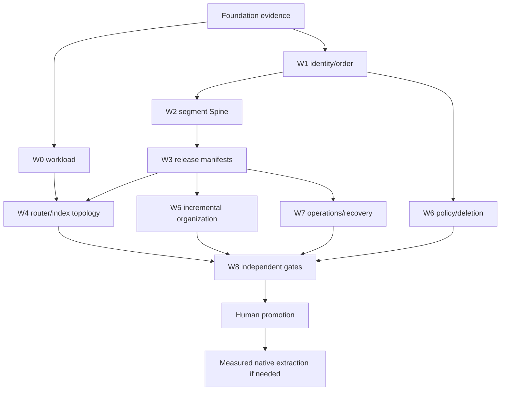

# Trace Billion-to-Trillion Scale Master Plan

> Status: architectural program baseline, not an implementation authorization or
> a scale claim. The current Foundation wave remains the prerequisite. This plan
> intentionally does not inspect or restate unfinished handoffs.

## 1. Mission and architectural judgment

Trace is intended to be a headless, self-organizing memory database whose
answers remain grounded in durable source evidence. The credible path to very
large memory is not a larger global tree or graph. It is a small canonical truth
plane plus independently rebuildable, bounded, partition-local retrieval
projections.

The present direction has:

- a strong path to the billion-token range if the real 100K and 1M gates prove
  incremental work, recovery, provenance, and retrieval quality;
- a credible but conditional path to roughly 10B source tokens after a
  shard-aware pilot and a measured capacity decision;
- a plausible path to a trillion-token **archive with bounded active
  cognition**, using immutable tiered storage and selective indexes;
- no current basis for promising a trillion tokens that are all continuously
  mutable, densely indexed, globally self-organized, and uniformly searchable
  at low latency.

The last target is a separate research program. It is not the default meaning of
"trillion-token Trace."

## 2. What the target means

No gate may use token count as its only scale descriptor. Every admitted run
must freeze this workload vector:

| Symbol | Required dimension |
| --- | --- |
| `T` | source tokens and tokenizer identity |
| `B` | raw and compressed source bytes |
| `D` | document/source count and size distribution |
| `N` | atom count and atom-size distribution |
| `A` | active indexed atoms/tokens versus archival atoms/tokens |
| `U` | ingest, update, revocation, and deletion rates |
| `Q` | query concurrency and query-class distribution |
| `L` | p50, p95, and p99 latency objectives by query class |
| `R` | durability, availability, RPO, RTO, replay, and rollback objectives |
| `P` | policy, retention, historical-query, and evidence requirements |
| `C` | storage, compute, network, model, and operator-cost envelope |

Inherited labels such as "100K" and "1M" are provisional until their unit is
recorded in a signed corpus manifest. Agents may not infer whether a label means
tokens, atoms, documents, or queries.

For planning only, average atom sizes of 256 to 1,024 tokens imply:

| Source scale | Approximate atom range |
| --- | ---: |
| 1B tokens | 1M to 4M atoms |
| 10B tokens | 10M to 40M atoms |
| 100B tokens | 100M to 400M atoms |
| 1T tokens | 1B to 4B atoms |

These are capacity illustrations, not accepted corpus contracts. For `N` atoms,
the uncompressed vector payload alone is `N * dimensions * bytes_per_dimension`;
ANN topology, payload metadata, replicas, build headroom, and snapshots add to
that number. Every pilot must publish the measured amplification factors.

## 3. Definitions that prevent false success

**Durable memory** means canonical source bytes, source revisions, atom ranges,
events, policy changes, and evidence anchors can be audited and reconstructed.

**Self-organizing** means new or changed material can update rebuildable
hierarchy, routing, lexical, vector, and sparse-association projections through
bounded incremental work. It does not mean repeated whole-corpus clustering or
an unbounded global graph.

**Accurate retrieval** means a frozen, independently evaluated protocol measures
evidence recall, ranking, citation precision, temporal and policy correctness,
abstention, and answer grounding. Visual coherence and synthetic lookups are not
accuracy authority.

**Fast enough** means the accepted latency, throughput, tail behavior, freshness,
and cost objectives for a declared workload. A mean latency from an idle system
does not satisfy this definition.

**Active cognition** is the material represented in online retrieval projections
and eligible for bounded query-time expansion. **Archive** is canonical material
that remains discoverable through metadata, lexical, summary, or routing layers
but may require staged refinement or rehydration before atom-level retrieval.

## 4. Non-negotiable invariants

1. The Spine owns truth; no vector database, search engine, queue, cache, tree,
   graph, or model output owns canonical identity or factual authority.
2. Physical placement is derived from stable logical keys. Mutable semantic
   clusters never determine canonical shard ownership.
3. Source and atom identifiers do not contain host names, database row numbers,
   vector point IDs, index names, or physical shard IDs.
4. Global total order is not required. Ordering is explicit per logical
   partition/source, with causal metadata and release watermarks for a
   cross-partition read cut.
5. Candidate projection data is invisible until direct validation succeeds and
   a small strongly consistent release pointer is changed atomically.
6. Queries are bounded in shards, candidates, graph degree/hops, model calls,
   bytes, and time. Any expansion is recorded in the evidence bundle.
7. Candidate hits are revalidated against the requested source revision,
   policy, visibility, and active release before they become evidence.
8. Revocation, deletion, retention, and historical policy are events that reach
   every projection, cache, queue, snapshot, and evidence path.
9. The previous validated release remains recoverable until retention policy
   explicitly permits collection.
10. Implementation and verification occur in separate sessions and preferably
    separate worktrees. A session never awards release authority to its own
    implementation.

## 5. Target architecture

The architecture is divided into four planes so that scale mechanisms can
change without moving the truth boundary.

### 5.1 Truth plane: immutable segmented Spine

The long-term Spine consists of:

- content-addressed source blobs and attachments;
- immutable atom/event segment files with checksums and schema fingerprints;
- source, revision, predecessor, byte/character offset, and content-hash
  metadata;
- per-logical-partition append positions and causal timestamps;
- policy, retention, revocation, and deletion events;
- immutable manifests that name the exact segment set for a snapshot.

PostgreSQL remains a good Foundation and control-plane implementation. It must
not be assumed to hold every source byte, vector, or atom row forever. At the
shard-aware stage, large immutable payloads move to object storage while hot
metadata, idempotency, leases, outboxes, and release pointers stay in a strongly
consistent store.

Logical identity is independent of placement:

- `blob_id` identifies verified source bytes;
- `source_id` identifies the logical source;
- `source_revision_id` identifies an immutable revision and predecessor;
- `atom_version_id` binds a source revision, exact range, content digest, and
  atomization-contract version;
- `event_id` supplies global idempotency, while `partition_sequence` supplies
  authoritative order within one logical partition;
- `partition_map_version` records where a logical partition was placed at the
  time of a read or write.

The exact encodings are ADR decisions. The semantic separation is mandatory.

### 5.2 Projection plane: immutable fragments plus a fresh tail

Each Cortex projection is a versioned, disposable view over a declared Spine
watermark. A projection revision comprises content-addressed fragments and a
manifest, not one mutable global index.

- New writes first enter a bounded fresh-tail overlay.
- Workers build or update partition-local lexical, vector, hierarchy, routing,
  and sparse-graph fragments.
- Compaction rewrites selected fragments and structurally shares unchanged
  fragments with the previous revision.
- Validation compares the candidate directly with canonical source ranges,
  policy, expected coverage, and the previous release.
- Activation publishes a partition manifest; a release coordinator then swaps
  one workspace release-root pointer.
- External index aliases are implementation details beneath the Trace release
  manifest. Their snapshots are recovery inputs, not cross-system truth.

At scale, canonical vectors are not duplicated as PostgreSQL JSON payloads.
Trace retains vector provenance, model/config fingerprints, point identity, and
rebuild instructions; the vector projection stores the serving representation.

### 5.3 Control plane: small, strongly consistent, and boring

The control plane stores only coordination state whose consistency is worth the
cost:

- workload and schema registry;
- logical partition map and placement epoch;
- projection job/run ledger and leases;
- per-partition candidate and active manifests;
- workspace release-root pointer;
- model, parser, normalizer, router, and policy fingerprints;
- benchmark and verifier receipts;
- retention, rollback, and garbage-collection eligibility.

The release root points to immutable partition manifests and records a vector of
source/projection watermarks. This gives a reproducible cross-partition read cut
without imposing one global event counter or one distributed transaction on
every ingest.

### 5.4 Query plane: bounded cascade, then canonical evidence

A query follows a budgeted cascade:

1. Resolve workspace, requested historical point, policy, and active release.
2. Produce a bounded shard candidate set from stable metadata/time/source
   filters plus lexical, centroid, hierarchy, and learned-routing signals.
3. Search partition-local lexical, vector, hierarchy, and sparse-graph indexes
   under per-stage budgets.
4. Merge candidates with deterministic score provenance and diversity rules.
5. Expand to additional shards only when an explicit confidence rule and
   remaining budget permit it.
6. Revalidate every finalist against the canonical source revision, policy,
   visibility, revocation state, and evidence offsets.
7. Return an evidence bundle naming release root, partition manifests, source
   revisions, ranking contributions, omissions, and budget use.

The router is allowed to lose candidates only within an accepted, measured
recall envelope. It is never allowed to fabricate evidence or silently search a
different policy/release.

## 6. Scale-gate ladder

Threshold values are human decisions informed by measured baselines. Agents may
populate measurement tables, but may not invent promotion thresholds.

| Gate | Purpose | Architecture under test | Required evidence to exit | Automatic failure examples |
| --- | --- | --- | --- | --- |
| F0 Foundation | Establish canonical truth, candidate isolation, replay, and benchmark identity | Current local-first Trace/Trace-Lite contracts | Signed Foundation dossier from the active program | Candidate leakage, unverifiable source mapping, non-reproducible runner |
| F1 real 100K | Prove one real corpus end to end | Single-node or embedded/reference path | Corpus hashes/licenses, retrieval and provenance metrics, crash/replay/rollback, resource and cost traces | Synthetic fallback, dropped atoms, policy leak, unclean recovery |
| F2 real 1M | Prove incremental economics and operational stability | Strong single node or small single-region deployment | Update/delete churn, tail latency, projection lag, rebuild/restore time, fault matrix | Whole-corpus work per small update, unbounded graph growth, backlog divergence |
| F3 10M-50M atoms shard pilot | Prove logical partitioning before headline token scale | One-region multi-process/multi-node pilot | Stable IDs through movement, per-shard replay, root-release activation, routing-oracle recall, skew/rebalance tests | Semantic physical partitioning, uncontrolled fan-out, shard-local identity collisions |
| F4 about 10B source tokens | Prove governed active memory at declared QPS/update load | Distributed Cortex and partitioned/tiered Spine as evidence requires | Real workload dossier, cost/capacity model, policy propagation, recovery, independent retrieval proof | Token-only claim, index build without query proof, unaffordable steady-state/rebuild cost |
| F5 about 100B source tokens | Prove compaction, lifecycle, and failure-domain economics | Sharded metadata and indexes with object-backed immutable segments | Long-running churn, segment compaction, regional restore, bounded routing under skew | Compaction debt, backup inconsistency, release metadata hotspot |
| F6 1T archival corpus | Prove durable archive plus bounded active cognition | Tiered archive, selective indexes, rehydration/refinement path | Archive integrity audit, discovery coverage, active-set SLA, deletion/retention proof, disaster recovery and cost | Claiming uniform active coverage, unverifiable cold data, unbounded rehydration |
| R7 1T uniformly active | Determine whether this target is useful and technically/economically defensible | Separate research architecture | New accepted workload, research results, and budget | Treating F6 as evidence for this target |

Each gate has four sessions at minimum: admission/freeze, implementation or run,
independent verification, and human promotion. Repair sessions are inserted
between implementation and a new verification session when needed.

## 7. Workstreams and dependencies

| ID | Workstream | Lead question | Earliest start | Primary repository |
| --- | --- | --- | --- | --- |
| W0 | Workload and economics | What exact memory service are we scaling? | Now, planning only | `trace` |
| W1 | Identity, ordering, and partition map | How is truth named and ordered without physical coupling or a global writer? | After F0 evidence can be referenced | `trace` |
| W2 | Segment and manifest Spine | How do immutable source/atom/event segments commit, compact, audit, and restore? | After W1 draft | `trace` |
| W3 | Projection release control plane | How do shard-local candidates become one reproducible active release? | W1 and W2 contracts | `trace` |
| W4 | Bounded routing and indexes | How do we avoid scatter/gather while measuring routing recall? | W0 and W3 | `trace`, evaluated by `trace-bench` |
| W5 | Incremental hierarchy and sparse association | How does organization evolve without global rebuild or all-pairs work? | F1 baseline and W3 | `trace`; mechanisms prototyped in `trace-lite` |
| W6 | Revocation, deletion, and historical policy | What becomes invisible immediately, what is physically purged, and what history is allowed? | W1 and threat/policy model | `trace` |
| W7 | Operations, recovery, and observability | Can lag, overload, failure, restore, and rollback stay bounded? | F1 and W3 | `trace` |
| W8 | Independent evidence program | What would falsify each quality and scale claim? | Continuous | `trace-bench` |
| W9 | Native kernels and service extraction | Which measured hot path merits a stable non-Python component? | Only after profiling a passed real gate | repository chosen by ADR |

## 8. Repository ownership

### Trace

Trace owns canonical production contracts: source and atom identity, events,
partition maps, segment manifests, release roots, policy/history, query budgets,
evidence bundles, and production adapters. It is the only repository that may
claim a passed end-to-end scale gate.

### Trace-Lite

Trace-Lite remains the embedded correctness oracle, local product, and mechanism
laboratory. It should expose deterministic fixtures, inspectable reference
behavior, and bounded retrieval ablations. It is not required to become the
distributed substrate, and its current full-memory rebuild and all-pairs
co-occurrence paths must not be extrapolated into scale claims. See
`trace-lite/docs/dev/SCALE_ROLE.md`.

### Trace-Bench

Trace-Bench owns independent dataset identity, adapters, run manifests,
baselines, metrics, fault protocols, capacity telemetry, and paired comparison.
Synthetic ladders are smoke/stress evidence only. Release authority comes from
a frozen protocol plus verifier receipt, never from a boolean authored by the
system under test. See `trace-bench/SCALE_EVIDENCE_PLAN.md`.

## 9. Stage deliverables

### Through F2: decompose the single-node system

- Freeze the workload manifest and canonical IDs.
- Remove whole-corpus assumptions from normal incremental ingest.
- Make every projection revision-addressed and source-watermark scoped.
- Separate fresh-tail serving from immutable compacted fragments.
- Stop duplicating production vector payloads in canonical relational storage.
- Measure organization work per changed atom/source, not only total build time.
- Establish recovery from source truth without trusting an index snapshot.

### F3: prove sharding semantics before scale volume

- Introduce logical partitions and versioned physical placement.
- Demonstrate move/copy/cutover without changing canonical IDs.
- Replace global ordering assumptions with per-partition sequence plus causal
  metadata and explicit release cuts.
- Build per-partition projection manifests and a workspace release root.
- Implement router-oracle evaluation and bounded expansion telemetry.
- Exercise duplicates, retries, out-of-order jobs, node loss, partial candidate
  completion, and skewed hot partitions.

### F4-F5: prove active distributed memory

- Use real source distributions and update/query concurrency.
- Tune index and routing topology from measured recall/cost, not vendor defaults.
- Introduce tiered storage, segment compaction, snapshot/restore, and capacity
  headroom policies.
- Establish disaster-recovery drills and policy propagation across every
  projection and cache.
- Justify any native kernel or new service with a profile and parity contract.

### F6: prove archival memory

- Define archive discovery guarantees separately from active retrieval SLA.
- Keep source integrity, manifests, and policy queryable across storage tiers.
- Use coarse lexical/metadata/routing indexes for broad discovery, then bounded
  on-demand refinement or rehydration.
- Verify long-horizon bit integrity, manifest reachability, key/retention policy,
  and region-loss recovery.
- Publish the steady-state, rebuild, migration, and operator economics.

## 10. Program risks and kill criteria

| Risk | Early signal | Required response |
| --- | --- | --- |
| Routing recall collapses as shards grow | Oracle evidence exists outside routed shard set | Increase/alter routing signals or stop promotion; do not hide with unbounded fan-out |
| Organization remains global | Small updates trigger corpus-scale clustering/summarization | Introduce partition-local fragments and structural sharing before scaling |
| External index becomes truth | Result cannot be reconstructed/revalidated from the Spine | Fail closed and repair the truth/provenance boundary |
| Policy or revocation leaks | Stale hit survives canonical revalidation or cache invalidation | Stop serving affected release; purge/rebuild through a tracked incident |
| Metadata/control hotspot | Root pointer, event ledger, or job coordinator saturates first | Partition control state while retaining a small per-workspace commit point |
| Storage amplification is uneconomic | Vector/index/replica/snapshot bytes exceed accepted envelope | Quantize, reduce active granularity, tier, or reject the target |
| Benchmark rewards the implementation | Moving corpus, leaked queries, self-authored authority, or synthetic fallback | Invalidate the run and freeze an independent protocol |
| Recovery cannot meet the window | Index rebuild or region restore exceeds accepted RTO | Add portable fragments/snapshots or reduce claimed availability/scale |
| Native rewrite outruns contracts | Two implementations diverge on provenance, policy, or failures | Halt extraction and return to the reference contract |

Any automatic failure blocks promotion. The response is a narrow repair and a
new independent verification run, not threshold relaxation inside the same run.

## 11. First decision packets after the Foundation gate

These packets are queued, not authorized by this document:

1. `SCALE-001` freezes the workload vector and the meaning of active versus
   archive at 1B, 10B, 100B, and 1T.
2. `SCALE-002` freezes logical identity, per-partition ordering, causal metadata,
   and cross-partition release-cut semantics.
3. `SCALE-003` compares source/atom segment and manifest formats with a small
   reversible prototype.
4. `SCALE-004` specifies candidate fragment validation, structural sharing,
   release-root activation, rollback, and collection.
5. `SCALE-005` defines the router oracle, shard budgets, expansion policy, and
   evidence bundle contribution accounting.
6. `SCALE-006` specifies revocation, legal/operational deletion, cryptographic
   erasure options, snapshot retention, and historical-query policy.
7. `SCALE-007` freezes the F3 fault, recovery, capacity, and independent
   verification protocol.

The ordering and status of all packets are maintained in
`SCALE_DECISION_REGISTER.md`.

## 12. Delegated expansion backlog

Lower-cost agents may expand the following after the governing ADR exists:

- exhaustive schema field tables and JSON examples;
- command-by-command runbooks and deployment examples;
- dataset/license/checksum inventories;
- telemetry names, dashboard layouts, and alert playbooks;
- exhaustive failure-case matrices derived from accepted semantics;
- cost-model spreadsheets populated with measured vendor/hardware values;
- fixture catalogs and adapter implementation checklists;
- prose cross-links and glossary expansion.

They may not choose consistency semantics, identity boundaries, partition keys,
release atomicity, deletion guarantees, gate thresholds, or promotion outcomes.
Those decisions stay with the lead architect, independent evidence, and the
human owner.

