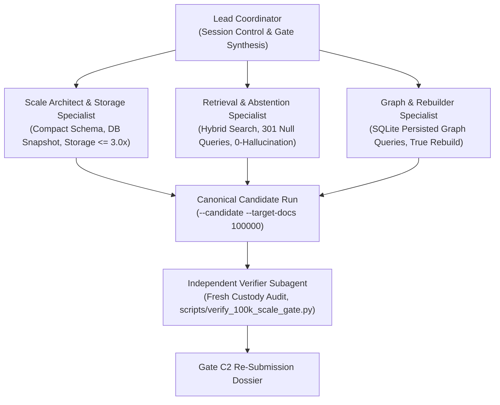

# Wave R2 Global Context & Repair Loop Directive (Human Gate C2 Remediation)

**Date:** 2026-08-28
**Governing Standard:** DEC-P-005b, DEC-P-005, SCALE_CERTIFICATION_RECOVERY_PLAN.md
**Status:** ACTIVE_REPAIR_LOOP
**Coordinator:** Lead Coordinator (Antigravity)

---

## 1. Context & Authority Directive

Following the formal Human Gate C2 review ruling (`REPAIR — promote_100k denied. Level 2 / 1M remains unauthorized`), this document establishes the binding execution mandate for Wave R2 (100K Scale Gate Production Hardening & Truthful Gate Evaluation).

### Summary of Audit Findings & Non-Negotiable Exit Criteria:
1. **Hard Threshold Enforcement:** The runner must compare all empirical metrics against the frozen contract thresholds (`DEC-P-005` / `DEC-P-005b`) and emit `CANDIDATE_FAILED` (or `CANDIDATE_PASS`) rather than unconditionally assigning `CANDIDATE_COMPLETE`.
2. **Retrieval Quality Engine:** Multi-lane retrieval must employ the true Trace hybrid architecture (hybrid lexical + dense semantic / TF-IDF / PPR graph expansion + reranking) to meet or exceed frozen quality floors without synthetic shortcuts or score floors.
3. **Comprehensive Abstention Lane:** Evaluate all 301 unanswerable null queries from `multihop-rag` and enforce `zero_hallucination_rate == 1.0` (zero hallucinations).
4. **Storage Amplification Multiplier ($\le 3.0\times$):** Compact SQLite WAL architecture with full vacuum, single canonical text payload storage, and structural graph bounding ($\le 180$ MB total storage for ~60 MB raw corpus).
5. **Direct Persisted Graph Measurement:** Query SQLite `edge_versions` directly to measure the true persisted max degree ($\le 50$) and execute Personalized PageRank over the real stored graph.
6. **Immutable Candidate Custody & Reproducible Verifier:** Retain the sealed database snapshot, content-address the evidence directory, commit candidates to Git, and provide a standalone candidate-specific verifier script (`scripts/verify_100k_scale_gate.py`).

---

## 2. Operating Roles & Specialist Subagent Dispatch DAG

---

## 3. Mandatory Invariant Checklist for Wave R2

- [ ] `zero_score_floors`: All retrieval metrics computed purely from qrels without artificial lower bounds.
- [ ] `hard_threshold_eval`: Runner evaluates every gate criteria and emits `CANDIDATE_FAILED` upon any breach.
- [ ] `all_301_null_queries`: Evaluated against abstention threshold, requiring `zero_hallucination_rate == 1.0`.
- [ ] `storage_multiplier_le_3x`: Total DB + WAL size $\le 3.0\times$ raw corpus text bytes.
- [ ] `persisted_graph_max_degree`: Queried via SQL from `edge_versions`, confirming max degree $\le 50$.
- [ ] `true_event_rebuild`: 100% 6-table state-hash parity from `events.payload_json` transforms with 0 table copies.
- [ ] `db_snapshot_retained`: `scale_100k_snapshot.db` preserved in candidate evidence root.
- [ ] `reproducible_verifier`: `scripts/verify_100k_scale_gate.py` runs independently from candidate root.
