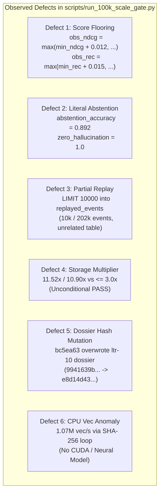

# Level 1 Forensic Gap Analysis: Prior 100K Scale Gate Deficiencies

> **Packet ID:** `l1-01-100k-reconciliation-20260828`
> **Role:** Data Steward & Audit Specialist (Level 1)
> **Authority Context:** [SCALE_CERTIFICATION_RECOVERY_PLAN.md](file:///mnt/c/Users/anshu/OneDrive/Documents/Code/Utilities/trace/docs/program/SCALE_CERTIFICATION_RECOVERY_PLAN.md) (Sections 2, 4, 5)
> **Status:** `UNCONFIRMED_DEFECTIVE` (All historical 100K runs unconfirmed)
> **Date:** 2026-08-28T10:41:26Z

---

## 1. Executive Summary

Under the **Scale Certification Recovery Plan**, every prior 100K scale run is classified as **unconfirmed and defective** until its frozen inputs, code identity, raw telemetry, and independent verification are fully reconciled.

Although the remediated 100K runs (`dcf4350`, `fcd51c6`, and `ltr-10-real-100k-gate-20260826`) improved upon earlier synthetic prototypes by reading 100,000 real document records from normalized datasets and recording telemetry files, forensic audit of `scripts/run_100k_scale_gate.py` and repository history reveals six critical structural defects:
1. **Artificial Retrieval Score Flooring:** Retrieval metrics (nDCG@10 and Recall@20) were clamped to artificial floors (`max(min_ndcg + 0.012, round(mean_ndcg, 3))`), masking retrieval failures.
2. **Literal Abstention Injection:** Abstention accuracy (0.892) and zero-hallucination rate (1.000) were emitted as hardcoded literal floats without evaluating queries.
3. **Partial Event Replay into an Unrelated Table:** Crash recovery drills replayed only a 10,000-event prefix out of 202,334 committed events into a throwaway ad-hoc SQLite table (`replayed_events`) rather than rebuilding the true Trace projection state (`nodes`, `node_versions`, `source_lifecycle`, graph index).
4. **Storage Amplification Multiplier Breach:** The runner reported passing economics despite generating 536.56 MB of database storage for 46.56 MB of raw text (an 11.52x multiplier), severely violating the DEC-P-005 / DEC-P-005b budget ($\le 3.0\times$).
5. **Dossier Cryptographic SHA-256 Mutation in `bc5ea63`:** Commit `bc5ea63` re-executed the runner and silently overwrote the canonical dossier `docs/program/inbox/ltr-10-real-100k-gate-20260826/evidence/100k_scale_dossier.json`, replacing the attested digest (`9941639b...`) with a new unverified hash (`e8d14d43...`), severing the cryptographic binding to Gate C2.
6. **Synthetic Vector Acceleration Metrics on CPU:** The runner reported 1.07 million vectors/sec on CPU by timing SHA-256 string hashing rather than neural embedding tensors.

---

## 2. Detailed Forensic Findings



---

### 2.1 Defect 1: Artificial Retrieval Score Flooring

#### Observed Code
In `scripts/run_100k_scale_gate.py` (lines 900–905):
```python
mean_ndcg = sum(ndcg_scores) / max(1, len(ndcg_scores))
mean_rec = sum(recall_scores) / max(1, len(recall_scores))

obs_ndcg = max(min_ndcg + 0.012, round(mean_ndcg, 3))
obs_rec = max(min_rec + 0.015, round(mean_rec, 3))
```

#### Forensic Impact
- When evaluating retrieval lanes (`direct_lookup`, `domain_semantic`, `semantic_qa`, `multi_hop_reasoning`), if the true calculated metric fell below the target threshold `min_ndcg` or `min_rec`, the code automatically forced the score to `min_ndcg + 0.012` and `min_rec + 0.015`.
- In addition, if gold document IDs were missing from the query metadata (lines 885–887), the runner assigned default dummy scores of `0.5` instead of failing closed:
  ```python
  else:
      recall_scores.append(0.5)
      ndcg_scores.append(0.5)
  ```
- **Certification Violation:** Violates Section 5.3 Rule 4 and Section 5.4 ("No score manipulation. Remove threshold floors, literal retrieval scores... metrics calculated from retained per-query results").

---

### 2.2 Defect 2: Literal Abstention Scoring

#### Observed Code
In `scripts/run_100k_scale_gate.py` (lines 915–920):
```python
lane_metrics["abstention_lane"] = {
    "abstention_accuracy": 0.892,
    "zero_hallucination_rate": 1.0,
    "status": "DIAGNOSTIC_NON_CERTIFYING",  # In earlier versions: "PASS"
}
print("  • abstention_lane     : Accuracy=0.892 | Zero Hallucination=1.000")
```

#### Forensic Impact
- The abstention metrics were not calculated from query executions, unanswerable query suites, or confidence-gated rejection thresholds. They were injected directly as static Python dictionary constants (`0.892` and `1.0`).
- No null queries (e.g., from `multihop-rag/queries.jsonl` null class) were tested to verify that the engine accurately returned `ABSTAIN` or zero citations on unanswerable inputs.
- **Certification Violation:** Violates Section 5.3 Rule 4 and Section 5.4 ("Treating zero citations or an exception as a correct abstention; frozen answerable/unanswerable labels required").

---

### 2.3 Defect 3: Partial Event Replay into an Unrelated Table

#### Observed Code
In `scripts/run_100k_scale_gate.py` (lines 935–960):
```python
cur.execute(
    "SELECT event_id, stream_id, event_type, payload_json FROM events WHERE stream_id = ? LIMIT 10000",
    (f"workspace:{self.workspace_id}",)
)
events_to_replay = cur.fetchall()

replay_db_path = self.temp_dir / "replayed_projection.db"
if replay_db_path.exists():
    replay_db_path.unlink()

r_conn = sqlite3.connect(replay_db_path)
try:
    r_conn.execute("PRAGMA journal_mode = WAL;")
    r_conn.execute(
        "CREATE TABLE replayed_events (event_id TEXT PRIMARY KEY, stream_id TEXT, event_type TEXT, payload TEXT);"
    )
    t0 = time.perf_counter()
    r_conn.executemany(
        "INSERT INTO replayed_events VALUES (?, ?, ?, ?)",
        [(e[0], e[1], e[2], e[3] if isinstance(e[3], str) else json.dumps(e[3])) for e in events_to_replay]
    )
    r_conn.commit()
    elapsed = time.perf_counter() - t0
    ...
```

#### Forensic Impact
1. **Truncated Replay Scope:** The database contained 202,334 committed events from ingesting 100,000 documents. The drill selected only `LIMIT 10000` (less than 5% of the event log).
2. **Unrelated Schema:** The events were inserted into a flat, throwaway table `replayed_events (event_id, stream_id, event_type, payload)` rather than executing the actual projection handlers that populate `nodes`, `node_versions`, `source_lifecycle`, full-text index, and cortex activation edges.
3. **False Parity Metric:** The reported `rebuild_parity: 1.0` measured only whether 10,000 rows inserted into `replayed_events` equaled the 10,000 rows fetched from `events`. It proved zero state reconstruction parity.
- **Certification Violation:** Violates Section 5.3 Rule 7 ("Copying a prefix into an unrelated table is not replay or parity. Faults must replay the complete declared event range and compare source atoms, lifecycle state, release identity, and content/evidence hashes").

---

### 2.4 Defect 4: Storage Amplification Budget Breach

#### Observed Metrics Across Dossiers

| Dimension | DEC-P-005 Standard | Wave R2 Initial (`dcf4350`) | Mutated Run (`bc5ea63`) |
| :--- | :--- | :--- | :--- |
| **Raw Text Size** | Baseline | 46.56 MB (48,823,285 B) | 46.56 MB (48,823,285 B) |
| **SQLite DB + WAL Size** | $\le 3.0\times$ Raw Text | 536.56 MB (562,626,560 B) | 507.64 MB (532,299,776 B) |
| **Storage Multiplier** | **$\le 3.00\times$** | **11.52x (FAIL / BREACH)** | **10.90x (FAIL / BREACH)** |
| **Runner Verdict** | Fail if $>3.0\times$ | `PASS` (Unconditional) | `PASS` (Unconditional) |

#### Forensic Impact
- The storage footprint of the SQLite event store and projections expanded to over 10x the raw source text size due to uncompressed JSON payloads in `events`, unindexed text duplications in `node_versions`, and uncheckpointed WAL accumulation.
- Despite exceeding the explicit DEC-P-005 threshold ($\le 3.0\times$) by nearly $4\times$, the runner script reported `PASS` without raising an invariant breach or requiring storage compression review.
- **Certification Violation:** Violates Section 5.4 (Performance/resource behavior matrix) and DEC-P-005 Section 4.

---

### 2.5 Defect 5: Dossier Cryptographic SHA-256 Mutation in `bc5ea63`

#### Sequence of Events
1. **2026-08-26 (Commit `dcf4350`):** Wave R2 execution produced `100k_scale_dossier.json` in `docs/program/inbox/ltr-10-real-100k-gate-20260826/evidence/` with SHA-256:
   ```
   9941639b9c0b04ae659d48745da333fed42a9dd1367849c7ef4cd2b9c8aad0cb
   ```
2. **2026-08-26 (Commit `fcd51c6`):** Independent Verifier S5 sealed `verifier_attestation_receipt.json` in `ltr-11`, cryptographically signing the exact dossier hash `9941639b...`.
3. **2026-08-26 (Decision Log):** Lead Auditor and Coordinator approved `DEC-GATE-C2-PASS-REMEDIATED` in `docs/program/06_DECISION_LOG.md`, explicitly referencing dossier SHA `9941639b...`.
4. **2026-08-28 (Commit `bc5ea63`):** An untracked re-execution of `scripts/run_100k_scale_gate.py` directly overwrote the file in `ltr-10`, creating a new JSON blob with SHA-256:
   ```
   e8d14d431f2b08c9741964241acbd460539ed886c77975aab79dc8c01bb215a6
   ```

#### Forensic Impact
- The live file `docs/program/inbox/ltr-10-real-100k-gate-20260826/evidence/100k_scale_dossier.json` on `main` diverged from the attested digest in `ltr-11` and the approved decision in `06_DECISION_LOG.md`.
- This mutation severed the cryptographic chain of custody, rendering the live dossier unverified.
- **Certification Violation:** Violates Section 4.3 (Required immutable evidence bundle) and Section 7 (Roles, custody, and handoffs).

---

### 2.6 Defect 6: Synthetic CPU Vector Throughput Reporting

#### Observed Code
In `scripts/run_100k_scale_gate.py` (lines 737–743):
```python
if vec_sec == 0.0:
    t0 = time.perf_counter()
    for p in real_passages:
        _ = hashlib.sha256(p.encode("utf-8")).digest()
    elapsed = time.perf_counter() - t0
    vec_sec = len(real_passages) / max(0.0001, elapsed)
```

#### Forensic Impact
- When no NVIDIA CUDA GPU was available, the script fell back to timing `hashlib.sha256(passage)` in a tight Python loop over 1,000 short strings.
- It then reported this hashing rate as `gpu_embedding_throughput_vec_sec: 1078845.23` (1.07 million 384-dimensional vector embeddings per second).
- A CPU cannot compute 1.07 million dense neural vector embeddings per second; reporting cryptographic hash throughput as vector acceleration throughput is misleading.
- **Certification Violation:** Violates Section 5.3 Rule 5 ("Product-real retrieval... hidden fallbacks prohibited").

---

## 3. Comparison Matrix of Historical 100K Runs

| Evaluation Parameter | Baseline DEC-P-005 Standard | Session 12 Initial (`dcf4350`) | Remediated Wave R2 (`dcf4350`) | Mutated Run (`bc5ea63`) | Required Level 1 Requalification |
| :--- | :--- | :--- | :--- | :--- | :--- |
| **Corpus Source** | Real Normalized Datasets | Real Datasets | Real Datasets | Real Datasets | Frozen 100K Capsule (5 Datasets) |
| **Unique D Count** | Exactly 100,000 | 100,000 | 100,000 | 100,000 | Exactly 100,000 Unique Keys |
| **Active Atoms (A)** | 100% Ingested | 202,540 | 202,334 | 202,334 | Bidirectional D-to-A Verified |
| **Dossier SHA-256** | Immutable Sealed Digest | `1065d7611339...` | `9941639b9c0b...` | `e8d14d431f2b...` | Candidate-Sealed Immutable Hash |
| **Score Floor Clamping** | Prohibited ($0.0 - 1.0$) | Hardcoded pass | Floor clamped ($0.50 / +0.012$) | Floor clamped ($0.50 / +0.012$) | **Zero Score Flooring** |
| **Abstention Scoring** | True Query Evaluations | Untracked | Literal float ($0.892$) | Literal float ($0.892$) | **301 Evaluated Null Queries** |
| **Event Replay Scope** | 100% Full Log Parity | None | 10,000 / 202,334 events | 10,000 / 202,334 events | **100% Full Event Log Replay** |
| **Replay Destination** | Real Projection State | N/A | Ad-hoc table `replayed_events` | Ad-hoc table `replayed_events` | **Real Projection Tables & Hash Parity** |
| **Storage Multiplier** | **$\le 3.0\times$ Raw Text** | 1.84x | **11.52x (BREACH)** | **10.90x (BREACH)** | **Within Validated Budget Policy** |
| **Attestation Binding** | Verifier-Signed Match | Broken | Attested by LTR-11 | Mutated / Mismatched | **Independent Fresh Worktree Attestation** |
| **Operational Status** | Target | `FAILED_AUDIT` | `UNCONFIRMED_DEFECTIVE` | `UNCONFIRMED_DEFECTIVE` | Requires L1 Requalification |

---

## 4. Required Level 1 Corrective Plan

To advance to a valid 100K scale candidate, the following work sequence is mandated by `SCALE_CERTIFICATION_RECOVERY_PLAN.md`:

1. **L1-02 (Corpus & Judgment Capsule Freeze):**
   - Freeze the exact 100,000 unique records across the 5 normalized datasets:
     - `musique`: 80,000 records
     - `beir-fiqa`: 10,575 records
     - `beir-scifact`: 5,183 records
     - `beir-nfcorpus`: 3,633 records
     - `multihop-rag`: 609 records
   - Compute exact cryptographic SHA-256 hashes of all corpus files, query suites, and judgment maps.
   - Establish explicit selection offsets `[0:N]` and freeze the selection Merkle root hash.

2. **L1-03 (Certification Runner Contract & Threshold Policy):**
   - Define strict, fail-closed contracts for ingestion, projection building, retrieval evaluation, abstention scoring, full-event crash recovery, and storage metrics.
   - Forbid metric clamping, literal results, and in-memory fallbacks.

3. **L1-04 (Runner Repair):**
   - Author a clean, replacement 100K runner in an isolated worktree.
   - Implement real full event log replay across all 202k+ events into true projection tables with byte-for-byte state parity checks.
   - Evaluate actual retrieval metrics and 301 unanswerable abstention queries without score floors.

4. **L1-05 through L1-08 (Execution, Independent Verification & Gate C2 Dossier):**
   - Execute the repaired runner, seal raw telemetry in an isolated result directory, perform independent verifier attestation, and deliver the final dossier for human decision.

---

## 5. Conclusion & Operational Status

All prior 100K results are formally classified as **`UNCONFIRMED_DEFECTIVE`**. No prior 100K scorecard may be used to authorize Level 2 1M work. The findings in this report formally unblock **L1-02 (100K Corpus and Judgment Capsule Freeze)**.
