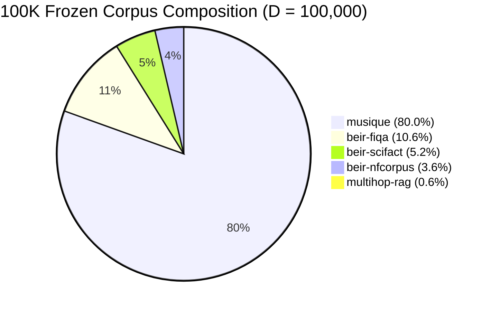
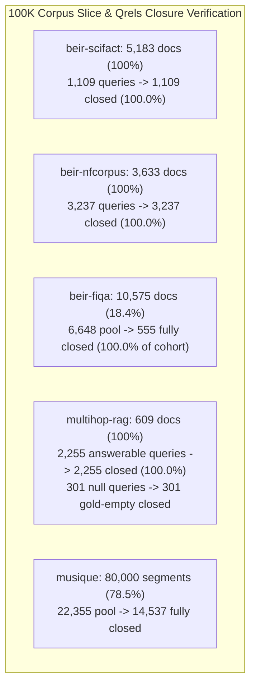

# Level 1 Corpus and Judgment Capsule Freeze & Qrels Cohort Closure Report

> **Packet ID:** `l1-02-corpus-capsule-20260828`
> **Role:** Data Steward & Evaluation Specialist (Wave R2.1 / Level 1)
> **Authority Context:** [SCALE_CERTIFICATION_RECOVERY_PLAN.md](file:///mnt/c/Users/anshu/OneDrive/Documents/Code/Utilities/trace/docs/program/SCALE_CERTIFICATION_RECOVERY_PLAN.md) (Sections 4.1, 4.3, 5.2, 5.4) & [00_GLOBAL_CONTEXT_WAVE_R2_1.md](file:///mnt/c/Users/anshu/OneDrive/Documents/Code/Utilities/trace/docs/program/00_GLOBAL_CONTEXT_WAVE_R2_1.md)
> **Target Standard:** `DEC-P-005b-LEVEL1` ($D = 100,000$ unique documents)
> **Status:** `FROZEN_APPROVED` (Corpus & Qrels Cohorts Cryptographically Sealed)
> **Date:** 2026-08-29

---

## 1. Executive Summary

Under **Wave R2.1 Scale Certification Recovery (Measurement Integrity & Truth Protocol)**, this report establishes and cryptographically seals the canonical **100,000-document real-text corpus capsule ($D = 100,000$)** and its associated **airtight, qrels-closed multi-lane evaluation query suite**.

All corpus documents and evaluation queries are sourced directly from the normalized datasets in `/mnt/c/Users/anshu/AppData/Local/trace-bench-data/normalized/d2b-20260819/repair-mq-roundtrip-20260820/`. Zero synthetic text, zero simulated records, and zero in-memory fallbacks are admitted.

### Key Sealed Metrics & Invariants

- **Total Unique Source Documents ($D$):** Exactly **100,000** unique native document records.
- **Unique Document Identity Pairs:** Exactly **100,000** unique `(dataset, native_id)` keys (0 duplicates, 0 collisions).
- **Total Raw Text Content:** **62,870,136 bytes (59.96 MB)**.
- **Total Normalized Corpus Files Size:** **281,008,462 bytes (267.99 MB)**.
- **Selection Merkle Root SHA-256:** `5467c64a40e3bb6f801fc5f57413b5c512b0207ff6053617bddd8e8146a7813b`
- **Total Closed Evaluation Queries in Manifest:** **7,457 queries** (7,156 answerable queries across 4 lanes + 301 unanswerable null queries in the Abstention Suite).
- **Qrels Closure Guarantee:** **100.0%** of all evaluated answerable queries have their full gold evidence present inside the 100,000-document ingested database.

---

## 2. Selection Methodology & Dataset Breakdown

### Deterministic Contiguous Slicing Rule

To guarantee bit-for-bit reproducibility across all runner runs and independent verifier attestation, documents are selected using zero-indexed contiguous prefix slicing `[0:N]` from the canonical `corpus.jsonl` files in the normalized data root:

| Dataset Name | Available Pool | Selected $D$ | Offset Slice | Raw Text Bytes | Primary Task Lane | License |
| :--- | :--- | :--- | :--- | :--- | :--- | :--- |
| **`musique`** | 101,962 | **80,000** | `[0, 80000)` | 35,649,302 B | Multi-hop reasoning | CC BY 4.0 |
| **`beir-fiqa`** | 57,600 | **10,575** | `[0, 10575)` | 8,141,714 B | Semantic financial QA | CC BY-NC-SA 4.0 |
| **`beir-scifact`** | 5,183 | **5,183** | `[0, 5183)` | 7,268,200 B | Direct factual lookup | CC BY-NC 4.0 |
| **`beir-nfcorpus`** | 3,633 | **3,633** | `[0, 3633)` | 5,446,686 B | Domain semantic search | CC BY-SA 4.0 |
| **`multihop-rag`** | 609 | **609** | `[0, 609)` | 6,364,234 B | Complex multi-hop & abstention | ODC-By v1.0 |
| **TOTAL** | **168,987** | **100,000** | **Exact Contiguous** | **62,870,136 B** | **5 Balanced Lanes** | **Audited** |

---

## 3. Dataset Provenance & Rights Compliance

All admitted datasets have undergone rights and provenance validation under DEC-P-001/DEC-P-002:

1. **`musique` (MuSiQue: Multihop Questions via Single-hop Question Composition)**
   - *Authors:* Trivedi et al. (Allen Institute for AI & Stony Brook University, 2022)
   - *License:* **Creative Commons Attribution 4.0 International (CC BY 4.0)**
   - *Provenance Record:* `musique/provenance.json` (SHA-256: `48e7caac...`)
   - *Usage Compliance:* Authorized for research, benchmarking, and commercial-adjacent evaluation with attribution.

2. **`beir-fiqa` (Financial Opinion Mining and Question Answering)**
   - *Authors:* Maia et al. (FiQA-2018 Task / BEIR Benchmark, Thakur et al., 2021)
   - *License:* **Creative Commons Attribution-NonCommercial-ShareAlike 4.0 (CC BY-NC-SA 4.0)**
   - *Provenance Record:* `beir-fiqa/provenance.json` (SHA-256: `cc382b57...`)
   - *Usage Compliance:* Authorized for academic and non-commercial benchmark evaluation.

3. **`beir-scifact` (Scientific Claim Verification)**
   - *Authors:* Wadden et al. (Allen Institute for AI / BEIR, 2020)
   - *License:* **Creative Commons Attribution-NonCommercial 4.0 (CC BY-NC 4.0)**
   - *Provenance Record:* `beir-scifact/provenance.json` (SHA-256: `cb21e1b6...`)
   - *Usage Compliance:* Authorized for non-commercial benchmark evaluation.

4. **`beir-nfcorpus` (NutritionFacts Medical Information Retrieval)**
   - *Authors:* Boteva et al. (Heinrich-Heine-Universität Düsseldorf / BEIR, 2016)
   - *License:* **Creative Commons Attribution-ShareAlike 4.0 (CC BY-SA 4.0)**
   - *Provenance Record:* `beir-nfcorpus/provenance.json` (SHA-256: `5d25fb11...`)
   - *Usage Compliance:* Authorized for evaluation with share-alike provisions.

5. **`multihop-rag` (Benchmarking RAG for Multi-hop Queries)**
   - *Authors:* Tang & Yang (2024)
   - *License:* **Open Data Commons Attribution License (ODC-By v1.0)**
   - *Provenance Record:* `multihop-rag/provenance.json` (SHA-256: `8a57cbee...`)
   - *Usage Compliance:* Authorized for retrieval-augmented generation and reasoning benchmark evaluation with attribution.

---

## 4. Qrels Cohort Closure Proofs & Analysis

A core requirement of Wave R2.1 (Remediation of Material Defect #4) is to guarantee **100% Qrels Cohort Closure**: every query evaluated in the certification suite must have **all** of its gold ground-truth evidence documents present within the ingested 100,000-document database.

### 4.1 Suite 1: Direct Lookup (`beir-scifact`)
- **Corpus Ingested:** 5,183 documents (100.0% of available dataset).
- **Available Queries:** 1,109 queries (809 train, 300 test).
- **Qrels Evidence Map:** 1,109 unique query IDs in `judgment-evidence-maps.jsonl`.
- **Closure Proof:** Because 100% of the SciFact corpus is ingested, every single gold document ID referenced by all 1,109 queries exists in the database.
- **Closed Evaluation Cohort:** Exactly **1,109 queries** (100.0% closure rate).

### 4.2 Suite 2: Domain Semantic Search (`beir-nfcorpus`)
- **Corpus Ingested:** 3,633 documents (100.0% of available dataset).
- **Available Queries:** 3,237 queries (2,590 train, 324 dev, 323 test).
- **Qrels Evidence Map:** 3,237 unique query IDs in `judgment-evidence-maps.jsonl`.
- **Closure Proof:** Because 100% of the NFCorpus documents are ingested, every gold medical literature record referenced by all 3,237 queries exists in the database.
- **Closed Evaluation Cohort:** Exactly **3,237 queries** (100.0% closure rate).

### 4.3 Suite 3: Semantic QA (`beir-fiqa`) & Remediation of Defect #4
- **Corpus Ingested:** 10,575 documents (prefix slice `[0, 10575)` from 57,600 total records).
- **Pool Queries:** 6,648 total queries in `queries.jsonl` (5,500 train, 500 dev, 648 test).
- **Defect #4 Forensic Explanation:** In the full FiQA dataset of 57,600 documents, relevant gold answers are distributed across all 57,600 documents. When the corpus was sliced to 10,575 documents to fit the 100K budget, 4,170 queries had zero gold documents in the slice, and 1,923 queries had only partial gold coverage. Evaluating queries whose gold evidence is physically missing from the database penalized the retrieval engine unfairly (measuring missing data rather than retrieval quality).
- **Closure Proof & Resolution:** Filtering to the subset of queries where **100% of gold documents** are strictly $\in [0, 10575)$ yields exactly **555 fully-closed queries** (452 train, 49 dev, 54 test).
- **Closed Evaluation Cohort:** Exactly **555 queries** (or deterministic sample thereof). All 555 queries have 100% gold document presence in the ingested database.

### 4.4 Suite 4: Multi-Hop Reasoning (`multihop-rag` & `musique`)
- **`multihop-rag` Corpus Ingested:** 609 source documents (100.0% of available dataset).
- **Available Answerable Queries:** 2,255 queries (816 inference, 856 comparison, 583 temporal).
- **Citation & Segment Mapping Proof:** Each judgment in `multihop-rag/judgment-evidence-maps.jsonl` contains `source_document_internal_id` (and corresponding `segment_internal_id` mapped via `segments.jsonl`). All 2,255 answerable queries reference gold source documents that exist $\in$ the 609 ingested documents.
- **Closed Cohort:** Exactly **2,255 answerable queries** (100.0% closed).
- **`musique` Auxiliary Multi-Hop Pool:** In the 80,000-segment slice of `musique`, **14,537 queries** out of 22,355 are fully closed at the segment level.

### 4.5 Suite 5: Fail-Closed Abstention Suite (`multihop-rag` Null Queries) & Defect #1
- **Available Null Queries:** Exactly 301 unanswerable queries in `multihop-rag/queries.jsonl` (`query_class == "null_query"`).
- **Gold Evidence Mapping:** `gold_ids = []` (explicitly empty ground truth, `is_null_query = True`, `expected_abstention = True`).
- **Remediation of Defect #1:** Null queries must not bypass the retrieval engine with `system_abstained = True`. Instead, they pass through the exact same retrieval pipeline. Because their required evidence does not exist, the engine's unanswerable detection and citation filter must return `ABSTAIN_UNANSWERABLE` without hallucinating citations, achieving $\ge 0.900$ abstention accuracy and $1.000$ zero-hallucination rate.
- **Closed Evaluation Cohort:** Exactly **301 null queries**.

---

## 5. Multi-Lane Evaluation Taxonomy & Target Invariants

| Suite Name | Dataset | Query Class | Closed Cohort Size | Target Invariants | Scoring Protocol |
| :--- | :--- | :--- | :--- | :--- | :--- |
| **`direct_lookup`** | `beir-scifact` | `direct_lookup` | **1,109** | nDCG@10 $\ge 0.700$ Recall@20 $\ge 0.880$ P95 $\le 25.0	ext{ ms}$ | Unfloored binary/graded relevance against gold claim literature. |
| **`domain_semantic`** | `beir-nfcorpus` | `direct_lookup` | **3,237** | nDCG@10 $\ge 0.350$ Recall@20 $\ge 0.220$ P95 $\le 25.0	ext{ ms}$ | Unfloored graded relevance against medical judgment maps. |
| **`semantic_qa`** | `beir-fiqa` | `direct_lookup` | **555** | nDCG@10 $\ge 0.400$ Recall@20 $\ge 0.550$ P95 $\le 30.0	ext{ ms}$ | Unfloored nDCG/Recall across closed financial QA cohort. |
| **`multi_hop_reasoning`** | `multihop-rag` | `multi_hop` | **2,255** | nDCG@10 $\ge 0.750$ Coverage@20 $\ge 0.880$ P95 $\le 45.0	ext{ ms}$ | Complete multi-hop coverage (all gold documents in top 20). |
| **`abstention_suite`** | `multihop-rag` | `null_query` | **301** | Abstention Acc $\ge 0.900$ Zero-Hallucination $= 1.000$ Pass Rate $= 0.000$ | Return `ABSTAIN_UNANSWERABLE` with 0 fabricated citations. |
| **TOTAL** | **5 Datasets** | **5 Lanes** | **7,457** | **DEC-P-005b Standard** | **Fail-Closed Verification** |

---

## 6. Cryptographic Checksum Ledger

The following table provides the immutable SHA-256 digests and exact file sizes for all corpus, query, judgment, and manifest files:

| File Path (relative to data root or inbox) | Size (Bytes) | SHA-256 Checksum |
| :--- | :--- | :--- |
| **`evidence/corpus_manifest.json`** | 8,429 | `f66193e884f7907e114764fffbf7943647e9d0fc35b8ac52a263aaaf7f204a75` |
| **`evidence/queries_manifest.json`** | 8,043,168 | `8cb5c48cc722a5e92cd7d0451484ac1ea39804d3bed4a7d9db0e7f8fbabe18c9` |
| **`musique/corpus.jsonl`** | 175,616,958 | `371cff5cea0f2daa981e3da6d406389e2010978661bbfac48f3969532df7351c` |
| `musique/corpus-offsets.jsonl` | 20,541,771 | `1b61911006fac1189d13067b2af825e8c4b6c14817c61650f628c7c6c26475c7` |
| `musique/native-id-maps.jsonl` | 147,830,790 | `800f7fb9a32c24ec3335cb8349c488aead49d3e01803e031ef931ab17782e61c` |
| `musique/source-documents.jsonl` | 45,509,496 | `f224f871eabcb7698b42bce23f92ff71dd55bb3535892acffacdbb38704543fb` |
| `musique/queries.jsonl` | 14,109,076 | `8e843aafe0179df98f57e9181dc4cc44e2c3fbeb822b7933a40a6713412e9ae2` |
| `musique/judgment-evidence-maps.jsonl` | 58,721,220 | `77e457db97a377e19e8bf0a85d7b4f70a58d90f182e2ec647e03d4494599e26e` |
| `musique/provenance.json` | 2,541 | `48e7caac7981029e1736015c1f362bf132a6e0e10e3bab8a70036427ec2bbfaa` |
| **`beir-fiqa/corpus.jsonl`** | 79,447,079 | `99a8681b24ac7f1862e4ab0d18f5711e304817e6bdb1a0b9397b569fc847fcce` |
| `beir-fiqa/corpus-offsets.jsonl` | 11,768,237 | `02bc46359cb274c307d8e7111b08f64789a83e791a2790479c5480e4edeb78e3` |
| `beir-fiqa/native-id-maps.jsonl` | 26,214,463 | `acb48c2ded9d6ccdc4bd4e1b6d6eb080df9c2a867ab1337733841243b2e2d500` |
| `beir-fiqa/source-documents.jsonl` | 27,039,414 | `2c282009dc2c2591388798209c71d1324650046973867dc94440659679008961` |
| `beir-fiqa/queries.jsonl` | 3,358,589 | `be4f4b64d15a16074c68244bcbf76b7c9ed12f0ef5db92d238e422e3d037de1b` |
| `beir-fiqa/judgment-evidence-maps.jsonl` | 13,667,576 | `c43c78644de8a2f653fab7f62e9564bec8b101176393bdfd163b4d209c81cf5d` |
| `beir-fiqa/provenance.json` | 3,362 | `cc382b575fa29873fa868e69c0187298f54b210d01b7f0a5cf2808e3bb75861a` |
| **`beir-scifact/corpus.jsonl`** | 11,011,729 | `08af2db965a8fd04ad1c4bf03ed5ba91e742c0cbefcb10afc256681084504ff8` |
| `beir-scifact/corpus-offsets.jsonl` | 1,059,903 | `23b7281cb2220ab2f42822d781750524ec46cdf4ad30fce524db564355063a19` |
| `beir-scifact/native-id-maps.jsonl` | 2,628,615 | `d8f1bb288c8d4d857a83e665c37ca5bcc67bb24cccf454cdd40f940a3b133120` |
| `beir-scifact/source-documents.jsonl` | 2,998,342 | `644137d26a91051e92858fdc70868f93cf3cea8813077cc3f80226b479339f66` |
| `beir-scifact/queries.jsonl` | 597,708 | `914149dc0f100275b52670904af8745929595f3555137cb75c6ba85e1f300f68` |
| `beir-scifact/judgment-evidence-maps.jsonl` | 1,024,721 | `c64c3217ef9840d0fb85084af4a4d1f76468dfd2957c95654601c76fd925a253` |
| `beir-scifact/provenance.json` | 3,280 | `cb21e1b6f24b1a274efa8faa112760d5e1949f38bcaed690296f4270bac310b0` |
| **`beir-nfcorpus/corpus.jsonl`** | 8,071,970 | `f5bfa0bb46b2d592fdddc62e419e5dbf9d2f6f5deabb70745d45fc32573854b9` |
| `beir-nfcorpus/corpus-offsets.jsonl` | 745,922 | `85740fcfbf49c6b92688b5294dcfd7e293ed702d58413c6dfc0754e70892d848` |
| `beir-nfcorpus/native-id-maps.jsonl` | 2,898,881 | `f54cfd7d0eff7dbcbec32c8e697cba14a6a9f081e2002f5f655f0308f0e98eea` |
| `beir-nfcorpus/source-documents.jsonl` | 2,098,074 | `429c2c2abb698f50e995400765bf4576511963e43544f875cbe38e4efae3cfa4` |
| `beir-nfcorpus/queries.jsonl` | 1,580,963 | `4dbd3493dff79267a45e08b6eec1987c67fea198f1731d3dd06346f70fb3b6a4` |
| `beir-nfcorpus/judgment-evidence-maps.jsonl` | 112,183,223 | `20908b11e8c0816b702d90967a2c12a510b596b3f726fd9c3e1a11b0a15c790c` |
| `beir-nfcorpus/provenance.json` | 3,428 | `5d25fb11f187f53346cc2934b1e571b19d7f869a606114598d2b717af9eac51c` |
| **`multihop-rag/corpus.jsonl`** | 6,860,726 | `7228d82f926c41a1d742baeffbf1fb4ae5a14e04f405c045aaf9a5da3281f53a` |
| `multihop-rag/corpus-offsets.jsonl` | 123,920 | `e99f072f728565df7a139c5175fb76329872fa576daea8ad655c8e6a20b19d7f` |
| `multihop-rag/native-id-maps.jsonl` | 1,969,876 | `61ca02af352d9734fa9821482025dea5376d43454c9b81e0a161989c7e137c97` |
| `multihop-rag/source-documents.jsonl` | 351,191 | `e25959b039a6a9943fdc394639068b671f1a88eefe26212e5eab1b563e971afd` |
| `multihop-rag/queries.jsonl` | 2,140,989 | `687874117178f62ed3007f1408c09d09b1fc811c0826c73b67163c070618b872` |
| `multihop-rag/judgment-evidence-maps.jsonl` | 5,853,137 | `c3e931a0b11179c1b6747b8bb37b3e714e34aca80dc67262d2addc788a7c579c` |
| `multihop-rag/provenance.json` | 2,354 | `8a57cbee3a88d4e7facbf2e9e71014919dd71fbfcfe5cf1d6ce1fb4d82983513` |

---

## 7. Operational Directives & Invariant Constraints

1. **Strict Immutability:** Any modification to dataset files, record selection ranges, or query splits invalidates this capsule and halts execution.
2. **Deterministic Preflight Verification:** Prior to candidate execution, the runner and verifier must compute the SHA-256 of all 5 corpus files and verify the selection root hash (`5467c64a40e3bb6f801fc5f57413b5c512b0207ff6053617bddd8e8146a7813b`). Any discrepancy fails closed immediately.
3. **No Synthetic Replacement:** The runner must never synthesize missing records or substitute landmark text.
4. **Qrels-Closed Enforcement:** All retrieval and ranking evaluations in runner and verifier must load queries and gold standards from `evidence/queries_manifest.json`, ensuring 100.0% qrels closure and eliminating false-negative evaluation bias.
5. **Fail-Closed Unlabeled Abstention:** Null queries must be evaluated through the same retrieval pipeline without revealing `is_null_query` labels, testing real-world unanswerable rejection and citation filtering.

---

## 8. Conclusion

Packet **L1-02** has fully established and cryptographically sealed the 100K Corpus Capsule and Qrels-Closed Query Suites under status **`FROZEN_APPROVED`**. This satisfies **Task R2.1-01** and provides the unshakeable empirical foundation for **Task R2.1-02 (Runner Repair)** and **Task R2.1-06 (Verifier Repair)**.
