# Trace-Lite Cortex Projection Lifecycle State Machine

## Overview
Trace-Lite projection components (Forest summary trees, RAPTOR node hierarchy, graph co-occurrence edges, and vector index collections) adhere to a strict candidate/active lifecycle state model.

```mermaid
stateDiagram-v2
    [*] --> building: begin_build / create_index_build(build_id)
    building --> candidate: store_candidate_trees_and_nodes(build_id)
    candidate --> validating: validate_index()
    validating --> candidate_validated: validation passed (integrity, topology, provenance)
    validating --> validation_failed: validation failed (orphans, missing provenance, hash mismatch)
    validation_failed --> [*]: active build preserved untouched; candidate abandoned
    candidate_validated --> active: activate_index_build(build_id)
    active --> retained: superseded by newer active build
    retained --> active: rollback_index_build(target_build_id)
    retained --> garbage_collected: prune builds older than retention window (N=2 kept)
```

## Key Isolation Invariants
1. **Candidate Read Isolation**: `get_node()`, `get_all_nodes()`, `get_trees()`, and `query()` resolve strictly against the active `build_id` (or active pointer). Staged candidate nodes/trees in `forest_nodes` and `forest_trees` with `build_id != active_build_id` are invisible.
2. **Vector Store Isolation**: Candidate vectors are staged in `vectors_candidate_<build_id>`. The active collection `vectors_active` is untouched until explicit `activate_collection()` or atomic rename.
3. **Graph Row Isolation**: Graph co-occurrence edges are stored with `build_id`. Active PPR traversal queries only edges belonging to `active_build_id`.
4. **Predecessor Retention & Rollback**: `activate_index_build` moves the previous active build to state `retained` and sets `supersedes_build_id`. Rollback is an instantaneous pointer operation (`rollback_index_build`) restoring the predecessor without rebuilding.
5. **Crash Resilience**: An interrupted build leaves the active build in state `active`. The unactivated candidate is safely ignored and reclaimed during subsequent runs.
