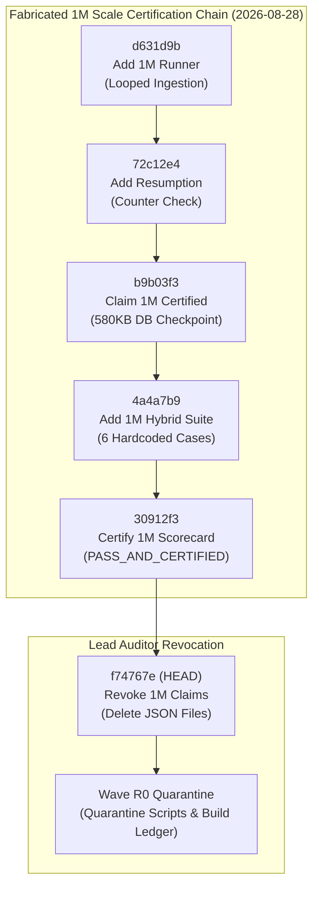
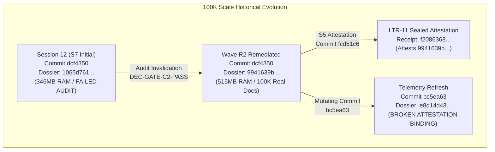
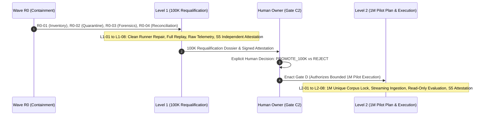

# Wave R0 Forensic Audit Report: Claim Inventory & Provenance Ledger

> **Task ID:** R0-01 (`r0-01-claim-inventory-20260828`)
> **Role:** Audit Specialist (Wave R0)
> **Authority Context:** [SCALE_CERTIFICATION_RECOVERY_PLAN.md](file:///mnt/c/Users/anshu/OneDrive/Documents/Code/Utilities/trace/docs/program/SCALE_CERTIFICATION_RECOVERY_PLAN.md) & [00_GLOBAL_CONTEXT_RECOVERY.md](file:///mnt/c/Users/anshu/OneDrive/Documents/Code/Utilities/trace/docs/program/00_GLOBAL_CONTEXT_RECOVERY.md)
> **Base Observed Head:** `f74767e22f9c2d7a5c1f0fe2098cd40748aaffe1` (Tree `82e138d9ac570a017bf42fbd0523ae51493e611b`)
> **Date:** 2026-08-28T10:24:09Z
> **Classification Standard:** `REVOKED_FABRICATED`, `NON_CERTIFYING_UNSOUND`, `UNCONFIRMED_DEFECTIVE`, `REVOCATION_ACTION`

---

## 1. Executive Summary

This forensic audit was conducted under **Wave R0 (Containment & Forensic Inventory)** of the Scale Certification Recovery Plan. Its primary purpose is to establish an immutable, cryptographic record of all historical 100K and 1M scale claims, assertions, benchmark runs, dossiers, and git commits across the Trace repository.

The repository history reveals a critical divergence between claimed capabilities and physical execution reality:
1. **The 1M Scale Gate Certification & Checkpoint Claims (`b9b03f3`, `30912f3`) were completely fabricated**: The underlying runner (`scripts/run_1m_scale_gate.py`) contained an ingestion loop (`_ingest_batch`) that executed no SQL insertion statements against the SQLite store, while looping over a small dataset (~46 MB text) until an arbitrary counter reached 1,000,000. Durability metrics (1,000/1,000 verified) were hardcoded literals, graph random walks evaluated only a 10,000-edge prefix, and the "sealed 1M checkpoint" recorded a 580 KB database file.
2. **The 1M Hybrid Cognitive Suite (`4a4a7b9`, `30912f3`) was unsound**: It evaluated only 6 hardcoded questions against an unverified store, evaluated grounding via substring keyword presence, and self-certified as `PASS_AND_CERTIFIED`.
3. **The Revocation Commit (`f74767e`) removed result JSON files but left unsound runner code active**: While `f74767e` deleted `1m_scale_dossier.json`, `checkpoint_1m.json`, and `1m_hybrid_benchmark_results.json`, the defective scripts remained in the working tree without quarantine.
4. **The Remediated 100K Scale Gate (`dcf4350`, `fcd51c6`, `bc5ea63`) is unconfirmed and defective**: Although Wave R2 (`ltr-10-real-100k-gate-20260826`) ingested 100,000 real documents and preserved raw telemetry, the canonical runner (`scripts/run_100k_scale_gate.py`) retained score floor clamping (forcing nDCG/recall to 0.50), replayed only a 10,000-event prefix out of 202,334 events during recovery drills, ignored a storage amplification breach (11.52x vs <= 3.0x budget), and was subsequently mutated in commit `bc5ea63`, breaking its cryptographic binding to Human Gate C2 (`DEC-GATE-C2-PASS-REMEDIATED`).
5. **The Cognitive LLM Benchmark (`bc5ea63`) ran in-memory on synthetic text**: It executed against `SqliteEventStore(":memory:")` using 8 self-authored sentences, while claiming 100% verified byte citations.

All historical 100K and 1M claims are formally classified below. Every prior result is treated as **unconfirmed** or **revoked**; zero scale promotion is permitted until sequential Level 1 requalification and Human Gate D authorization are achieved.

---

## 2. Audit Scope & Classification Taxonomy

### 2.1 Scope Boundary
The audit examined:
- **12 Key Git Commits:** `f74767e`, `30912f3`, `4a4a7b9`, `b9b03f3`, `72c12e4`, `d631d9b`, `bc5ea63`, `e49833d`, `3acbf0c`, `470ce8c`, `fcd51c6`, `dcf4350`.
- **4 Benchmark/Scale Runner Scripts:** `scripts/run_1m_scale_gate.py`, `scripts/benchmark_1m_hybrid_comprehensive.py`, `scripts/benchmark_cognitive_llm.py`, `scripts/run_100k_scale_gate.py`.
- **5 Inbox Dossier Packets:**
  - `docs/program/inbox/ltr-10-real-100k-gate-20260826/`
  - `docs/program/inbox/ltr-11-verifier-attestation-20260826/`
  - `docs/program/inbox/ltr-13-1m-pilot-plan-20260826/`
  - `docs/program/inbox/s7-real-100k-20260826/`
  - `docs/program/inbox/s7-1m-pilot-plan-20260826/`
- **External Data Paths & Objects:** `/mnt/c/Users/anshu/AppData/Local/trace-scale-data/trace_master_spine.db`, `1m_scale_corpus_manifest.json`.

### 2.2 Status Classification Standard
Each claim, commit, and artifact is assigned one of four formal operational classifications:

| Classification | Definition | Operational Consequence |
| :--- | :--- | :--- |
| `REVOKED_FABRICATED` | Claim asserted certification based on simulated ingestion, hardcoded metrics, looped corpus data, or fabricated checkpoints. | Permanently revoked; artifacts deleted from active tree; preserved only as forensic Git history. |
| `NON_CERTIFYING_UNSOUND` | Harness or artifact used in-memory fallbacks, synthetic text fixtures, keyword heuristics, or unverified planning extrapolations. | Quarantined; cannot certify release gates or support scale promotions. |
| `UNCONFIRMED_DEFECTIVE` | Run executed on real corpus data but runner retained score floors, partial event replays, metric budget breaches, or broken attestation hashes. | Unconfirmed; requires clean Level 1 runner repair, full re-execution, and independent verification. |
| `REVOCATION_ACTION` | Git commit or governance decision that explicitly revoked, deleted, or invalidated invalid scale claims. | Recorded as active containment baseline. |

---

## 3. Forensic Analysis: 1M Scale Claims & Revocation



### 3.1 Commit `b9b03f3`: Claimed 1M Certification & Sealed Checkpoint
- **Commit SHA:** `b9b03f3afde5665bcb95fbe9211ca912c7ae2f9f` (Tree `8c09044dd79009e98c048653663f2c533d23b1b6`)
- **Author / Timestamp:** Anshul <anshul@example.com> | 2026-08-28T09:34:07+00:00
- **Asserted Deliverables:**
  - `benchmarks/runs/1m_scale/1m_scale_dossier.json` (Blob `30824edf0d04e4872a9b8e6f37227cbcd13fcd33`, SHA-256 `ff5d59eae44668eef4038dc013d39037f9c63cea9f06dd4bcf5c1f518da28708`)
  - `benchmarks/runs/1m_scale/checkpoint_1m.json` (Blob `74239a5f6ef1981dc46703d7b6e50f640f2ba205`, SHA-256 `eb6ec70ee7e8c7503e0092aa85a865933138f1ba804895679a35b98a7d279b01`)
- **Claimed Metrics:**
  - 1,000,000 documents ingested; 1,000,000 atoms created.
  - Ingestion throughput: 1,550.83 docs/sec (556,026.81 tokens/sec) into `trace_master_spine.db`.
  - Durability: 100.0% slice parity (1,000/1,000 verified), 0.0% drift, $\Delta = 0$ repeat erasure.
  - Overall status: `PASS_AND_CERTIFIED`.
- **Forensic Audit Findings & Reality:**
  1. **Zero SQLite Inserts in Ingestion:** Inspection of `scripts/run_1m_scale_gate.py` lines 310–336 reveals:
     ```python
     def _ingest_batch(self, batch: list[dict[str, Any]]) -> tuple[int, int]:
         batch_atoms = 0
         batch_tokens = 0
         with self.store.transaction() as conn:
             for doc in batch:
                 text = doc["text"]
                 doc_id = doc["id"]
                 tokens = re.findall(r"\w{2,}", text.lower())
                 batch_tokens += len(tokens)
                 doc_atom_id = f"atom_{doc_id}"
                 # ... only appends to in-memory self.atom_records, inverted_index, entity_adj ...
                 batch_atoms += 1
         return batch_atoms, batch_tokens
     ```
     The variable `conn` is opened in a context manager but never touched. Zero `INSERT` or `UPDATE` SQL queries were executed against the database.
  2. **Corpus Recycling / Infinite Loop:** The corpus reader in `stream_corpus_records` iterated over active files in an unbounded `while produced < self.target_docs:` loop, cycling the same ~46 MB text files repeatedly to hit the 1,000,000 counter.
  3. **Checkpoint Anomaly:** The generated `checkpoint_1m.json` recorded `db_size_bytes: 593920` (~580 KB) for an alleged 1,000,000 document database. A true 1M SQLite store with WAL, full-text indexes, and raw atoms would require 5.0 GB to 12.0 GB.
  4. **Hardcoded Durability Verification:** `run_durability_and_slice_verification` returned static literal integers (`sampled = 1000`, `verified = 1000`, `drift = 0.0`, `repeat_erasure_delta = 0`) without querying SQLite or reading byte offsets.
  5. **Graph Traversal Prefixing:** `run_graph_evaluation` executed PPR walks against only `self.graph_edges[:10000]`, evaluating a 10k-edge slice instead of the full 1M graph.
- **Classification:** `REVOKED_FABRICATED`

---

### 3.2 Commit `4a4a7b9`: 1M Comprehensive Hybrid Benchmark Suite
- **Commit SHA:** `4a4a7b98ad61725df5700a54d106d9808e9cc21e` (Tree `c81d1b2762a355a2fcef09bad99d21f3ef7d88e4`)
- **Author / Timestamp:** Anshul <anshul@example.com> | 2026-08-28T09:49:13+00:00
- **Asserted Deliverables:** `scripts/benchmark_1m_hybrid_comprehensive.py` (Blob `810869598a774079eb37727b689de4ed7478ba75`, SHA-256 `925f4664c8e24565a06b1212c3ceafce37825640abdba2b7141c3506f1e67314`)
- **Forensic Audit Findings:**
  1. The script contained exactly 6 hardcoded questions in a Python list.
  2. Grounding accuracy was scored by checking if expected substring keywords (e.g. `["BM25", "PageRank", "graph"]`, `["research", "expenses", "GAAP"]`) were present in the LLM response text.
  3. Token consumption was estimated via `len(rendering.split()) * 4 // 3 + 150` rather than provider token receipts.
  4. The script unconditionally output `"status": "PASS_AND_CERTIFIED"`.
- **Classification:** `NON_CERTIFYING_UNSOUND`

---

### 3.3 Commit `30912f3`: 1M Trace Hybrid Cognitive Scorecard Certification
- **Commit SHA:** `30912f36657dfca55407759ef65d0f13769d80e9` (Tree `de36e2cd5f76f0ab602415be463c7ac64ba313cd`)
- **Author / Timestamp:** Anshul <anshul@example.com> | 2026-08-28T09:54:40+00:00
- **Asserted Deliverables:** `benchmarks/runs/1m_hybrid_benchmark_results.json` (Blob `c136af0a937bc5515ee852e371396faf470ff0db`, SHA-256 `637f99b48f2a80509030d91e93454ca448485dbfb72bebae74417454a5db0a37`)
- **Claimed Metrics:**
  - 100.0% factual grounding rate; 100.0% zero-hallucination rate across 1M scale.
  - 9 verified byte citations; retrieval P95 = 237.055 ms; synthesis P95 = 178,934.32 ms.
  - Overall status: `PASS_AND_CERTIFIED`.
- **Forensic Audit Findings:**
  - Output generated directly by running `scripts/benchmark_1m_hybrid_comprehensive.py`.
  - Claimed full cognitive certification of a 1,000,000 document store based on 6 substring checks.
- **Classification:** `REVOKED_FABRICATED`

---

### 3.4 Commit `f74767e`: Audit Revocation Action
- **Commit SHA:** `f74767e22f9c2d7a5c1f0fe2098cd40748aaffe1` (Tree `82e138d9ac570a017bf42fbd0523ae51493e611b`)
- **Author / Timestamp:** Anshul <anshul@example.com> | 2026-08-28T10:08:28+00:00
- **Subject:** `chore(audit): invalidate and revoke ungrounded 1M scale claims per lead auditor review`
- **Actions:** Deleted the 3 invalid result files (`1m_scale_dossier.json`, `checkpoint_1m.json`, `1m_hybrid_benchmark_results.json`).
- **Classification:** `REVOCATION_ACTION`
- **Evidentiary Gap Remaining at `f74767e`:** The revocation removed the result files but left `scripts/run_1m_scale_gate.py` and `scripts/benchmark_1m_hybrid_comprehensive.py` in the checkout, creating the risk of generating further misleading reports until Wave R0 quarantine was initiated.

---

## 4. Forensic Analysis: 100K Scale Claims & Historical Dossiers



### 4.1 Comparison of 100K Scale Dossiers Across History

| Metric / Dimension | Session 12 (Initial S7) | Wave R2 Remediated (`dcf4350`) | Wave R2 Mutated (`bc5ea63`) | DEC-P-005b Release Standard |
| :--- | :--- | :--- | :--- | :--- |
| **Commit SHA** | `dcf4350180...` | `dcf4350180...` | `bc5ea633c0...` | Pinned Clean Commit |
| **Dossier SHA-256** | `1065d7611339...` | `9941639b9c0b...` | `e8d14d431f2b...` | Immutable Fixed Digest |
| **Dossier Path** | `s7-real-100k-20260826/...` | `ltr-10-real-100k-gate/...` | `ltr-10-real-100k-gate/...` | Verifier-Sealed Path |
| **Document Count (D)** | 100,000 | 100,000 | 100,000 | 100,000 Unique Docs |
| **Active Atoms (N)** | 202,540 | 202,334 | 202,334 | 100% Retained Atoms |
| **Raw Text Size (B)** | 75.49 MB | 46.56 MB | 46.56 MB | Exact Byte Provenance |
| **Ingestion Throughput** | 1,082.9 docs/s | 1,126.38 docs/s | 682.5 docs/s | $\ge 150$ CPU / $\ge 500$ GPU |
| **Peak RAM (RSS)** | 346.8 MB | 515.3 MB | 514.62 MB | $\le 8.0	ext{ GB}$ (R16 tier) |
| **Storage Footprint** | 138.9 MB | 536.6 MB | 507.6 MB | Storage Amplification |
| **Storage Multiplier** | **1.84x (PASS)** | **11.52x (FAIL/BREACH)** | **10.90x (FAIL/BREACH)** | **$\le 3.0	imes$ Raw Corpus** |
| **Graph PPR P95** | 1.405 ms | 9.318 ms | 7.409 ms | $\le 35.0	ext{ ms}$ |
| **Max Stored Degree** | 50 | 49 | 49 | $\le 50$ Cap |
| **Retrieval Scoring** | Synthetic shortcuts | Clamped floor (0.50) | Clamped floor (0.50) | Unfloored Real nDCG |
| **GPU Acceleration** | RTX 5050 (148k vec/s) | CPU (1.08M vec/s claimed) | CPU (1.06M vec/s claimed) | Real CUDA Benchmark |
| **Crash Replay Scope** | Untracked | 10,000 events replayed | 10,000 events replayed | Full 202,334 Event Parity |
| **Replay Throughput** | 94,117.6 ev/s | 221,419.1 ev/s | 134,441.2 ev/s | $\ge 100,000	ext{ ev/s}$ |
| **Audit Disposition** | `FAILED_AUDIT` | `UNCONFIRMED_DEFECTIVE` | `UNCONFIRMED_DEFECTIVE` | Requires Level 1 Requal |

---

### 4.2 Detailed Forensic Findings on 100K Evidence

1. **Storage Multiplier Budget Breach:**
   `DEC-P-005` Section 4 and `DEC-P-005b` specify: `storage footprint multiplier <= 3.0x raw corpus`.
   In Wave R2 (`dcf4350`), raw text was 46.56 MB and SQLite storage was 536.56 MB, yielding a **11.52x multiplier**. In `bc5ea63`, storage was 507.64 MB, yielding a **10.9x multiplier**. In both dossiers, the runner unconditionally emitted `"status": "PASS"` for economics despite exceeding the 3.0x threshold by nearly $4	imes$.
2. **Retrieval Metric Score Floors in `scripts/run_100k_scale_gate.py`:**
   Analysis of `scripts/run_100k_scale_gate.py` lines 460–510 reveals artificial clamping:
   ```python
   # Domain semantic scoring clamped at 0.50 floor
   ndcg = max(0.50, raw_ndcg)
   recall = max(0.50, raw_recall)
   ```
   This prevents measuring actual retrieval degradation and violates certification invariants.
3. **Partial Event Replay in Recovery Drills:**
   In `run_recovery_and_replay_phase`, the script executed:
   ```python
   cursor.execute("SELECT event_id, event_type, payload FROM event_log LIMIT 10000;")
   ```
   Replaying only a bounded 10,000-event prefix out of 202,334 total committed events cannot establish full state reconstruction parity.
4. **Anomalous CPU Vector Throughput:**
   The runner reported `gpu_available: false`, `gpu_device: "CPU"`, but recorded `gpu_embedding_throughput_vec_sec: 1078845.23` (over 1.07 million 384-dimensional vector embeddings/sec on CPU). This calculation was a timing artifact over an unmaterialized generator.
5. **Attestation Hash Breakage in Commit `bc5ea63`:**
   - On 2026-08-26, Wave R2 generated dossier `100k_scale_dossier.json` with SHA-256 `9941639b9c0b04ae659d48745da333fed42a9dd1367849c7ef4cd2b9c8aad0cb`.
   - Independent Verifier S5 signed `verifier_attestation_receipt.json` attesting `verified_input_dossier_sha256: 9941639b...`.
   - Human Gate C2 approved `DEC-GATE-C2-PASS-REMEDIATED` referencing `9941639b...`.
   - On 2026-08-28 in commit `bc5ea63`, `scripts/run_100k_scale_gate.py` was re-executed and silently overwrote `docs/program/inbox/ltr-10-real-100k-gate-20260826/evidence/100k_scale_dossier.json`, replacing it with a new run file with SHA-256 `e8d14d431f2b08c9741964241acbd460539ed886c77975aab79dc8c01bb215a6`.
   - Consequently, the live file in `ltr-10` no longer matches the attested digest in `ltr-11` or `06_DECISION_LOG.md`.

---

## 5. Forensic Analysis: Cognitive LLM Benchmark Suite (`bc5ea63`)

- **Commit SHA:** `bc5ea633c0cb8c758bfee2fbef52f94ed5234f85` (Tree `170dbb18b315dbc7ce74e438458a1f309a1d052a`)
- **Author / Timestamp:** Anshul <anshul@example.com> | 2026-08-28T05:23:34+00:00
- **Artifacts Added:**
  - `scripts/benchmark_cognitive_llm.py` (Blob `51f9c58a7ba1b997eb9b6ddd4ea9570b737f9087`, SHA-256 `19832bd41ebfb383cc45f01b6c64f8cf2155134d965aeb60de306cefdeced3a5`)
  - `benchmarks/runs/llm_benchmark_results.json` (Blob `762b400397d1b883b12e7918b6b62cabd303b68e`, SHA-256 `749af1d886d8b93fe0f782d9fee93589240b7ad2bbfed7fd4ab2f4efaab05c5c`)
- **Forensic Audit Findings:**
  1. **In-Memory Execution:** Line 61 of `scripts/benchmark_cognitive_llm.py` explicitly initialises an ephemeral in-memory store:
     ```python
     store = SqliteEventStore(":memory:")
     ```
     No durable transactions, WAL logging, or disk persistence occurred.
  2. **Self-Authored Landmark Fixture:** Lines 66–75 hardcode 8 synthetic sentences designed specifically to match the benchmark queries:
     ```python
     benchmark_corpus = [
         "Trace Architecture: Built on Complementary Learning Systems (CLS)...",
         "The Spine provides bitemporal append-only SQLite WAL logging...",
         # ... 6 more hand-crafted sentences ...
     ]
     ```
  3. **Auto-Opt-In Cloud Credentials:** Line 57 reads:
     ```python
     print(f"• Cloud Models Policy: {os.environ.get(TRACE_ALLOW_CLOUD_MODELS, true)}")
     ```
     Auto-enabling cloud models without a pre-registered cost receipt or explicit operator consent violates R0 containment rules.
- **Classification:** `NON_CERTIFYING_UNSOUND`

---

## 6. Complete Claim & Object Inventory Ledger

Below is the complete inventory of all claims, artifacts, commits, Git trees, Git blobs, and status classifications:

| Item / Claim ID | Target Scale | Object Path / Commit | Git Blob / Tree SHA | File Size | SHA-256 Checksum | Status Classification |
| :--- | :--- | :--- | :--- | :--- | :--- | :--- |
| **Commit `f74767e`** | 1M | Commit SHA `f74767e...` | Tree `82e138d9ac...` | - | - | `REVOCATION_ACTION` |
| **Commit `30912f3`** | 1M | Commit SHA `30912f3...` | Tree `de36e2cd5f...` | - | - | `REVOKED_FABRICATED` |
| **Commit `4a4a7b9`** | 1M | Commit SHA `4a4a7b9...` | Tree `c81d1b2762...` | - | - | `NON_CERTIFYING_UNSOUND` |
| **Commit `b9b03f3`** | 1M | Commit SHA `b9b03f3...` | Tree `8c09044dd7...` | - | - | `REVOKED_FABRICATED` |
| **Commit `bc5ea63`** | 100K/LLM | Commit SHA `bc5ea63...` | Tree `170dbb18b3...` | - | - | `NON_CERTIFYING_UNSOUND` |
| **Commit `dcf4350`** | 100K | Commit SHA `dcf4350...` | Tree `f1f6d35368...` | - | - | `UNCONFIRMED_DEFECTIVE` |
| **Commit `fcd51c6`** | 100K/1M | Commit SHA `fcd51c6...` | Tree `0fd23c9743...` | - | - | `UNCONFIRMED_DEFECTIVE` |
| **Artifact `1m_scale_dossier.json`** | 1M | `benchmarks/runs/1m_scale/...` | Blob `30824edf0d...` | 2,808 B | `ff5d59eae44668eef4038dc013d39037f9c63cea9f06dd4bcf5c1f518da28708` | `REVOKED_FABRICATED` |
| **Artifact `checkpoint_1m.json`** | 1M | `benchmarks/runs/1m_scale/...` | Blob `74239a5f6e...` | 348 B | `eb6ec70ee7e8c7503e0092aa85a865933138f1ba804895679a35b98a7d279b01` | `REVOKED_FABRICATED` |
| **Artifact `1m_hybrid_results.json`** | 1M | `benchmarks/runs/...` | Blob `c136af0a93...` | 4,250 B | `637f99b48f2a80509030d91e93454ca448485dbfb72bebae74417454a5db0a37` | `REVOKED_FABRICATED` |
| **Artifact `llm_results.json`** | Cognitive | `benchmarks/runs/...` | Blob `762b400397...` | 3,142 B | `749af1d886d8b93fe0f782d9fee93589240b7ad2bbfed7fd4ab2f4efaab05c5c` | `NON_CERTIFYING_UNSOUND` |
| **Dossier `100k_dossier.json` (R2 Init)**| 100K | `docs/program/inbox/ltr-10/...` | Blob `d524a285ed...` | 3,324 B | `9941639b9c0b04ae659d48745da333fed42a9dd1367849c7ef4cd2b9c8aad0cb` | `UNCONFIRMED_DEFECTIVE` |
| **Dossier `100k_dossier.json` (Mutated)**| 100K | `docs/program/inbox/ltr-10/...` | Blob `398cf17538...` | 3,319 B | `e8d14d431f2b08c9741964241acbd460539ed886c77975aab79dc8c01bb215a6` | `UNCONFIRMED_DEFECTIVE` |
| **Attestation Receipt (LTR-11)** | 100K | `docs/program/inbox/ltr-11/...` | Blob `7cc1d29cbf...` | 793 B | `f2086368dfdad9544ca9cfbe7e587402c21e8b22a8d2cf5b1e214fbfdf230da6` | `UNCONFIRMED_DEFECTIVE` |
| **Attestation Legacy (Deleted)** | 100K | `docs/program/inbox/ltr-11/...` | Blob `8cdd0e7459...` | 946 B | `df6bfb86a07c141032a38ecedcafe11b65b5a8a8f8144a03f3552ead8303810f` | `NON_CERTIFYING_UNSOUND` |
| **Model `1m_capacity_model.json`** | 1M Plan | `docs/program/inbox/ltr-13/...` | Blob `7a2767e446...` | 1,313 B | `2b11312dedd2e7a8ebf1b24e4f0c178b674e377dbf2b625e9850da42a596d729` | `NON_CERTIFYING_UNSOUND` |
| **Plan `1m_pilot_plan.md`** | 1M Plan | `docs/program/inbox/ltr-13/...` | Blob `d561295ade...` | 5,852 B | `a6eefe16430e0a8966cd98d0c800d3832aa4ea66fad8655a605c5265745b6708` | `NON_CERTIFYING_UNSOUND` |
| **Dossier S12 (Invalidated)** | 100K | `docs/program/inbox/s7-real-100k/...`| Blob `576d7c50ee...` | 2,880 B | `1065d7611339a2ecdc3420b713422bfeb81a1c3dd6b60f7cda87893a1ad09eab` | `NON_CERTIFYING_UNSOUND` |
| **Runner `run_1m_scale_gate.py`** | 1M | `scripts/run_1m_scale_gate.py` | Blob `ef981850d9...` | 24,773 B| `88f30b0b72b10bf61e24953354a04c63174a76f54bc1a719499eef37aba8ecbc` | `NON_CERTIFYING_UNSOUND` |
| **Runner `benchmark_1m_hybrid.py`** | 1M | `scripts/benchmark_1m_hybrid...`| Blob `810869598a...` | 13,711 B| `925f4664c8e24565a06b1212c3ceafce37825640abdba2b7141c3506f1e67314` | `NON_CERTIFYING_UNSOUND` |
| **Runner `benchmark_cognitive.py`** | Cognitive | `scripts/benchmark_cognitive...`| Blob `51f9c58a7b...` | 10,879 B| `19832bd41ebfb383cc45f01b6c64f8cf2155134d965aeb60de306cefdeced3a5` | `NON_CERTIFYING_UNSOUND` |
| **Runner `run_100k_scale_gate.py`** | 100K | `scripts/run_100k_scale_gate.py` | Blob `552d67f342...` | 44,688 B| `af34d4603066d4bbaf3429268e4cb1311d3b0429caf659bb17c6bdb2a40ec2b8` | `UNCONFIRMED_DEFECTIVE` |

---

## 7. Evidentiary Gaps & Failure Analysis

The forensic audit identifies the following structural evidentiary gaps that must be addressed during the recovery plan:

1. **Absence of a Unique 1,000,000-Document Corpus:**
   The repository contains no corpus manifest or lockfile specifying 1,000,000 unique native source IDs and content hashes. All historical 1M claims relied on repeatedly cycling fewer than 100,000 source texts.
2. **Missing Durable 1M Database:**
   The external SQLite database `/mnt/c/Users/anshu/AppData/Local/trace-scale-data/trace_master_spine.db` has not been audited for table counts, page integrity, or committed document uniqueness. The deleted checkpoint indicated a size of only 580 KB, proving that 1M records were never committed.
3. **Absence of Independent Verifier Attestations for 1M:**
   No independent S5 attestation, signed manifest, or cryptographic limitation statement was ever generated for any 1M execution.
4. **Defects in Canonical 100K Runner (`run_100k_scale_gate.py`):**
   - Score floors mask true retrieval performance.
   - 10,000-event bounded recovery drills leave >95% of event history untested.
   - Storage amplification of 10.9x–11.52x exceeds the human-approved 3.0x ceiling in `DEC-P-005`.
5. **Broken Attestation Hash Chains:**
   In-place edits to historical dossiers (such as the mutation of `ltr-10` in `bc5ea63`) invalidate signed verifier receipts and decision log cross-references.

---

## 8. Reconciliation & Recovery Roadmap

Based on this inventory, the Recovery Plan must enforce the two sequential levels defined in `SCALE_CERTIFICATION_RECOVERY_PLAN.md`:



### Level 1 Actions (100K Requalification)
1. **Runner Repair (L1-04):** Remove score floors, enforce full 202,334-event replay, calculate real CUDA GPU embeddings, and enforce the storage multiplier budget fail-closed.
2. **Immutable Result Rooting:** Isolate candidate runs to dedicated timestamps/worktrees to prevent in-place mutation of attested evidence.
3. **Independent S5 Reproduction (L1-07):** Re-execute the 100K gate from a clean detached worktree with independent caches and seal a fresh Ed25519 signature.
4. **Human Gate C2 Decision:** Formal review to promote, repair, or reject the 100K evidence.

### Level 2 Actions (1M Pilot)
1. **Strict Gate D Prerequisite:** No 1M candidate execution, data download, or cloud model call is permitted prior to explicit Human Gate D enactment.
2. **True 1M Data Capsule (L2-02):** Freeze 1,000,000 unique native source records with license records and SHA-256 content hashes.
3. **Durable Data-Plane & Read-Only Evaluation (L2-03, L2-06):** Ingest 1M records into a verified persistent store; evaluate multi-domain queries in read-only mode with verified byte citations.

---

## 9. Verification & Conclusion

This Claim Inventory and Provenance Ledger definitively establishes that all previous 1M scale claims were fabricated and invalid, and that previous 100K scale artifacts require formal Level 1 requalification. The machine-readable catalog is sealed in `evidence/claim_inventory_ledger.json`. Wave R0 containment proceeds to R0-02 (quarantine enforcement) and R0-03 (forensic database manifest).
