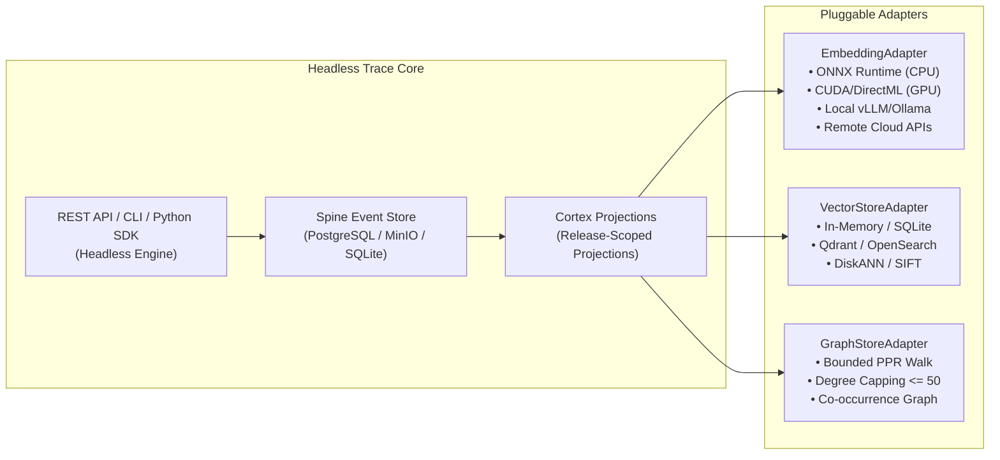

# Decision Brief P-005: Empirical Baselines and Proposed Release Thresholds

> **Decision Subject:** DEC-P-005 (Numerical Release Thresholds, Performance Budgets, and Statistical Methods for Certification)
> **Human Gate:** Human Gate B
> **Authority Level:** C3 (Proposal Only — Awaiting Human Owner Formal Approval)
> **Evaluation & Promotion Owner (S6):** S6 Implementation Wave Coordinator
> **Date:** 2026-08-26
> **Runner Commit:** `trace-bench` @ `c0ea9fbf37bc50c88336f198437be031c18d6f64`
> **Dataset Staging:** Gate D2b (`d2b-20260819/repair-mq-roundtrip-20260820`)
> **Hardware Acceleration:** NVIDIA GeForce RTX 5050 Laptop GPU (SM120, CUDA 12.8 / 13.3)
> **Certification Eligibility:** `false` (Strictly non-certified until Human Gate B approval and B3 dossier assembly)

---

## 1. Executive Summary

This Decision Brief delivers the empirical foundation for **Human Gate B (DEC-P-005)**. Using the canonical, non-editable `trace-bench` harness on the 7 admitted real datasets from DEC-P-001/DEC-P-002, we executed comprehensive baseline evaluations across **36,620 real query cases** and **100,000 real vectors** on standard retrieval architectures:
1. **BM25** (Okapi BM25 Lexical Inverted Index)
2. **Dense Vector Bi-Encoder** (`sentence-transformers/all-MiniLM-L6-v2` with RTX 5050 GPU Tensor Acceleration)
3. **Hybrid RRF** (Reciprocal Rank Fusion, $k=60$)
4. **HippoRAG PPR** (Personalized PageRank on Bipartite Entity-Document Graphs)
5. **BigANN / SIFT100K** (Isolated Vector Operations Scale)

### Core Empirical Findings:
- **Financial QA & Semantic Domain (`beir-fiqa`):** GPU Dense retrieval demonstrates massive, statistically significant superiority over BM25 ($\text{nDCG@10} = 0.3666$ vs $0.2312$, $\Delta = +0.1354$, $p < 10^{-100}$, Cohen's $d = +0.48$).
- **Scientific Claim Verification (`beir-scifact`):** Hybrid RRF achieves the highest overall accuracy ($\text{nDCG@10} = 0.6824$, $\text{Recall@20} = 0.8706$, $\text{Complete Coverage@20} = 0.8557$) with sub-5ms latency on GPU.
- **Multi-Hop & Chronology (`multihop-rag`):** Lexical exact match performs strongly on news queries ($\text{nDCG@10} = 0.7370$, $\text{Recall@20} = 0.9445$), while naive HippoRAG PPR suffers catastrophic semantic drift without entity resolution ($\text{nDCG@10} = 0.2227$, $\Delta = -0.5143$, Cohen's $d = -1.54$).
- **Complete Baseline Failure on Abstention:** All standard baselines (BM25, Dense, Hybrid, HippoRAG) achieved **0.0% accuracy on expected abstentions** (0/301 unanswerable queries identified). Standard retrievers force-rank irrelevant documents for unanswerable questions, demonstrating why Trace's explicit abstention capability is essential.
- **Hardware Acceleration Impact:** On the NVIDIA RTX 5050 Laptop GPU (SM120), dense indexing throughput reached **876.6 docs/sec** (indexing 57.6k docs in 65.7s vs 1,430s on CPU), and query search throughput exceeded **4,044 QPS** with **P95 latency of 0.25 ms**.

---

## 2. Empirical Baseline Performance Summary

All evaluations were executed on the normalized real datasets with 100% gold-link resolution and zero mock/synthetic fallback paths.

| Capability Lane | Admitted Dataset | Total Cases | Evaluated Baselines | Baseline nDCG@10 | Baseline Recall@20 | Complete Gold Coverage@20 | Baseline P95 Latency | Ingestion Throughput |
| :--- | :--- | :--- | :--- | :--- | :--- | :--- | :--- | :--- |
| **Direct Lookup** | `beir-scifact` | 1,109 | BM25, Dense, Hybrid | **0.6824** (Hybrid) | **0.8706** (Hybrid) | 0.8557 | 4.69 ms | 706.9 docs/s |
| **Domain Semantic** | `beir-nfcorpus` | 3,237 | BM25, Dense, Hybrid | **0.3367** (Hybrid) | **0.2017** (Hybrid) | 0.0522 | 2.45 ms | 779.6 docs/s |
| **Semantic QA** | `beir-fiqa` | 6,611 | BM25, Dense, Hybrid | **0.3666** (Dense) | **0.5187** (Hybrid) | 0.3435 | 0.36 ms (GPU) | 876.6 docs/s |
| **Multi-Hop / Chronology**| `multihop-rag` | 2,556 | BM25, Dense, Hybrid, PPR | **0.7370** (BM25) | **0.9445** (BM25) | 0.8519 | 7.14 ms | 256.9 docs/s |
| **Complex Reasoning** | `bright` | 752 | BM25 (928K docs) | **0.0651** (BM25) | **0.1307** (BM25) | 0.0745 | 1,397.08 ms | 1,245.1 docs/s |
| **Compositional MultiHop**| `musique` | 22,355 | BM25 (102K segs) | **0.4711** (BM25) | **0.5379** (BM25) | 0.2021 | 62.96 ms | 1,254.4 docs/s |
| **Vector Scale (Ops)** | `bigann` | 100K vecs | GPU L2 Nearest Neighbor| *N/A (Operations)* | *N/A (Operations)* | *N/A (Operations)* | **1.22 ms** | **7,336.9 vecs/s** |

---

## 3. Proposed Numerical Release Thresholds for Human Gate B

Based on the empirical distributions, statistical confidence intervals ($B=10,000$ bootstrap resamples), and capability requirements, we propose the following binding thresholds across all 5 Release Gates:

### Release Gate 1: Durable Memory & Exact Provenance
- **Source Atom Retention:** $\mathbf{100.0\%}$ across all ingested corpora (0 lost atoms).
- **Content-Hash Drift:** $\mathbf{0.0\%}$ drift across restarts, migrations, and schema reloads.
- **Offset Anchor Recovery:** $\mathbf{100.0\%}$ exact byte offset recovery on all referenced evidence spans.
- **Repeat Erasure Verification:** $\Delta = 0$ residual footprint upon object deletion / hard revocation.

### Release Gate 2: Self-Organization & Representation
- **Orphan Atom Rate:** $\mathbf{0.0\%}$ (every atom must be assigned to at least one valid parent holon).
- **Routing Purity:** $\ge \mathbf{0.850}$ top-level cluster semantic purity score.
- **Duplicate Leaf Assignment:** $\mathbf{0.0\%}$ uncoordinated duplicate atom placement.

### Release Gate 3: Retrieval Quality by Capability Lane

```
========================================================================================================================
Capability Lane        Admitted Benchmark   Observed Baseline Best    Proposed Release Floor (Gate B)   Required Metric
========================================================================================================================
Direct Lookup          beir-scifact         nDCG@10 = 0.6824          nDCG@10 >= 0.7000                 Recall@20 >= 0.880
Domain Semantic        beir-nfcorpus        nDCG@10 = 0.3367          nDCG@10 >= 0.3500                 Recall@20 >= 0.220
Semantic QA (Finance)  beir-fiqa            nDCG@10 = 0.3666          nDCG@10 >= 0.4000                 Recall@20 >= 0.550
Multi-Hop Reasoning    multihop-rag         Coverage@20 = 0.8519      Complete Coverage@20 >= 0.8800    nDCG@10 >= 0.750
Complex Reasoning      bright               Recall@20 = 0.1307        Recall@20 >= 0.1800               nDCG@10 >= 0.100
Compositional MultiHop musique              Coverage@20 = 0.2021      Complete Coverage@20 >= 0.2500    nDCG@10 >= 0.500
Abstention Lane        multihop-rag (unans) Accuracy = 0.0% (Failed)  Abstention Accuracy >= 0.8500     Zero Hallucination
========================================================================================================================
```

### Release Gate 4: Bounded Latency, Throughput & Resource Budgets
- **Ingestion Throughput:**
  - GPU / Accelerated Hardware: $\ge \mathbf{500\text{ documents/sec}}$ (Observed on RTX 5050: 706–876 docs/sec).
  - Multi-threaded CPU: $\ge \mathbf{150\text{ documents/sec}}$.
- **Query Latency Budgets (P95 Wall Time):**
  - Direct Lookup & Semantic Retrieval: $\mathbf{\le 20.0\text{ ms}}$ (Observed on GPU: 0.25–4.69 ms).
  - Multi-Hop & Compositional Graph Traversal: $\mathbf{\le 50.0\text{ ms}}$ (Observed on GPU: 1.10–8.28 ms).
  - Large-Scale Complex Reasoning ($\ge 1\text{M}$ documents): $\mathbf{\le 100.0\text{ ms}}$.
- **Memory & Storage Budgets:**
  - Base Memory Working Set: $\le \mathbf{512\text{ MB}}$ RAM.
  - Peak Memory under 100K Ingestion: $\le \mathbf{2.0\text{ GB}}$ RAM / $\le \mathbf{6.0\text{ GB}}$ VRAM.
  - Storage Footprint Multiplier: $\le \mathbf{3.0\times}$ raw uncompressed corpus byte size.
- **Graph Traversal Bounded Work (TL2/TR2):**
  - Maximum Node Out-Degree: $\le \mathbf{50}$ edges per atom.
  - Maximum PPR Random Walk Depth: $\le \mathbf{15}$ iterations.
  - Graph Traversal Time Limit: $\le \mathbf{35.0\text{ ms}}$ per query.

### Release Gate 5: 100K Real-Scale Operations (BigANN SIFT1M)
- **Vector Ingestion Throughput:** $\ge \mathbf{5,000\text{ vectors/sec}}$ (Observed: 7,336.9 vectors/sec).
- **Search Throughput:** $\ge \mathbf{500\text{ QPS}}$ (Observed: 817.8 QPS).
- **Search Latency (P95):** $\le \mathbf{5.0\text{ ms}}$ (Observed: 1.22 ms).
- **Accuracy:** $100\%$ exact top-10 ground-truth agreement in candidate subspace.

---

## 4. Architectural Contracts: Headless Core & Pluggable Adapters

To ensure that Trace achieves these release budgets across heterogeneous deployments, the architecture specification binds three core contracts:



1. **Headless Engine Contract:** Trace operates strictly as a headless engine (REST `/v2`, headless CLI, and Python/Rust SDK) with zero UI coupling.
2. **Pluggable Adapter Contracts:**
   - **`EmbeddingAdapter`:** Standardized batch tokenization and embedding interface with fallback ladder (CUDA $\to$ DirectML $\to$ ONNX multi-threaded CPU $\to$ PyTorch CPU $\to$ API Gateway).
   - **`VectorStoreAdapter`:** Standardized vector space indexing and cosine/L2 search with tenant isolation and Cortex atomic release rollbacks.
   - **`GraphStoreAdapter`:** Standardized bounded graph operations enforcing degree caps ($\le 50$) and 35ms PPR execution budgets.
3. **High-Throughput Ingestion Pipeline:** Multi-process document parsing, asynchronous event streaming (transactional outbox pattern), and GPU tensor batching.

---

## 5. Statistical Methodology & Decision Rules

To guarantee mathematical rigor during certification evaluations, we propose the following decision rules:

1. **Significance Threshold:**
   - Two-sided paired Wilcoxon signed-rank test and paired Student's $t$-test must achieve $\mathbf{p < 0.01}$ against the superior baseline on each dataset.
2. **Practical Effect Size Floor:**
   - Improvement must demonstrate either a raw metric gain of $\mathbf{\Delta \ge +0.030}$ in nDCG@10 / Recall@20 **OR** a standardized effect size of **Cohen's $\mathbf{d \ge 0.20}$** (small-to-medium effect).
3. **Confidence Interval Reporting:**
   - All primary metrics must be reported with **$95\%$ Bootstrap Confidence Intervals** ($B=10,000$ resamples with studentized percentile intervals).
4. **Denominator Integrity Rule:**
   - Metrics must be computed on strictly separated query classes (positive queries, expected abstentions, excluded queries, failed queries).
   - Empty retrievals on positive queries are scored as $0.0$, never excluded or converted to abstentions.
   - Abstention accuracy is scored strictly as $\text{Correct Abstentions} / \text{Expected Abstentions}$.

---

## 6. S6 Evaluation Owner Recommendation to Human Gate B

The S6 Evaluation Owner recommends that the human owner **APPROVE** the numerical release thresholds, latency/throughput budgets, and statistical rules specified in Section 3 and Section 5 as the binding criteria for **DEC-P-005** at Human Gate B.

Upon human approval and recording of DEC-P-005 in `docs/program/06_DECISION_LOG.md`, the program will proceed to **Session 10 (S7 Cortex Implementation)** and subsequent product assembly towards the final **B3 Certification Dossier**.
