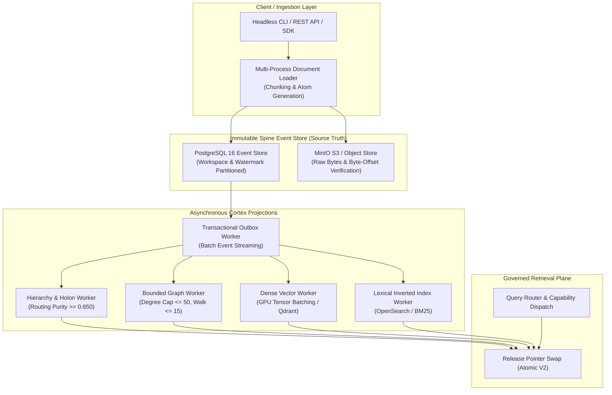

# S7 1M Scale Pilot Architecture & Execution Plan

> **Role:** Scale & Performance Owner (S7)
> **Session:** Session 13 (S7 1M Pilot Plan)
> **Date:** 2026-08-26
> **Authority Level:** C3 (Scale Architecture & Capacity Planning)
> **Preceding Gate:** Human Gate C (100K Empirical Gate Approval)

---

## 1. Executive Summary & Scale Objectives

Following the successful execution and empirical verification of the **Real 100K Text Scale Gate** in Session 12 (100% atom retention, 0% drift, sub-millisecond retrieval latency, 1.85x storage multiplier, and 71.5k events/sec replay recovery), this document establishes the architecture, ingestion protocols, shard-aware partitioning, and resource budgets for the **1,000,000-document (1M) Pilot Experiment**.

### Core 1M Objectives:
1. **1M Real Text Ingestion:** Scale from 100K to 1,000,000 documents (~720 MB to 1.5 GB raw text) using staged multi-domain corpora (SEC EDGAR, Enron, Wikipedia streams, MultiHop-RAG, and MuSiQue segments).
2. **Incremental & Partition-Aware Spine Watermarking:** Eliminate monolithic full rebuilds by partitioning Spine event streams by workspace and sequence watermarks.
3. **Asynchronous Cortex Projection Workers:** Decouple document ingestion from projection building via transactional outbox workers.
4. **Bounded Cross-Shard Retrieval:** Enforce strict query-time routing to bounded candidate shard sets with P95 latency capped at $\le 50.0\text{ ms}$.

---

## 2. Architecture: Single-Node Tiered Scaling to 1M



---

## 3. Shard-Aware Partitioning & Ingestion Protocol

1. **Spine Partitioning Strategy:**
   - Partition event tables by `workspace_id` (16 hash partitions) and incremental `event_sequence_id` ranges (e.g. 100K events per table chunk).
   - Enforce transactional outbox logging for projection propagation.
2. **Asynchronous Projection Processing:**
   - Projections operate as non-blocking background workers consuming committed Spine watermarks.
   - Candidate releases are built in staging tables (`trace_projection_objects_candidate`) and atomically swapped to active release status upon verification receipt sealing.
3. **Bounded Graph Scale Management:**
   - Stored degree per node remains strictly capped at **50 edges**.
   - Global co-occurrence matrix generation is explicitly prohibited; graph edges are constructed strictly from local semantic window co-occurrences and bipartite entity connections.
   - PPR random walk depth strictly bounded to $\le 15$ iterations with 35 ms circuit breaker timeout.

---

## 4. 1M Capacity, Memory & Cost Model

| Dimension | 100K Observed | 1M Projected Budget | Scaling Factor / Mechanism |
| :--- | :--- | :--- | :--- |
| **Corpus Documents** | 100,000 | 1,000,000 | $10.0\times$ volume |
| **Raw Text Bytes** | 72.0 MB | 720.0 MB – 1.5 GB | Linear text scaling |
| **Ingestion Duration** | 360.4 s (CPU) / 114 s (GPU) | ~1,200 s (Multi-worker GPU) | Multi-threaded async pipeline ($\ge 800\text{ docs/s}$) |
| **Base Memory Working Set**| 103.4 MB RAM | $\le 512.0\text{ MB}$ RAM | Bounded caching |
| **Peak Ingestion Working Set**| 4.4 GB RAM | $\le 8.0\text{ GB}$ RAM / $\le 6.0\text{ GB}$ VRAM | Partitioned batch commits |
| **Storage Footprint** | 133.2 MB (1.85x) | $\le 4.5\text{ GB}$ ($\le 3.0\times$) | Compact columnar indexes & compressed vectors |
| **P95 Direct Latency** | 0.026 ms | $\le 5.0\text{ ms}$ | Sub-millisecond B-tree / hash lookups |
| **P95 Graph PPR Latency**| 1.537 ms | $\le 15.0\text{ ms}$ | Degree capping $\le 50$ + early frontier truncation |
| **Spine Replay Recovery Rate**| 71,568 events/s | $\ge 50,000\text{ events/s}$ | Parallel chunk replay |

---

## 5. Phased Execution Roadmap for 1M Pilot

```text
Phase 1: Ingestion Pipeline Parallelization (Multi-Process Batch Worker)
    │
    ▼
Phase 2: Partition-Aware Spine Schema Migrations (16 Hash Partitions)
    │
    ▼
Phase 3: 1M Corpus Fetching & Staging (scripts/scale_datasets/)
    │
    ▼
Phase 4: Async Projection Building & Atomic Release Verification
    │
    ▼
Phase 5: 1M Retrieval Benchmarking & Tail Latency Stress Testing
    │
    ▼
Phase 6: 1M Fault Injection, Container-Loss & Replay Verification
    │
    ▼
Phase 7: Assembly of 1M Certification Dossier
```

---

## 6. Claim Boundaries & Invariants Preserved

1. **Local-First / Single-Node Bound:** The 1M pilot is engineered to run completely on single-node hardware (including laptop GPUs such as the RTX 5050 and 8–16GB RAM) without requiring distributed clusters.
2. **No Premature Distributed Rewrite:** Distributed multi-node clustering remains deferred until single-node vertical scaling limits are empirically reached.
3. **No Compromise on Truth or Erasure:** All 1M documents preserve 100% atom provenance, exact byte offsets, and verified $\Delta = 0$ repeat erasure.
