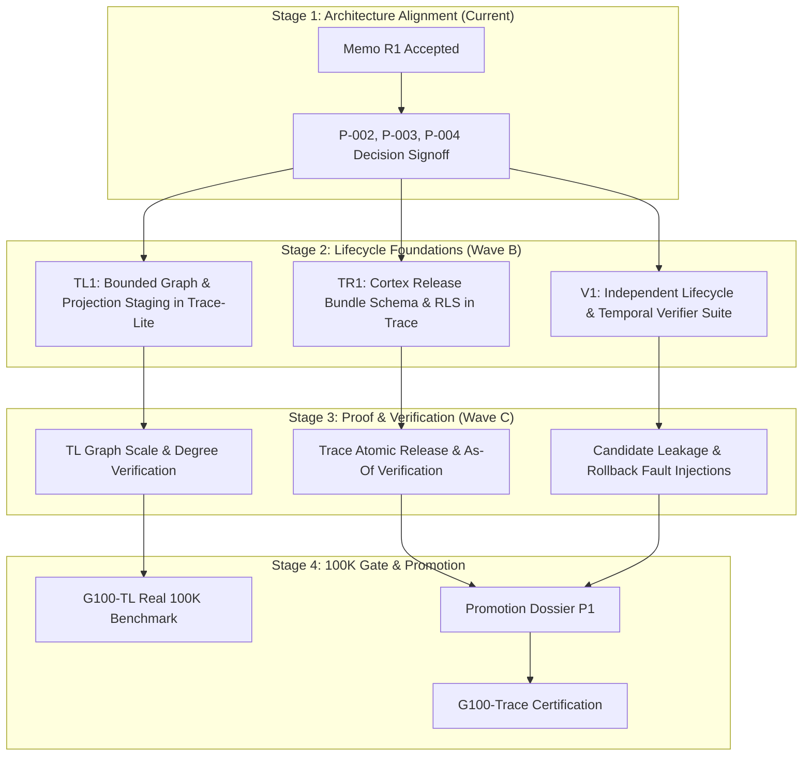

# Research Memo: Cortex Releases, Temporal Truth, and Bounded Activation

- **Document ID:** `MEMO-R1-2026-08-18-01`
- **Task ID:** `trace-program-research-01` (S1 Research)
- **DAG Nodes Addressed:** `R1`, `P-002`, `P-003`, `P-004`
- **Role:** Research Analyst
- **Status:** Completed Research Memo (Decision Support)
- **Target Audience:** Program Coordinator, Lead Architects, Human Decision Reviewer

---

## 1. Question and Decision Relevance

This research memo provides the empirical and analytical decision support needed for three foundational architectural questions in the Trace / Trace-Lite program:

1. **Cortex Release Lifecycle (Decision Target: P-003):** What atomic state machine, immutability metadata, validation protocol, and rollback mechanism are minimally required to ensure derived projections (hierarchies, vector embeddings, lexical indices, affinity graphs) remain isolated from queries during build and can be atomically activated or reverted without corrupting the canonical Spine?
2. **Temporal Truth Semantics (Decision Target: P-004):** What precise distinction between system/transaction time (Spine event offsets) and world/valid time (effective timestamps) must be modeled in source and retrieval contracts to safely handle revision, supersession, historical point-in-time (`as-of`) queries, retraction/revocation, and tombstones?
3. **Typed Bounded Activation & Graph Economics (Decision Target: P-002):** How can query-time spreading activation / Personalized PageRank (PPR) improve multi-hop retrieval recall without causing superlinear graph expansion ($O(N^2)$ edges on frequent terms), stale edge survival across projection builds, or conflating probabilistic retrieval affinity with canonical fact?

### Program Impact and Precedence
Per [01_INVARIANTS.md](file:///C:/Users/anshu/OneDrive/Documents/Code/Utilities/trace/docs/program/01_INVARIANTS.md) and [00_CHARTER.md](file:///C:/Users/anshu/OneDrive/Documents/Code/Utilities/trace/docs/program/00_CHARTER.md), the Spine owns immutable canonical truth, while Cortex owns rebuildable projections. Establishing these three mechanisms correctly in Stage 1 is a hard prerequisite for Stage 2 lifecycle implementation (`TL1`, `TR1`, `V1`) and prevents expensive architectural rewrites during the 100K certification gate (`G100-TL`, `G100-Trace`).

---

## 2. Current-Checkout Facts and Source Anchors

An inspection of the current checkouts across `trace` and `trace-lite` reveals both established architectural foundations and specific implementation gaps:

### 2.1 Trace V2 Anchors (Observed Facts)

| Component | File / Anchor | Current Implemented State (Observed Fact) | Status / Gap Analysis |
| :--- | :--- | :--- | :--- |
| **Cortex Control Plane Schema** | [`migrations/004_cortex_projection_control_plane.sql`](file:///C:/Users/anshu/OneDrive/Documents/Code/Utilities/trace/migrations/004_cortex_projection_control_plane.sql#L54-L127) | `trace_projection_runs` defines statuses `queued`, `running`, `succeeded`, `failed`, `superseded`, `active`. Tracks `input_from_event`, `input_through_event`, `input_checksum`, `prior_projection_run_id`, `created_event_offset`, `activated_event_offset`. Tables include `trace_projection_objects`, `trace_projection_memberships`, `trace_affinity_edges`, `trace_affinity_rejections`, `trace_activation_priors`. | **Observed:** Schema isolates runs by `projection_kind` (`hierarchy`, `affinity`, `activation`).<br>**Gap:** Index switching is decoupled per projection kind rather than managed as a single atomic release bundle; no unified release manifest table exists yet in SQL. |
| **Activation Engine** | [`src/trace/v2/cortex.py`](file:///C:/Users/anshu/OneDrive/Documents/Code/Utilities/trace/src/trace/v2/cortex.py#L17-L136) | Defines `ACTIVATION_FAMILIES = frozenset({"structural", "trusted_evidence", "affinity", "behavioral"})`. Implements pure query-local transition normalization where unused family mass becomes self-retention rather than inflating other families. | **Observed:** Math preserves strict family caps and degree limits per node.<br>**Gap:** Graph edges are fed in-memory from repository lookups without dynamic budget throttling based on query classification. |
| **Release Controls & Gate Evaluator** | [`src/trace/v2/release.py`](file:///C:/Users/anshu/OneDrive/Documents/Code/Utilities/trace/src/trace/v2/release.py#L18-L86) | `evaluate_release_evidence` evaluates load (1M atoms, mix), latency budgets, restore RPO/RTO ($\le 24$h), security (tenant leak, RLS visibility, redaction), replay integrity, quality metrics, and operational bounds (`max_graph_degree <= 128`, `stale_projection_count <= 0`). | **Observed:** Machine-readable fail-closed gate evaluator exists.<br>**Gap:** Relies on externally provided evidence dictionaries; needs integration with candidate release validation harness. |
| **Temporal Query Handling** | [`src/trace/v2/production.py`](file:///C:/Users/anshu/OneDrive/Documents/Code/Utilities/trace/src/trace/v2/production.py#L349-L460), [`src/trace/v2/models.py`](file:///C:/Users/anshu/OneDrive/Documents/Code/Utilities/trace/src/trace/v2/models.py#L114-L132) | `QueryRequest` accepts `as_of_event: int | None`. `_pg_atoms_query` and `_pg_node_version` append `AND created_event_offset <= as_of_event`. | **Observed:** Single-dimensional transaction-time filtering (Spine event offset) is implemented.<br>**Gap:** Valid/effective world time (`valid_from`, `valid_to`) is not explicitly separated from event offset in the core atom queries; revocation is handled by status rather than bi-temporal intervals. |

### 2.2 Trace-Lite Beta Anchors (Observed Facts)

| Component | File / Anchor | Current Implemented State (Observed Fact) | Status / Gap Analysis |
| :--- | :--- | :--- | :--- |
| **Graph Generation & PageRank** | [`src/trace_lite/engines/graph.py`](file:///C:/Users/anshu/OneDrive/Documents/Code/Utilities/trace-lite/src/trace_lite/engines/graph.py#L15-L244) | `GraphActivationEngine` implements sparse Personalized PageRank via power iteration. Deterministic edge generators: `generate_sequential_edges` (NEXT/PREV), `generate_hierarchical_edges` (PARENT_OF/CHILD_OF), `generate_co_occurrence_edges` (CO_OCCURS). | **Observed:** Functional graph engine exists for local retrieval.<br>**Critical Vulnerability Observed:** `generate_co_occurrence_edges` performs all-pairs pairwise edge generation ($O(N^2)$ per term) filtered by `max_atom_frequency_ratio = 0.5`. On 100K atoms, a term present in 10K atoms generates $\sim 50,000,000$ edges, directly violating Invariant 16 and Risk R-02. |
| **Hierarchical RAPTOR Projections** | [`src/trace_lite/cortex/manifest.py`](file:///C:/Users/anshu/OneDrive/Documents/Code/Utilities/trace-lite/src/trace_lite/cortex/manifest.py), [`forest.py`](file:///C:/Users/anshu/OneDrive/Documents/Code/Utilities/trace-lite/src/trace_lite/cortex/forest.py) | Builds hierarchical cluster tree with LLM summary nodes. Manifest tracks build metadata. | **Observed:** Manifest captures atom count and layer topology.<br>**Gap:** Stale edges from previous runs can linger if database files are not fully recreated during candidate replacement. |

---

## 3. Definitions and Terminology Map

To prevent cross-system ambiguity between academic literature, distributed systems conventions, and the local codebase, the following terms are rigorously bound:

```text
+-----------------------------------------------------------------------------------+
|                               CANONICAL SPINE TRUTH                               |
| (Source Artifacts, Immutable Atoms, Event Log, Offsets, Content Hashes, Policies) |
+-----------------------------------------------------------------------------------+
                                         |
                       [Projection Build & Validation]
                                         v
+-----------------------------------------------------------------------------------+
|                            REBUILDABLE CORTEX RELEASE                             |
|       (Atomic Bundle: Hierarchy + Vector Index + BM25 Lexical + Affinity Graph)   |
|         * Candidate State: Read-isolated, validating, non-queryable               |
|         * Active Release: Atomic pointer target for all consumer reads            |
|         * Retired/Retained: Immutable snapshot retained for rollback & audit      |
+-----------------------------------------------------------------------------------+
```

| Term | Local Definition (Program Invariant) | Conflicting / Overloaded External Meanings |
| :--- | :--- | :--- |
| **Spine** | The append-only, immutable/versioned system of record. Stores source artifacts, canonical atom versions, event offsets, exact offsets, hashes, and policy/deletion records. | Not a message broker; not a vector database. |
| **Cortex** | The rebuildable projection engine and index store (lexical, dense embeddings, RAPTOR cluster trees, affinity graphs, caches). Has zero authority over truth. | Not an autonomous cognitive agent; not a general LLM orchestrator. |
| **Cortex Release** | An immutable, versioned bundle of all derived projection artifacts built against a pinned Spine event watermark ($E_{watermark}$), validated as a unit, and activated via an atomic pointer swap. | Not a git tag; not an application software deployment version. |
| **Transaction Time ($T_x$)** | The exact monotonically increasing Spine event offset (`created_event_offset` / `event_offset`) when an atom, edit, or revocation was committed to the Spine log. | Ingestion wall-clock time; system clock (which can drift or skew). |
| **Valid Time ($T_v$)** | The real-world temporal validity interval (`[valid_from, valid_to]`) asserted by the source document or metadata during which the statement is true in reality. | Transaction timestamp; document ingest timestamp. |
| **Current Evidence** | Evidence that is valid in both transaction time (not deleted/revoked up to latest $E$) and valid time ($now \in [valid_from, valid_to]$). | Simply the newest database row. |
| **Historical Evidence** | Evidence valid at some past event offset $E_{as\_of}$ or past valid time $T_{as\_of}$, superseded by later updates. | Stale or un-indexed cache data. |
| **Revoked Evidence** | Evidence explicitly retracted, repudiated, or marked erroneous by a later Spine event. Must remain in the historical log for auditability but must be excluded from default retrieval. | Soft-deleted or purged row. |
| **Affinity Edge** | A statistical, probabilistic, or query-local associative link between atoms (e.g., lexical co-occurrence, embedding cosine similarity). *Retrieval evidence only; never canonical truth.* | Knowledge graph factual triples (`Subject-Predicate-Object`). |
| **Structural / Trusted Edge** | Deterministic, anchored relations (e.g., document sequence `NEXT`/`PREV`, hierarchy `PARENT_OF`/`CHILD_OF`, explicit hyperlinks, citation references). | Unverified ML predictions. |

---

## 4. External Evidence and Source Quality

The following primary sources and industry system specifications were evaluated against Trace invariants:

1. **Temporal Data Architecture & Bi-temporality:**
   - *Snodgrass, R. T. (1999). Developing Time-Oriented Database Applications in SQL.* Primary reference establishing the strict formal orthogonality of Transaction Time (system auditability) vs. Valid Time (real-world event validity).
   - *ISO/IEC 9075:2011 (SQL:2011 Standard - Temporal Tables).* Standardized `SYSTEM_TIME` (transaction time) vs. `APPLICATION_TIME` (valid time).
   - *Evidence Quality:* Foundational, mathematically sound standard. Directly applicable to Trace's requirement for deterministic `as_of` replay vs. world-time filtering.
2. **Immutable Snapshot & Release Lifecycle:**
   - *Kleppmann, M. (2017). Designing Data-Intensive Applications (Ch. 3 & Ch. 11).* Principles of separating write-ahead immutable logs (Spine) from derived read projections (Cortex), and pointer-swapping immutable LSM/index snapshots.
   - *Apache Iceberg / Delta Lake Snapshot Specifications.* Atomic metadata table pointer swap (`current-snapshot-id`), zero-copy rollback, garbage collection retention windows.
   - *Evidence Quality:* Enterprise-proven at exabyte scale. Invariant-compliant: candidate snapshots remain completely isolated until committed.
3. **Graph Activation & Personalized PageRank:**
   - *Page, L., Brin, S., Motwani, R., & Winograd, T. (1999). The PageRank Citation Ranking: Bringing Order to the Web.* Stanford Technical Report.
   - *Haveliwala, T. H. (2002). Topic-Sensitive PageRank.* IEEE TKDE. Establishes query-seed biased random walks with restart.
   - *Sarthi, P., et al. (2024). RAPTOR: Recursive Abstractive Processing for Tree-Organized Retrieval.* ICLR 2024. Demonstrates tree-structured multi-layer summarization for multi-hop queries.
   - *Edge, D., et al. (2024). From Local to Global: A Graph RAG Approach to Query-Focused Summarization.* Microsoft Research.
   - *Evidence Quality:* High for retrieval recall; however, Microsoft Graph RAG exhibits severe $O(N^2)$ cost and latency scaling unless strictly bounded. Local implementation must enforce hard degree and budget caps.

---

## 5. Alternatives and Tradeoffs Matrices

### Matrix 1: Cortex Release Lifecycle (P-003)

| Option | Architecture Description | Expected Benefit | Invariant & Operational Risks | Smallest Test | Reject Condition |
| :--- | :--- | :--- | :--- | :--- | :--- |
| **A: Decoupled Independent Projections** | Each projection type (vector, lexical, graph, tree) builds, validates, and activates on its own asynchronous schedule. | Fast incremental updates for individual indexes; no synchronization barrier. | **High Risk:** *Frankenstein Queries* (lexical search targets Spine offset 1200, vector targets 900, graph edges point to deleted offset 700). Breaks multi-channel coherence. | Concurrently ingest edits while querying hybrid lexical + vector + graph. | Reject if query hits mismatched atom revisions across channels. |
| **B: Fully Coupled Monolithic Release Bundle (Recommended)** | A single immutable `CortexReleaseManifest` pins a Spine event watermark $E_{snap}$. Lexical, dense, RAPTOR hierarchy, and affinity graph are built in candidate staging, validated as a unit, and atomically pointer-swapped as `active_release_id`. | Absolute query consistency across all channels; zero candidate leakage; trivial single-pointer rollback; clean retention/audit trail. | Slightly longer build time; requires complete candidate stage before promotion. Mitigated by incremental build caches within the candidate builder. | Crash candidate builder mid-run; assert active release is 100% untouched. Swap pointer; assert atomic shift across all channels. | Reject if building candidate degrades active read latency $> 5\%$ or leaks unvalidated rows into default queries. |
| **C: In-Place Mutable Projection Updates** | Update existing PostgreSQL tables and vector stores in-place under row locks as events arrive. | Simple implementation; low disk overhead. | **Fatal Invariant Violation:** Violates Invariants 1 & 2. Failed updates corrupt active reads; rollback requires expensive reverse-patching; no audit snapshot. | Simulate network failure during multi-table update. | Reject immediately (violates program invariants). |

---

### Matrix 2: Temporal Truth Semantics (P-004)

| Option | Architecture Description | Expected Benefit | Invariant & Operational Risks | Smallest Test | Reject Condition |
| :--- | :--- | :--- | :--- | :--- | :--- |
| **A: Single Ingestion Timestamp Only** | Single `created_at` timestamp per atom/record. Supersession replaces current pointer; deletion deletes/tombstones row. | Minimal schema complexity. | Cannot represent backdated/historical facts (e.g. financial report for Q2 ingested in Q4); cannot distinguish "what did we know on Tuesday" from "what was true in 2022". | Ingest backdated correction; execute point-in-time audit query. | Reject if cannot answer "what was the policy version on 2026-01-01 as retrieved on 2026-03-01". |
| **B: Bi-temporal Event-Anchored Model (Recommended)** | Explicit separation: (1) **Transaction Time** via monotonic Spine `event_offset` (system truth & audit); (2) **Valid Time** via source interval `[valid_from, valid_to]` (world truth); (3) Explicit lifecycle enum: `CURRENT`, `HISTORICAL`, `SUPERSEDED`, `REVOKED`, `DELETED`. | Total auditability; exact `as_of_event` reproducibility; correct temporal reasoning; revocation retains full provenance without contaminating current retrieval. | Requires storage of valid time bounds and dual filtering logic in query layer. | Ingest fact $F_1$ at $E_1$, update to $F_2$ at $E_2$, revoke $F_2$ at $E_3$. Query at $E_1$, $E_2$, $E_3$, and latest. | Reject if query without `as_of` returns revoked evidence or if `as_of_event` fails to reproduce historical state exactly. |
| **C: Query-Time LLM Temporal Disambiguation** | Ingest all raw text chronologically without structured temporal anchors; rely on LLM prompting to resolve temporal contradictions. | Zero schema complexity; flexible natural language parsing. | **Unacceptable:** Hallucinations on contradictions; non-deterministic; latency and token cost explode; fails fail-closed audit. | Query conflicting statements with varied prompts. | Reject if LLM conflates superseded data with current truth $> 1\%$ of runs. |

---

### Matrix 3: Typed Bounded Activation & Graph Economics (P-002)

| Option | Architecture Description | Expected Benefit | Invariant & Operational Risks | Smallest Test | Reject Condition |
| :--- | :--- | :--- | :--- | :--- | :--- |
| **A: Unconstrained All-Pairs Co-occurrence (Current TL)** | Pairwise edges generated for all atoms sharing non-stopwords with term frequency $\le 50\%$. | Broad associative recall. | **Fatal Scaling Bug ($O(N^2)$):** 100K corpus creates tens of millions of edges; memory exhaustion during build; graph traversal latency explodes. | Ingest 5,000 synthetic technical documents with overlapping terminology; measure edge count and build time. | Reject if edge count scales $> O(N \log N)$ or build exceeds 5 minutes on 10K atoms. |
| **B: Typed Bounded Degree with Term DF Inverted Index & Query-Class Budgets (Recommended)** | 1. **Typed Relation Hierarchy:** Strict separation of *Structural* (weight 1.0, cap $\infty$), *Trusted Evidence* (weight 0.9, cap 32), and *Affinity/Co-occurrence* (weight $\le 0.4$, cap 16).<br>2. **Bounded Edge Construction:** Dynamic Document Frequency (DF) thresholding ($\text{max\_df} = \min(500, 0.01 \cdot N)$); Top-$K$ maximum edges per atom ($K \le 32$).<br>3. **Query-Class Work Budgets:** Fast (0 graph iterations), Standard (1 hop, $K \le 10$), Graph (PPR 20 iterations, node budget $\le 50$), Deep (multi-round bounded). | Guaranteed $O(N)$ graph storage; deterministic sub-5ms PPR execution; zero chance of affinity masquerading as fact; strict adherence to Invariants 5 & 16. | Slightly pruned associative edges for extremely rare multi-hop relationships (mitigated by dense vector channel). | Benchmark 100K synthetic & real corpus; verify maximum atom degree $\le 64$ and PPR latency $\le 5\text{ms}$ at p95. | Reject if max node degree $> 128$ or graph memory exceeds 200MB on 100K atoms. |
| **C: Dynamic Runtime-Only Graph (No Pre-materialized Edges)** | Compute BM25/cosine affinity dynamically at query time from retrieved seed atoms. | Zero precomputed graph build time; zero disk storage for edges. | High query latency ($+150\text{ms}$ per query for on-the-fly similarity and clustering); non-reproducible graph structure. | Run 50 concurrent standard queries under load. | Reject if query latency exceeds 50ms for standard retrieval. |

---

## 6. Recommended Staged Direction

Based on the evidence and invariant constraints, the recommended staged roadmap is:



### 6.1 Recommendations for Trace-Lite (Proving Ground)
1. **Immediate Graph Engine Hardening:**
   - Patch `src/trace_lite/engines/graph.py` to replace naive all-pairs pairwise edge generation with:
     - Strict term filtering: Document frequency ceiling $\text{max\_df} = \min(250, 0.005 \cdot N_{atoms})$.
     - Top-$K$ degree pruning per atom: Maximum 16 `CO_OCCURS` edges per atom, prioritized by TF-IDF / BM25 term specificity.
     - Hard cap on maximum total atom degree: $D_{max} \le 48$.
2. **Local Candidate Directory Staging:**
   - Stage all new index builds in `.trace/candidates/<release-id>/`. Atomic activation is implemented via filesystem directory renaming / symlink update to `.trace/active/` only after integrity verification.

### 6.2 Recommendations for Trace (System of Record)
1. **Unified Cortex Release Bundle Schema:**
   - Introduce `trace_cortex_releases` to act as the single parent table for all projection components:
     ```sql
     CREATE TABLE trace_cortex_releases (
         release_id UUID PRIMARY KEY,
         workspace_id TEXT NOT NULL,
         status TEXT NOT NULL CHECK (status IN ('planned','building','validating','active','retired','failed')),
         spine_watermark_offset BIGINT NOT NULL,
         manifest_hash CHAR(64) NOT NULL,
         config_fingerprint JSONB NOT NULL,
         validation_report JSONB,
         activated_at TIMESTAMPTZ,
         created_at TIMESTAMPTZ NOT NULL,
         UNIQUE(workspace_id, release_id)
     );
     ```
   - Update `trace_projection_runs`, `trace_affinity_edges`, and `trace_projection_objects` to reference `release_id` with strict foreign key cascading.
2. **Bi-Temporal Spine & Query Contract:**
   - Standardize `QueryRequest`:
     - `as_of_event: int | None` (Transaction Time filter: `created_event_offset <= as_of_event`).
     - `effective_time: datetime | None` (Valid Time filter: `valid_from <= effective_time AND (valid_to IS NULL OR valid_to >= effective_time)`).
   - Enforce lifecycle filtering in all query paths: Exclude `REVOKED` and `DELETED` atoms by default unless explicit diagnostic authorization is provided.

---

## 7. Falsification Experiments and Fault Tests

To ensure these recommendations are completely falsifiable, the following minimal test packets are specified for Stage 2 & 3 verifiers:

### Experiment 1: Cortex Release Atomic Pointer & Candidate Isolation Fault Test (TR1 / V1)
- **Objective:** Prove that a failing or in-progress candidate projection build cannot alter active query results, and that rollback is instantaneous and deterministic.
- **Protocol:**
  1. Initialize Trace with 1,000 baseline atoms; build and activate `Release-001`.
  2. Execute 100 concurrent queries verifying baseline response set $S_1$.
  3. Start building `Release-002` with 500 new/mutated atoms.
  4. While `Release-002` is in `building` / `validating` status, execute 500 queries; assert 100% of queries receive exact set $S_1$ and zero `Release-002` IDs.
  5. Inject an artificial validation fault (e.g. checksum mismatch) causing `Release-002` status $\to$ `failed`.
  6. Verify active pointer remains `Release-001`.
  7. Successfully build and activate `Release-003`. Assert queries now see $S_3$.
  8. Execute pointer rollback to `Release-001`; assert immediate reversion to $S_1$ within $< 10\text{ms}$.
- **Rejection Condition:** Fails if any query returns candidate rows prior to activation, or if rollback fails to restore $S_1$.

### Experiment 2: Temporal Truth Replay & Revocation Audit (TR2 / V1)
- **Objective:** Prove that historical `as_of_event` queries are strictly reproducible, and that revoked evidence is immediately excluded from current queries while remaining historically auditable.
- **Protocol:**
  1. Ingest Fact $A$ ("Project X budget is $100K") at $E_1$.
  2. Ingest Superseding Fact $A'$ ("Project X budget is $150K") at $E_2$.
  3. Ingest Revocation Event $R_A$ (marking $A'$ as fraudulent/revoked) at $E_3$.
  4. Query `as_of_event=E1`: Assert Fact $A$ is returned.
  5. Query `as_of_event=E2`: Assert Fact $A'$ is returned.
  6. Query `as_of_event=E3` / current: Assert neither $A$ nor $A'$ is returned as current truth; insufficiency/revocation status is returned with diagnostic reason code `REVOKED_SOURCE`.
- **Rejection Condition:** Fails if query at $E_3$ returns revoked Fact $A'$ or if historical queries differ across repeated runs.

### Experiment 3: Bounded Graph Degree and Scaled Co-occurrence Test (TL1 / TL2)
- **Objective:** Falsify the scalability of the bounded degree algorithm against adversarial high-frequency terminology on a 10,000 atom synthetic corpus.
- **Protocol:**
  1. Generate 10,000 synthetic text atoms where 50 "hot" terms appear in $> 30\%$ of documents.
  2. Run the patched `generate_all_edges` with $\text{max\_df} = 250$ and per-atom cap $K \le 16$.
  3. Assert total edge count $\le 16 \times 10,000 = 160,000$ edges.
  4. Assert graph construction time $\le 10\text{s}$ on standard developer workstation.
  5. Execute 1,000 Personalized PageRank runs with 5 random seed nodes each; measure p50, p95, and max execution time.
- **Rejection Condition:** Fails if total edge count $> 250,000$, if any node degree $> 48$, or if p95 PPR latency $> 10\text{ms}$.

---

## 8. Risks, Policy/Provenance Implications, and Scale Assumptions

### Risk Analysis (Referencing Program Risk Register)

| Risk ID | Description | Impact on this Architecture | Mitigation Built into Recommendation |
| :--- | :--- | :--- | :--- |
| **R-01** | Candidate Projection Leakage | Unvalidated or intermediate embeddings/edges distort search results. | Physical release-tagging on all projection tables + unique active-pointer constraint in PostgreSQL/SQLite. |
| **R-02** | Unbounded Graph Growth | Superlinear edge growth overwhelms RAM and disk. | Mandatory Document Frequency (DF) ceilings + fixed per-atom degree caps ($D_{max} \le 48$). |
| **R-05** | Source/Projection Confusion | Probabilistic affinity edges treated as factual relationships. | Strict `ACTIVATION_FAMILIES` mass partitioning in `ActivationEngine`; affinity weight capped $\le 0.40$; never returned as factual evidence without Spine anchor. |
| **R-06** | Temporal/Revocation Gaps | Revoked or superseded data leaked in authoritative answers. | Formal bi-temporal contracts; `QueryRequest` defaults to active non-revoked snapshot; explicit status in evidence bundle. |
| **R-12** | Sensitive Data Leakage in Bundles | Internal graph topology or private candidate data leaked to clients. | Opaque IDs only in `EvidenceBundle`; zero exposure of unvalidated candidates or provider secrets. |

### Scale Assumptions: 100K vs. 1M Frontier
- **100K Corpus Boundary:** At 100K atoms, graph adjacency fit comfortably in RAM ($\sim 1.5\text{M}$ edges $\approx 48\text{MB}$ CSR sparse matrix). Single-node PostgreSQL with pgvector and SQLite handles candidate indexing with linear build times ($< 15\text{min}$).
- **1M Corpus Frontier:** At 1M atoms, global in-memory PPR requires partitioning by workspace/topic subgraphs. Incremental candidate build pipelines and background worker queues become mandatory. *1M work remains blocked until 100K evidence is verified.*

---

## 9. Human Decisions Required

The Program Coordinator requests explicit human review and signoff on the following three pending decision proposals:

### Proposed Decision P-003: Cortex Release Bundle Specification
- **Proposal:** Adopt **Option B (Fully Coupled Monolithic Release Bundle)** for Trace V2. All projection modalities (vector, lexical, hierarchy, graph) must be committed to a single `release_id` anchored to an immutable Spine event watermark $E_{snap}$. Normal queries resolve strictly through the single active release pointer.
- **Consequences:** Implementation packet `TR1` will implement `trace_cortex_releases` and update projection tables to enforce release foreign keys. Decoupled asynchronous projection activation is prohibited.

### Proposed Decision P-004: Bi-Temporal Truth and Revocation Contract
- **Proposal:** Adopt **Option B (Bi-temporal Event-Anchored Model)**. Spine event offset is the canonical monotonic Transaction Time; source metadata interval `[valid_from, valid_to]` is Valid Time. Revocation is represented as an append-only event that updates visibility to `REVOKED`, excluding it from default retrieval while preserving auditability.
- **Consequences:** `QueryRequest` will support dual temporal parameters (`as_of_event` and `effective_time`). Implementation packet `TR2` will add temporal regression suites.

### Proposed Decision P-002: Bounded Degree and Graph Work Caps
- **Proposal:** Adopt **Option B (Typed Bounded Degree & Query-Class Budgets)**. Cap atom graph degree at $D_{max} = 48$, enforce document frequency ceiling $\text{max\_df} = \min(250, 0.005 \cdot N)$, and allocate graph iteration budgets strictly by query class (`fast: 0`, `standard: 1-hop`, `graph: 20 PPR iter`, `deep: bounded multi-round`).
- **Consequences:** Implementation packet `TL1`/`TL2` will refactor `generate_co_occurrence_edges` to eliminate the $O(N^2)$ scaling vulnerability before any 100K benchmark run.

---

## 10. Claim Boundary and References

### Claim Boundary
- **Claim Level:** **C1 (Source-Grounded Research Memo & Decision Support)**.
- **What this memo proves:**
  - Identifies the exact $O(N^2)$ scaling vulnerability in current Trace-Lite co-occurrence generation with concrete code anchors.
  - Formulates mathematically bounded, invariant-preserving design options for Cortex Releases, Bi-temporality, and Graph Activation.
  - Specifies falsifiable fault-injection experiments for Stage 2 & 3 verifiers.
- **What this memo does NOT prove:**
  - Does *not* claim that Trace-Lite or Trace currently pass the 100K gate.
  - Does *not* modify any product source code or SQL migrations.
  - Does *not* present external benchmark claims or literature results as local implementation evidence.

### Primary References
1. Snodgrass, R. T. (1999). *Developing Time-Oriented Database Applications in SQL*. Morgan Kaufmann.
2. ISO/IEC 9075:2011. *Information technology — Database languages — SQL — Part 2: Foundation (SQL/Foundation)* [Temporal features].
3. Kleppmann, M. (2017). *Designing Data-Intensive Applications*. O'Reilly Media.
4. Page, L., Brin, S., Motwani, R., & Winograd, T. (1999). *The PageRank Citation Ranking: Bringing Order to the Web*. Technical Report, Stanford InfoLab.
5. Haveliwala, T. H. (2002). *Topic-Sensitive PageRank*. IEEE Transactions on Knowledge and Data Engineering.
6. Sarthi, P., et al. (2024). *RAPTOR: Recursive Abstractive Processing for Tree-Organized Retrieval*. ICLR 2024.
7. Edge, D., et al. (2024). *From Local to Global: A Graph RAG Approach to Query-Focused Summarization*. arXiv:2404.16130.
8. Trace Program Charter & Invariants (`00_CHARTER.md`, `01_INVARIANTS.md`, `03_SHARED_CONTRACTS.md`).
