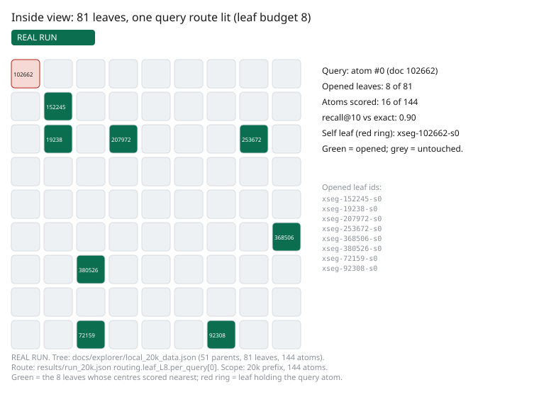
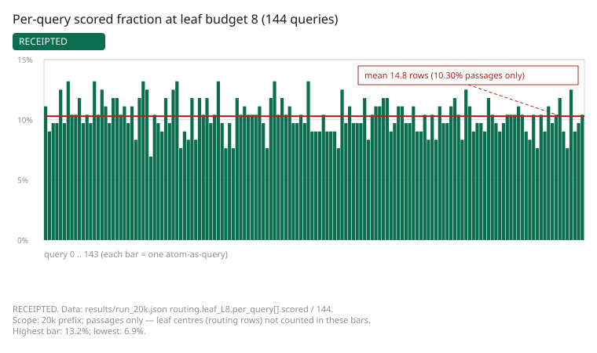
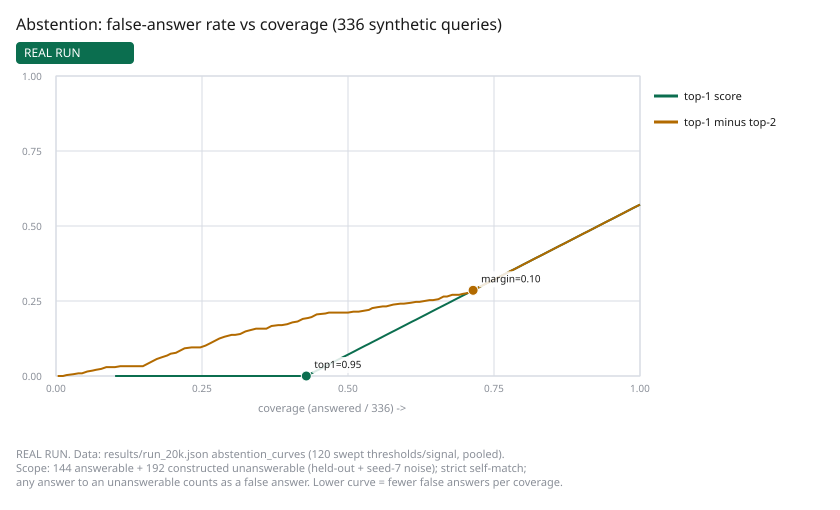
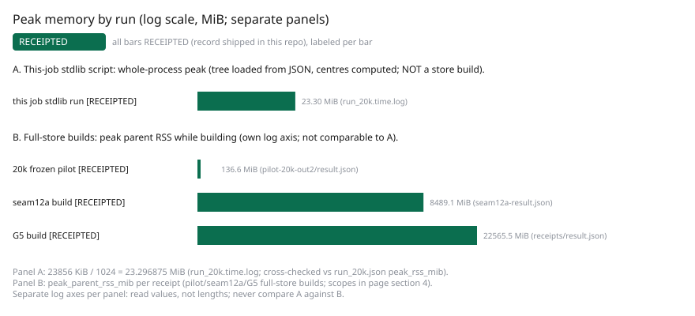
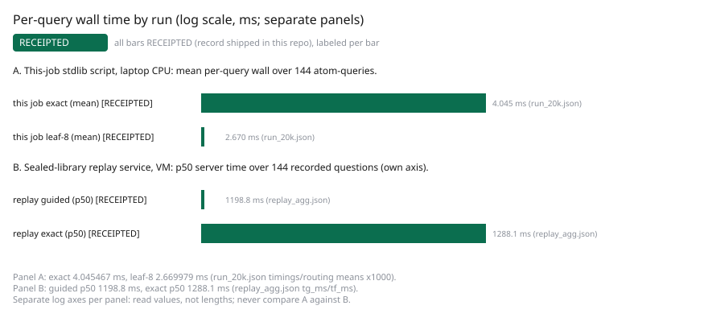

# Benchmarks, in depth (2026-11-05)

Every number below carries its scope: what was measured, on which data, on
which machine, by which method, and where the record lives. Numbers without
a shipped record are labeled as such. This page uses no comparative
adjectives about cost or speed: each method's figures stand side by side.

> **How to read this page**
> - Every figure is RECEIPTED (record shipped in this repo), RECORDED (staged copy), or AS STATED (no record shipped in this repo).
> - Scope (data, machine, method) is shown with every number; readings never cross scopes.
> - nDCG appears in sections 2 and 5; abstention ("I don't know") in section 6.
> - "Recall" here means agreement with exact search or an oracle, never answer quality.
> - Section 9 is a stand-in re-implementation, not TRACE's method.

## 1. What was measured where (map)

- Sealed library, 812,545 passages / 99,891,846 tokens (0.11% short of the
  100-million-token target): the 50-search comparison (section 2, RECEIPTED
  in `../receipts/benchmarks-deep/`) and the 144 recorded replay queries
  (section 3, RECEIPTED).
- Earlier builds on a smaller corpus (two runs, same corpus): section 4.
- 20,030-token reproduction (88 docs, 144 vectors): the frozen-harness record
  plus NEW measurements made for this page (sections 5-7). New numbers are
  labeled NEW (experimental, scoped to the 20k prefix) with their receipt
  in `benchmarks-deep/results/`.
- 504.5M- and 310.5M-token builds: staged worker-written receipts, build
  machine gone (section 8, RECORDED).
- 1.53B-token side test of group-picking only: RECEIPTED (section 8;
  group-picking only, never merged or served).
- Public data (BEIR SciFact/NFCorpus/FiQA): an independent stand-in
  re-implementation with plain k-means groups, NOT TRACE's method (section 9,
  AS STATED).

## 2. The 50-search sealed-library comparison

Scope: 50 test searches (40 authored questions + 10 taken from passage
openings) against the sealed 812,545-passage library, on the Azure VM
(E4s_v5, India Central). Method: TRACE routed dense (vector) search only, no
keyword component; compared against exact meaning-based search (every
passage scored) and ordinary keyword search.

| Comparison | Figure | Scope note |
|---|---|---|
| Share of exact search's top ten kept by TRACE | 0.9985 averaged over 200 question–part pairs | 50 searches x 4 parts, per-part top-10 vs exact; merged global top-10 identical on 50/50; preservation of exact results, not answer quality |
| Passage rows scored by TRACE | 0.79% on one of four nearly equal library parts (the first library part) | single-part passage-scoring work only; group choice, build, and search-stage time are separate costs (~127x less scoring work) |
| Right source passage in top ten | keyword 82%, TRACE 52%, exact 52% | same 50; the gap is meaning-search vs keywords, not the routing shortcut |
| Rank-aware score (nDCG) | keyword 0.74, TRACE 0.42 | same 50; binary designated-source target, not human relevance judgments; never the 82/52 pair under an nDCG label |
| Search-stage time per query (NOT end-to-end; protocols differ, embedding timed separately) | keyword retrieval p50 6 ms; exact batched mean ~88 ms; TRACE 4-shard search-call p50 1.2 s | same 50 searches; keyword batch-1 retrieval only; exact batch-50 amortized GEMM; TRACE 4 sequential search calls |
| Stored size on disk | TRACE 2.28 GB, plain vectors 1.25 GB, keyword index 0.51 GB | `du -sb`; NOT memory in use |
| Query process peak memory while answering the 50 | 1.03 GiB VmHWM (0.91 GiB scope peak) | TRACE arm only; the other arms were not measured the same way, so no memory comparison is drawn |
| Checkable records on re-run | matched on every re-run claim | 10-probe subset all-perfect, plus merged top-10 identical on 50/50; outside-unverified (no outside party has re-verified) |

Record status: RECEIPTED (all eight rows). Comparison figures:
`../receipts/benchmarks-deep/RESULTS.md` — retention over 200
question–part pairs L23/L25, scored rows L65 (1600/203137 = 0.7876%),
source-in-top-10 and nDCG L35-38, search-stage latency L51 (S1 4-shard
p50 1217.6 ms) / L53 (exact batch-50 amortized mean ~87.5 ms) / L54
(keyword batch-1 retrieval-only p50 6.1 ms), embedding timed separately
L49 (p50 13.4 ms), disk bytes L70/L72/L75 — with machine-readable
`../receipts/benchmarks-deep/results.json` alongside.
`../receipts/benchmarks-deep/summary.txt` is a STALE intermediate: it
predates the final keyword arm (`S2: not run`, summary.txt L18/L28) while
the final `results.json` carries that arm (`bm25_n`, L271); the figures
above follow the final record. The per-query files
`dense_queries.jsonl` / `bm25_queries.jsonl` named at `RESULTS.md` L5 are
absent from the shipped record directory (see `SHA256SUMS`), so only
aggregates are available: missed-result identities and individual source
ranks cannot be recomputed. Query-process peak and re-run check:
`../receipts/benchmarks-deep/LOAD.md` — peak L21-22 (951,730,176 B scope
peak labeled ~0.91 GiB in the file; VmHWM 1,083,680 KiB), re-run
L43/L47-L50, identical merged top-10 on 50/50 at `RESULTS.md` L41.

## 3. Recorded replay: 144 questions asked twice

Scope: 144 chosen questions against the same sealed library, recorded
2026-11-04T15:10-15:21Z on the VM service; each question asked twice (TRACE,
then exact search), top 10 kept each time. Record:
`explorer/data/replay.js` (RECEIPTED); the aggregation quoted here is
recomputed by `benchmarks-deep/results/agg_replay.py` (output
`benchmarks-deep/results/replay_agg.json`).

- Guided and exact top-10 agreed as sets on 144/144, in the same order on
  144/144; mean overlap 1.0000.
- Recorded server time: TRACE p50 1198.8 ms (mean 1206.7, range
  1165.8-1348.8); exact scan p50 1288.1 ms (mean 1292.2, range 1256.8-1580.4).
- These are the questions the team chose to record, an illustration, not a
  measurement; the 50-search test in section 2 is the measurement.

## 4. Earlier builds on a smaller corpus (two runs)

Scope: 13,081 complete documents, 63,441 atoms, 120 structural probes per
mode; recall = agreement with an exact float64 cosine oracle, NOT relevance.
Runs differ in settings and are not like-for-like.

| | seam12a (hnsw candidates, columnar) | Older run (earlier settings) |
|---|---|---|
| Scope: corpus tokens, same corpus both runs | 10,003,381 | same corpus |
| Peak build memory, main / child process | 8,489.1 / 7,169.2 MiB | 22,565.5 / 15,668.8 MiB |
| Wall time | 9,494.9 s (~2.6 h) | 12,973 s (~3.6 h) |
| Probe recall@10, all-sources guided/flat | 0.7367 / 0.055 | 0.7300 (guided) |
| Probe recall@10, leave-source-out | 0.4883 / 0.0017 | (in receipt) |
| Stored size after run | 3,058,624,883 bytes | 2,868,578,536 bytes |
| Hardware | shared VM, cpus 0-1, nice 19, 1-thread BLAS | VM, cpus 0-2, nice 19 |

Fresh-item visibility (seam12a): p50 96.8 ms / p95 115.5 ms (n=33, all
within 5 s); readers p50 74.7 ms (n=27,796); append ack-to-query 0.114 s.
Memory here is peak while BUILDING, never memory while serving.
Records (RECEIPTED): `../receipts/earlier-runs/seam12a-result.json`,
`../receipts/result.json`, `BENCHMARKS.md`.

## 5. NEW (experimental, scoped): routing vs brute force on the 20k prefix (receipt: benchmarks-deep/results/run_20k.json)

Scope: the 20,030-token / 88-document / 144-vector prefix shipped in the
repo; the REAL group tree from the frozen run (51 parents, 81 leaves of
1-5 atoms, median 2); all 144 atoms used as queries with self present;
cosine over cached FP32 MiniLM vectors, normalized at scoring. Method: a
centroid router (score query against group centres, open top groups, score
member atoms) against brute-force exact search over the same 144 vectors.
Definitions were preregistered in `benchmarks-deep/results/PREREG.md`
before running; commands in `benchmarks-deep/REPRODUCE-DEEP.md`. Run wall
6.3 s, whole-process peak 23.30 MiB (23856 KiB, `/usr/bin/time -v`), laptop CPU, nice 19.

Leaf-level routing (81 leaf centres):

| Leaves opened | recall@10 | recall@100 | self-nDCG@10 | fidelity-nDCG@10 (as implemented: zero-based) | passages scored (mean) | incl. routing rows | per-query wall |
|---|---|---|---|---|---|---|---|
| 1 | 0.2021 | 0.0204 | 1.0000 | 0.4912 | 2.0 (1.42%) | 83.0 | 2.39 ms |
| 2 | 0.3743 | 0.0396 | 1.0000 | 0.6808 | 4.0 (2.75%) | 85.0 | 2.37 ms |
| 4 | 0.6569 | 0.0767 | 1.0000 | 0.8695 | 7.7 (5.33%) | 88.7 | 2.43 ms |
| 8 | 0.9361 | 0.1483 | 1.0000 | 0.9775 | 14.8 (10.30%) | 95.8 | 2.67 ms |
| 16 | 0.9972 | 0.2925 | 1.0000 | 0.9990 | 29.2 (20.31%) | 110.2 | 3.05 ms |
| 81 (all; sanity: must equal exact) | 1.0000 | 1.0000 | 1.0000 | 1.0000 | 144.0 | 225.0 | 6.30 ms |

Parent-level routing (51 parent centres): 1 parent: recall@10 0.3708 at 7.5
passages; 4 parents: 0.8382 at 27.9; 8 parents: 0.9701 at 40.7; all 51:
1.0000 (sanity holds). Brute-force exact: 144 rows, mean 4.045 ms/query.

Preregistration deviation (prereg text kept unchanged): `PREREG.md`
states gain 11-rank, i.e. one-based ranks with gains 10..1
(`PREREG.md:36`), while the script uses a zero-based index with gains
11..2 (`run_20k.py:146`). The fidelity-nDCG@10 column above shows the
as-implemented (zero-based) values; no recomputed column is shown.

Reading: on this 144-row toy, keeping ~0.997 of exact top-10 took scoring
~20% of passages (16 leaves) — a far weaker trade than the sealed-library
0.9985 at 0.79%, as expected: with 1-5 atoms per leaf there is little for
routing to save, and the routing rows (81 centres) outnumber the passages
scored at small budgets. The self-nDCG column is 1.0000 throughout because
the query's own leaf centre is always near its own vector — a property of
this tiny self-retrieval protocol, not a finding about quality.

*Inside view: the 81-leaf group tree with query atom #0's route lit at leaf
budget 8 (8 opened leaves, 16 atoms scored, recall@10 0.90). RECEIPTED;
receipt `benchmarks-deep/results/run_20k.json`; the query's identity is resolved by the same span-hash join as the measurement (row 0 = doc 152245, its own leaf opened). PNG preview alongside the
SVG; see `benchmarks-deep/figures/INDEX.md`.*

*Per-query scored fraction at leaf budget 8: one bar per each of 144
atom-queries, mean 14.8 rows (10.30% of passages only; routing rows not counted). RECEIPTED; receipt
`benchmarks-deep/results/run_20k.json`.*

## 6. NEW (experimental, scoped): abstention — a script-only exact-search "I don't know" mechanism check; prototype (receipt: benchmarks-deep/results/run_20k.json)

Scope: same 144 vectors. Answerable: 144 atom queries with self present
(correct = top-1 is self). Unanswerable (192): the same 144 with self
removed, plus 48 seeded Gaussian noise queries (seed 7). Rule: answer iff
signal >= threshold. ANY answer to an unanswerable query counts as a false
answer — strict by preregistration, pessimistic where a neighbour is
genuinely similar. Thresholds preregistered blind. Signals come from exact
search inside the script (self present, self removed, noise); they do not
run through the routed arm or the served TRACE engine
(`run_20k.py:170-182`).

| Signal | Threshold | Coverage (answered / all 336) | Precision on answered | False-answer rate (wrong answers / all 336) |
|---|---|---|---|---|
| top-1 score | 0.85 | 0.458 (154/336) | 0.935 | 0.030 (10/336) |
| top-1 score | 0.95 | 0.429 (144/336) | 1.000 | 0.000 |
| top-1 score | 0.99 | 0.429 (144/336) | 1.000 | 0.000 |
| top-1 minus top-2 margin | 0.02 | 0.869 (292/336) | 0.493 | 0.440 |
| top-1 minus top-2 margin | 0.10 | 0.714 (240/336) | 0.600 | 0.286 |
| top-1 minus top-2 margin | 0.25 | 0.435 (146/336) | 0.555 | 0.193 |

Coverage and false-answer-rate denominators are all 336 synthetic queries
(144 answerable + 192 unanswerable); precision divides by answered queries
only (`run_20k.py:184-191`).

Sampled risk-coverage curves (120 of 140 distinct top-1-score thresholds
and 120 of 319 distinct margin thresholds kept; pooled over all 336 plus a
noise-excluded split of 288 = 144 answerable + 144 self-removed, stored
under the misleading key `heldout_split`) are in
`benchmarks-deep/results/run_20k.json` under `abstention_curves`, and
plotted below. Post-plan deviation (prereg text kept unchanged): the plan
promised every distinct threshold swept (`PREREG.md:56-57`) and a
held-out-vs-noise split (`PREREG.md:60-61`); the script decimates each
curve to at most 120 rows (`run_20k.py:208-210`) and the split excludes
noise but keeps answerables (`run_20k.py:206`). Read this as a mechanism check, not
as a quality result: by construction every answerable query is a stored
vector asked about itself, so its top-1 score is 1.0 (a self-match). The
perfect separation at 0.95/0.99 (every answerable top-1 >= 0.99, every
unanswerable < 0.95, precision 1.000, false-answer rate 0.000) therefore
shows only that the answer/abstain code path works when the right answer is
present; it says nothing about how real questions would separate. Real
unanswerable questions will not separate this cleanly, and no abstention
measurement on real user questions exists yet. Threshold 1.0 exactly is unusable (float
normalization puts most self-matches at 0.9999999-1.0000002). The margin
signal is markedly weaker than the top-1 score on this set.

*Risk-coverage (script-only exact-search mechanism check; prototype):
false-answer rate (wrong answers / all queries) vs coverage for the
top-1-score and margin signals over 336 synthetic queries (144 answerable
+ 144 self-removed + 48 noise); preregistered points marked. RECEIPTED;
receipt `benchmarks-deep/results/run_20k.json`.*

## 7. NEW (experimental, scoped): build-step and per-query cost on the 20k prefix

Scope: same run as sections 5-6 (laptop CPU, nice 19, stdlib Python).
Load vectors 0.0095 s; load tree JSON 0.0063 s; build 81 leaf + 51 parent
centres 0.0138 s; join check 144/144 via span-text sha256. Per-query wall:
exact 4.045 ms mean; leaf-8 routing 2.670 ms; leaf-16 3.047 ms. Whole-process
peak 23.30 MiB (tree loaded from JSON, centres computed; not a store build). These describe a 144-row stdlib script, not the TRACE engine.

*Peak memory by run, two panels with separate log axes: (A) this job's stdlib script, whole-process peak (tree loaded from JSON, centres computed; not a store build); (B) peak parent RSS of full-store builds. All bars RECEIPTED (record shipped in this repo), labeled per bar. Read the labels, not just the lengths; never compare A against B.*

*Per-query wall time, two panels with separate log axes: (A) this job's stdlib script on a laptop CPU (mean over 144 atom-queries); (B) the sealed-library replay service on the VM (p50 server time over 144 recorded questions). All bars RECEIPTED. The stand-in public-data timings (section 9) are not plotted. No cross-bar comparison is drawn.*

## 8. Earlier larger builds (staged receipts; build machines gone)

504.5M tokens (13 shards, 7,653,469,538 bytes): exact search matched ground
truth (1.0, 0 errors); one shard down: 0.885 with 0 wrong passages;
compressed search 0.994-0.998 at top-10 on the five newest shards ONLY
(8-12); 13-shard query p50 6.86 s / p95 7.55 s, shards searched one at a
time; per-shard adapter p50 ~517-537 ms, engine ~191-192 ms; ~7-8 min build
per shard. 310.5M tokens (8 shards, 4,709,827,408 bytes): exact 1.0; one
shard down 0.87; compressed 0.995-0.998 on all 8; 8-shard p50 4.18 s.
Records: `../receipts/earlier-runs/RECEIPT-RUNG-500M.txt` /
`../receipts/earlier-runs/RECEIPT-RUNG-300M.txt` — RECORDED (staged copy;
original run files lost; worker-written; cannot be re-run).

Separate 1.53B-token group-picking side test, RECEIPTED:
`../receipts/benchmarks-deep/D1-cluster-eval-results.md` (Exp 2 row K=1024,
64 probes: 0.9947 at 6.56% scanned, 5,000 held-out queries; file L4/L23)
plus `../receipts/benchmarks-deep/D1-cluster-eval-results.json`
(machine-readable, same run). Scope: 7,134,906 vectors in 109 pieces from
1,531,809,092 tokens (the 109-piece manifest sums were checked exact during
the hunt; the manifest file itself is not shipped here); rented Colab GPUs,
2026-10-16; group-picking only, never merged or served through TRACE, no
checkable records at that size.

## 9. Public data: the stand-in result (NOT TRACE's method)

Scope: an independent re-implementation (plain k-means groups, MiniLM
vectors, one seed family) on three small public sets; env AMD Ryzen 7 250.
TRACE itself was NOT run on public data.

- SciFact (5,183 passages, 300 queries): exact nDCG@10 0.6451, recall@10
  0.7833; grouped overlap-with-exact 0.9519 at 23.62% scored (16 probes),
  0.9878 at 46.79% (32 probes); keyword-search nDCG 0.6700 (BM25, a
  keyword search method that scores passages by matching query words).
- NFCorpus (3,633 passages, 323 queries): exact 0.3162 / 0.1550; grouped
  0.8997 at 28.32% (16 probes), 0.9688 at 55.36% (32 probes).
- FiQA (57,638 passages, 648 queries): exact 0.3687 / 0.4413; grouped 0.5217
  at 0.46% (1 probe), 0.9516 at 7.13% (16 probes), 0.9937 at 27.94%
  (64 probes); scoring under 1% kept only ~52%.
- A faiss IVFFlat cross-check agrees with the re-implementation to ~0.01.
- Records: the experiment's `summary.md` plus per-set JSON, logs, and
  scripts (kept with the experiment, outside this repo). Record status:
  AS STATED.

Reading: the sealed-library 0.9985-at-0.79% is NOT reproduced on public
data, and a simple stand-in did not reach it at small size. Dataset-specific
numbers only; no general claim is drawn.

## 10. What this does not show

- No relevance judgment by people exists for the sealed library or the 20k
  prefix; "recall" in sections 4-5 and 8 is agreement with exact search or
  an oracle, while section 2's 82%/52% is source-passage retrieval on 50
  searches. None of these is answer quality.
- No side-by-side memory-in-use comparison exists anywhere; the 2.28/1.25/
  0.51 GB figures are stored size on disk, and the 1.03 GiB peak covers the
  TRACE arm alone.
- The 20k routing/abstention numbers are a 144-row synthetic protocol (a
  script-only exact-search mechanism check; prototype); the abstention
  unanswerables are constructed (held-out + noise), not real
  user questions, and the strict self-match criterion counts similar
  neighbours as wrong.
- The groups come from ordinary sorting runs (k-means); the order measures
  on the sealed library are RECEIPTED in
  `../receipts/order-measure/out-1-test-searches-pairs-balance.txt` through
  `../receipts/order-measure/out-4-routing-ablation.txt`, and the
  size-series spot checks (10,000-200,000 passages: 4.68 / 4.97 / 4.93 /
  4.84 and 4.82 / 4.94, no trend claimed) are RECEIPTED in
  `../receipts/benchmarks-deep/measure-n*.txt` (6 files). These describe the
  finished result, not a formation process, and no claim is made beyond the
  sizes sorted (largest 233,000 passages).
- The 504.5M/310.5M/1.53B figures cannot be re-run (machines gone); the
  1.53B row's cluster-eval receipt is shipped in
  `../receipts/benchmarks-deep/`, the 109-piece manifest is not (large).
- The 20k routing numbers (sections 5-6) are self-retrieval: each query is
  a stored vector asked about itself (144 rows), so they check the routing
  and abstention mechanics; they are not evidence about relevance or about
  larger libraries.
- Rank-aware scores (nDCG) with a binary designated-source label (source
  passage = 1, everything else = 0 — a source-ordinal target, not
  independent relevance judgments by people) exist only as the 50-search
  comparison in section 2 (our own protocol) and the stand-in rows in
  section 9; there is no nDCG@10 for TRACE itself on a public benchmark.
- TRACE has no public-benchmark result of its own; section 9 is a stand-in.

## 11. Comparison framing (plain readings, no adjectives)

- On the sealed library's 50 searches, TRACE's shortcut preserved exact
  meaning-search results (0.9985 averaged over 200 question–part pairs;
  merged top-10 identical on 50/50) while scoring 0.79% of rows on one
  part (the first library part, single-part work only); on the same 50, keyword search
  placed the source passage in its top ten more often (82% vs 52%), with
  search-stage times (different protocols, not end-to-end; embedding
  excluded) of 6 ms keyword-retrieval p50, ~88 ms exact batched mean, and
  1.2 s TRACE 4-shard search-call p50.
- On public sets, the stand-in grouping needed 7-55% of passages scored to
  keep 0.90-0.99 of exact top-10, with the share depending on the dataset;
  FiQA at under 1% scored kept ~0.52.
- On the 20k prefix, 16 of 81 leaves (20% of passages) kept 0.9972 of exact
  top-10; a top-1-score threshold of 0.95 answered only the 144 answerable
  queries (precision 1.000, coverage 0.429) while a margin threshold of
  0.10 answered 240/336 at precision 0.600.
