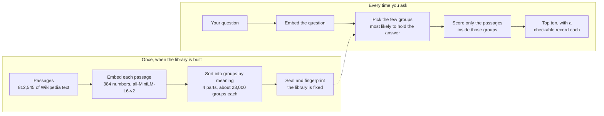
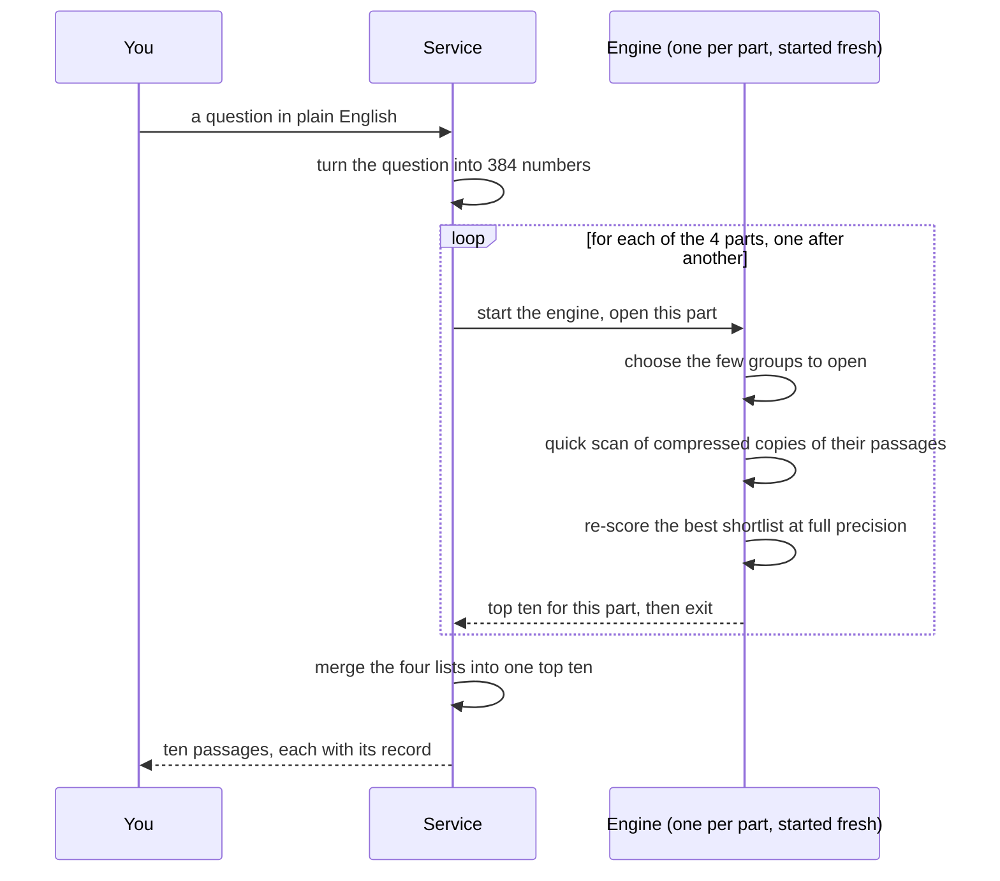

<!-- SPDX-License-Identifier: Apache-2.0 -->
# How TRACE works: a 10-minute read

TRACE searches a sealed library of text by meaning, and gives every result a
record you can check. It is a research prototype. This page explains the idea,
walks through one search, says why it is slow, and says exactly what is in this
repository and what is not.

Every number links to its record in [BENCHMARKS.md](../BENCHMARKS.md). Short
answers to the hard questions are in the [FAQ](FAQ.md).

**In this page:** [The idea](#1-the-idea-in-one-picture) ·
[Building the library](#2-building-sorting-the-library-into-groups) ·
[One search](#3-one-search-opening-a-few-groups) ·
[The record](#4-the-record-on-every-result) ·
[Storage](#5-storage-sealed-and-safe-to-crash) ·
[Why it is slow](#6-why-it-is-slow) ·
[What is in this repo](#7-what-is-in-this-repo-and-what-is-not) ·
[Check us](#8-check-us)

## 1. The idea in one picture

Searching by meaning normally means comparing your question with every passage
in the library. TRACE sorts the passages into groups first. A question then
opens only the few groups likely to hold the answer, and compares itself with
the passages inside them.



What that buys, as measured on our library: a question scored **0.79% of the
rows** in one of the four parts (1,600 of 203,137) and kept **99.85% of exact
search's top ten**
([B1](../BENCHMARKS.md#b-what-the-method-does), [B2](../BENCHMARKS.md#b-what-the-method-does)).
What it does **not** buy: speed. See [section 6](#6-why-it-is-slow).

## 2. Building: sorting the library into groups

Each passage is turned into a list of 384 numbers that captures roughly what it
says (the encoder is all-MiniLM-L6-v2, a small public model). Passages with
similar numbers belong together, so passages about vaccines end up near
passages about the immune system. Nobody writes labels or topic lists.

On our 100M-token library the groups come from one ordinary sorting run
(k-means, five passes, once per quarter of the library), not from the store
reorganising itself as it grew. We measured how ordered the finished groups are.
We did not measure the order forming over time, and we make no claim about
millions or billions of passages. The
[how-it-works page](https://anshul48.github.io/trace/how-it-works/) shows the
measurements and the limits.

The library is split into four nearly equal parts of about 203,000 passages,
with 22,995 groups per part
([OUT1](../receipts/order-measure/out-1-test-searches-pairs-balance.txt#L3)).
It holds 812,545 passages and 99,891,846 tokens, which is 0.11% short of 100
million. The passages are English Wikipedia text (CC BY-SA 4.0).

## 3. One search: opening a few groups

The served search engine works in two passes over each part, which is why it
can score so few rows. This is the engine as we run it on our server (see
[section 7](#7-what-is-in-this-repo-and-what-is-not) for what is published).



In words:

1. **Pick groups.** The question is compared with each group's centre, and the
   closest groups are opened. The rest of the part is never touched.
2. **Quick scan.** The passages in those groups are scanned using compressed
   copies (two bits per number), which is cheap but approximate.
3. **Re-score the shortlist.** The best candidates from the scan are re-scored
   against full-precision copies, and the top ten are kept.
4. **Merge.** The four parts each return a top ten and the service merges them.

The scoring-work figure comes from steps 1 to 3: 1,600 rows scored where an
exact search scores 203,137 ([B1](../BENCHMARKS.md#b-what-the-method-does)).
The result matches exact search closely: 0.9985 of its top ten on average, and
a merged top ten identical to exact search on 50 of 50 test searches
([B2, B3](../BENCHMARKS.md#b-what-the-method-does)).

A reading note that matters: on our 50 test searches the *exact* search also
found the right source passage only 52% of the time, and plain keyword search
found it 82% of the time
([A4](../BENCHMARKS.md#a-where-trace-loses)). TRACE reproduces exact
meaning-based search almost perfectly, so it inherits that search's strengths
and weaknesses. If you need exact words, use keyword search.

## 4. The record on every result

Each result comes with a record: the article it came from, where in the article
(the character span), the licence, and a SHA-256 fingerprint of the exact text.
The fingerprint is a short code worked out from the text; your browser can
recompute it, and if one letter changed the code would not match.

**What a match shows:** the text on the page is the text the fingerprint was
published for. **What it does not show:** that the search found the best
passage, that the source says the same today, or that the record was made when
we say. It is a check on consistency, not an independent seal. This is why we
call it a *checkable record* and do not say "verifiable" or "cryptographically
linked".

You can try it in the [explorer](https://anshul48.github.io/trace/explorer/),
which replays 144 searches TRACE answered on our server, each result with its
check.

## 5. Storage: sealed, and safe to crash

"Sealed" means the library is fixed and fingerprinted when it is built. Readers
see a stable snapshot, even while background work reorganises files underneath.

The design (as filed in our engine source, not independently shown) is a
write-ahead log that is forced to disk before a write is acknowledged, and
compaction that writes a new file and swaps it in atomically, so a running
search never sees a half-written state. After a crash, only unconfirmed tail
data can be lost.

The evidence we publish for this is small: three kill drills during an append
test, after which the store verified with zero bad rows
([C3](../BENCHMARKS.md#c-what-the-extra-time-buys)). Appending 49% more
passages to a 203,137-passage base took about 18 s against 291 s to rebuild,
at recall not worse than the rebuild
([C1](../BENCHMARKS.md#c-what-the-extra-time-buys)). That was one run on one
shard-sized base, not on the full library. The sealed original files were left
byte-for-byte unchanged during the test (the record compares hashes before and
after).

## 6. Why it is slow

The live service answered in a median of **1,236 ms**. A standard HNSW index
answered the same 50 searches in **0.66 ms**, with the same hit rate: about
**1,880 times** faster
([A1](../BENCHMARKS.md#a-where-trace-loses)). That comparison is not like for
like (the index returns ids only, at one thread; the service starts engine
processes and returns passages), and adding the encoding time to the index side
brings the record's own ratio down to 85.76. It is still a large loss.

The reason is the shape of the served path. The engine is a compiled C program,
and the service starts it fresh, once per part, for every question: four
one-shot processes per search, one after another. Our own profile (filed
on our server; its per-stage numbers are not published here) found that
starting those processes, mapping the files and reading data dominate each
search, and the arithmetic inside the engine does not. A resident server that opens
each part once and answers many questions is designed, but **not built**, so we
state no speed number for it.

So the honest summary is that TRACE does less *scoring work* and takes more
*time*. Less work should matter once a library is too big to scan in the time
or memory you have. We have not measured where that crossover is.

## 7. What is in this repo, and what is not

| In this repository | Only on our server |
|---|---|
| The explorer: a replay of 144 recorded searches, with the in-browser record check | The 812,545-passage library and its searchable store |
| The frozen **Python** candidate (207 files, [`freeze-src/`](../freeze-src/)) and the records of the earlier qualification run ([`receipts/`](../receipts/)) | The compiled C search engine (`cand_serve`): **its source is not in this repository yet** |
| The benchmark records ([`receipts/benchmarks-deep/`](../receipts/benchmarks-deep/)) and two filed summaries ([`receipts/filed-summaries/`](../receipts/filed-summaries/README.md)) | The raw per-query files behind those summaries |
| A 20k demo (88 documents) and a small reproduction you can run | The live query service (switched off) |
| Checks: `verify_freeze.py`, `check_receipts.py`, `verify_20k.py` | A download kit for the whole library (planned, not built) |

If a sentence on this page describes the C engine, you are reading a
description of something this repository does not contain. The only mention in
the repository is [LOAD.md, line 7](../receipts/benchmarks-deep/LOAD.md#L7),
which names it as the retrieval engine behind the timings.

**Where TRACE is used.** ANIMA, a separate prototype for running coding agents
under a hidden checker, uses TRACE as a *prototype memory link*. We make no
claim that this link recalls anything across sessions.

## 8. Check us

```bash
git clone --depth 1 https://github.com/Anshul48/trace && cd trace
python3 tools/verify_freeze.py     # entries=207 ok=207 missing=0 mismatch=0
python3 tools/check_receipts.py    # receipts ok: gates, both probe modes, ...
python3 run_explorer.py --dataset 20k
```

The first two commands check the frozen code and the recorded gates. The third
serves the explorer from your own clone. None of them reruns the 100M numbers,
which need a library we have not published
([BENCHMARKS.md, section D](../BENCHMARKS.md#d-checks-you-can-run-yourself)).

If a number does not hold, please
[open a claim-check issue](https://github.com/Anshul48/trace/issues/new?template=claim_check.yml).
