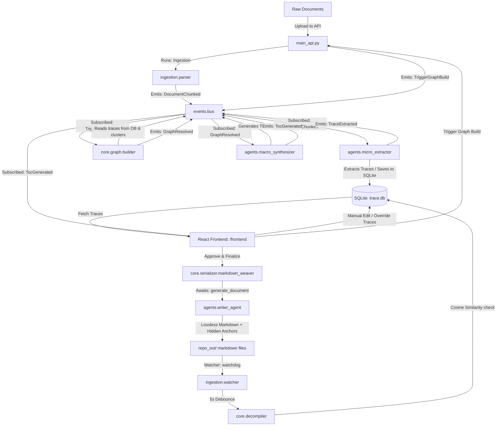

# Project Trace: Core Architecture Specifications

This document outlines the core technical specifications and components of the **Bi-Directional Knowledge Graph OS**.

## System Overview

## Module Directory Breakdown

### 1. Ingestion Layer (`src/trace/ingestion/`)
- `parser.py`: Partitions documents (text, pdf, docx) via the `unstructured` library, chunks them by title (to keep semantic cohesion), hashes the chunk contents, commits them as immutable blocks into the SQLite database under a specific `project_id`, and publishes a `DocumentChunked` event for each chunk.
- `watcher.py`: A filesystem monitor built on top of the `watchdog` library. It listens to modifications inside the generated `repo_out/` directory, implementing a debouncing thread (5 seconds) to prevent multiple triggers during active writing.

### 2. Event Bus (`src/trace/events/`)
- `bus.py`: An asynchronous pub/sub event bus that serves as the decoupled messaging backbone. Modules subscribe to semantic events (e.g., `DocumentChunked`, `TraceExtracted`, `GraphResolved`, `TocGenerated`, `PipelineFinished`). Safe subscription hooks prevent UI updates from breaking backend pipelines on reload.

### 3. Agent Shell (`src/trace/agents/`)
- `micro_extractor.py`: A rolling episodic memory state machine that sequentially evaluates chunks, keeping track of prevailing versions and hypotheses. It extracts `HippocampalTrace` nodes representing technical concepts and saves them to the DB.
- `macro_synthesizer.py`: Orchestrates macro-level synthesis, generating a global Table of Contents (TOC) for the `README.md` file using the graph's topology. Built-in tenacity retry logic guarantees stability against LLM service hiccups.
- `writer_agent.py`: Employs a low-temperature model (`gemini/gemma-4-31b-it` at temperature `0.1`) to act as a lossless compiler. It weaves the original source blocks into clean, structured Markdown, inserting invisible trace boundaries (`<!-- trace_id: UUID -->`).

### 4. Core Engine (`src/trace/core/`)
- `db.py`: Singleton interface managing `trace.db`. Organizes documents and traces under the persistent `projects` schema to prevent token wastage and support failure recovery.
- `schemas.py`: Houses Pydantic models for type safety.
- `decompiler.py`: Rips out trace contents between anchors, checks hashes to verify edits, and evaluates semantic similarity via local sentence embeddings.
- `graph/builder.py` & `graph/clustering.py`: Deterministically builds the global network. It triggers on-demand via `TriggerGraphBuild`, reads traces from the database, and collapses redundant concepts into canonical entities using Agglomerative Clustering.
- `serializer/markdown_weaver.py`: Traverses the final canonical graph, calls the `WriterAgent` to generate document files, and embeds cross-linking wikilinks (e.g., `[[My Concept]]`).
