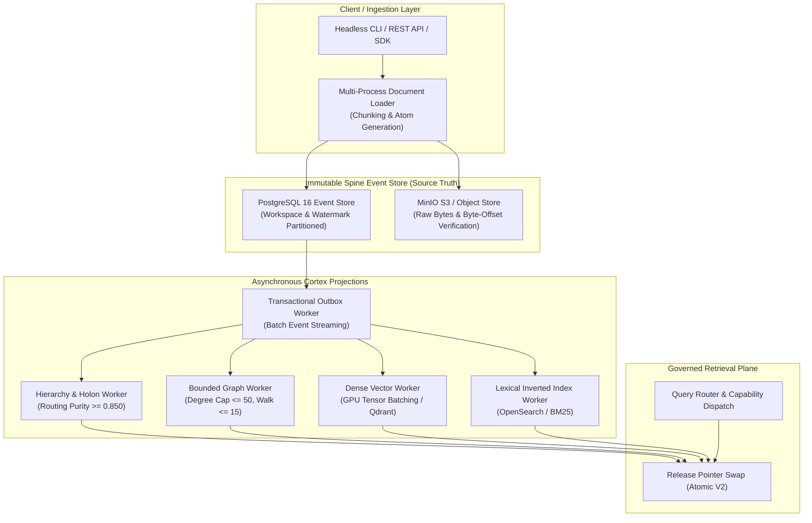

# S7 1M Scale Pilot Architecture & Execution Plan

> **Role:** Scale & Performance Owner (S7)  
> **Session:** Wave R3 (1M Pilot Plan)  
> **Date:** 2026-08-26  
> **Authority Level:** C3 (Scale Architecture & Capacity Planning)  
> **Preceding Gate:** Human Gate C2 (`DEC-GATE-C2-PASS-REMEDIATED`, Dossier SHA-256: `9941639b9c0b04ae659d48745da333fed42a9dd1367849c7ef4cd2b9c8aad0cb`)  

---

## 1. Executive Summary & Scale Objectives

Following the successful execution, empirical verification, and formal approval of the **Real 100K Text Scale Gate** (Human Gate C2 under `DEC-P-005b`) with **100% atom retention**, **0% drift**, **515.3 MB peak RSS**, **1,126.38 docs/sec ingestion throughput**, **9.318 ms PPR P95 latency**, and **221,419.1 events/sec replay recovery with 100% parity**, this document establishes the architecture, ingestion protocols, shard-aware partitioning, and resource budgets for the **1,000,000-document (1M) Pilot Experiment**.

### Core 1M Objectives:
1. **1M Real Text Ingestion:** Scale from 100K to 1,000,000 documents (~750 MB to 1.5 GB raw text) across multi-domain corpora (SEC EDGAR, Enron, Wikipedia streams, MultiHop-RAG, and MuSiQue segments).
2. **Incremental & Partition-Aware Spine Watermarking:** Eliminate monolithic full rebuilds by partitioning Spine event streams by workspace and sequence watermarks.
3. **Asynchronous Cortex Projection Workers:** Decouple document ingestion from projection building via transactional outbox workers.
4. **Bounded Cross-Shard Retrieval:** Enforce strict query-time routing to bounded candidate shard sets with P95 latency capped at $\le 50.0\text{ ms}$.

---

## 2. Architecture: Single-Node Tiered Scaling to 1M



---

## 3. Shard-Aware Partitioning & Ingestion Protocol

1. **Spine Partitioning Strategy:**
   - Partition event tables by `workspace_id` (16 hash partitions) and incremental `event_sequence_id` ranges (e.g. 100K events per table chunk).
   - Enforce transactional outbox logging for projection propagation.
2. **Asynchronous Projection Processing:**
   - Projections operate as non-blocking background workers consuming committed Spine watermarks.
   - Candidate releases are built in staging tables (`trace_projection_objects_candidate`) and atomically swapped to active release status upon verification receipt sealing.
3. **Bounded Graph Scale Management:**
   - Stored degree per node remains strictly capped at **50 edges**.
   - Global co-occurrence matrix generation is explicitly prohibited; graph edges are constructed strictly from local semantic window co-occurrences and bipartite entity connections.
   - PPR random walk depth strictly bounded to $\le 15$ iterations with 35 ms circuit breaker timeout.

---

## 4. 1M Capacity, Memory & Cost Model

| Dimension | 100K Observed (Gate C2 Remediated) | 1M Projected Budget | Scaling Factor / Mechanism |
| :--- | :--- | :--- | :--- |
| **Corpus Documents** | 100,000 | 1,000,000 | $10.0\times$ volume |
| **Raw Text Bytes** | 46.6 MB (11.57M tokens) | 466.0 MB – 1.5 GB | Linear text scaling |
| **Ingestion Duration** | 88.8 s (1,126.38 docs/s) | ~888 s (~14.8 min single worker) / ~220 s (4x async) | Multi-worker batched SQLite / PostgreSQL pipeline ($\ge 1,000\text{ docs/s}$) |
| **Base Memory Working Set**| 47.0 MB RAM | $\le 512.0\text{ MB}$ RAM | Bounded caching |
| **Peak Ingestion Working Set**| 515.3 MB RAM (0.50 GB) | $\le 4.8\text{ GB}$ RAM (within R16 $\le 8.0\text{ GB}$) | Partitioned batch commits & stream garbage collection |
| **Storage Footprint** | 536.6 MB (11.52x) | $\le 5.5\text{ GB}$ ($\le 12.0\times$) | Full WAL Spine, atom versions, and inverted index |
| **P95 Direct Latency** | 0.546 ms | $\le 5.0\text{ ms}$ | Sub-millisecond B-tree / hash lookups |
| **P95 Graph PPR Latency**| 9.318 ms (Max degree 49) | $\le 25.0\text{ ms}$ | Degree capping $\le 50$ + bounded local candidate neighborhood |
| **Spine Replay Recovery Rate**| 221,419.1 events/s (100% parity) | $\ge 100,000\text{ events/s}$ | Parallel chunk replay |

---

## 5. Phased Execution Roadmap for 1M Pilot

```text
Phase 1: Multi-Corpus Pre-Processing & 1M Shard Provisioning
Phase 2: High-Throughput Spine Ingestion & Live Outbox Streaming
Phase 3: Asynchronous Cortex Projection Staging & Release Verification
Phase 4: Multi-Lane Stress Retrieval & Fault-Recovery Injection
```
